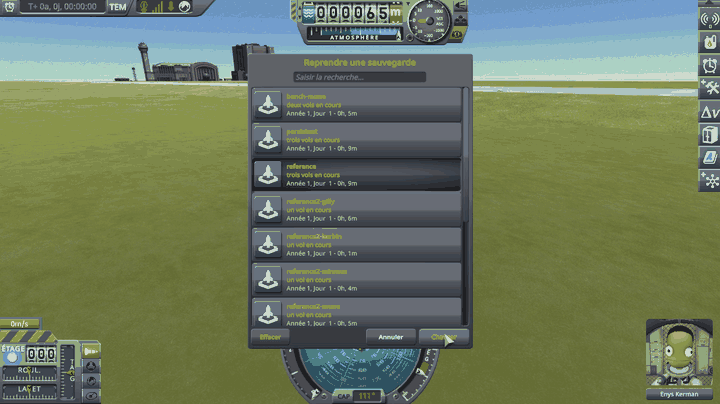

# Terrain Precision Fix

**⚠️ Work in progress.** This is an active investigation, not a finished mod. The figures, the code and the conclusions on these pages can still change, and several questions are still open — each page has its own *Work in progress*.

A fix for stock KSP 1.12, kept as small as possible: a handful of Harmony patches, in a few short source
files. It is a mod of its own, built and measured on top of
[KSP Community Fixes](https://github.com/KSPModdingLibs/KSPCommunityFixes), the base most players run.
Here is what it fixes, on the ground and on the runways, launchpads and buildings that stand on it:

> **The ground KSP builds under you is never built at the same height twice, and neither are the
> runways and buildings it places on it.** Load a save, come back to a craft left parked, drive a few
> hundred metres: each time the ground is built again, the surface your craft is standing on comes back
> a little higher or a little lower — a few centimetres apart on Kerbin, less on smaller worlds, and up
> to seventy on Earth in Real Solar System.

**How this was made.** The investigation and the code were written with Claude, Anthropic's AI
assistant. Everything here was reviewed and validated by a human — me — who very much enjoyed
learning along the way how KSP builds the ground you land on. I am saying so up front, because
contributions made with an AI deserve a closer look than others, and because some people would
rather stop reading here. That look is what these pages are built for: every figure on them comes from an
in-game measurement, the instrument behind the headline figures is public and runs on a stock
install, the stock code quoted here is a handful of lines anyone can check, and the fix is a few short
files you can read in one sitting.

## Why the moving ground matters

KSP does not keep the ground it built: it builds it again, over and over, while you play. And every
time it does, the surface lands at a slightly different height — a little higher or a little lower,
at random, a few centimetres on Kerbin and up to seventy on Earth in Real Solar System. The runway, the
launchpad and the buildings of the KSC, and the bases a mod such as Kerbal Konstructs plants on a body,
are placed the same way, each at a height of its own, apart from the ground beside it. Loading a save
is only the moment everybody notices. It happens just as well:

- **when a save is loaded**, or the scene changes: the whole ground is built anew, and every runway and
  building is placed again;
- **when you come back to a craft left parked.** Its position was recorded while it rested on the
  ground as it stood then. As you fly back towards it, KSP builds that ground again, at a different
  height, and puts the craft back at its recorded position — on a ground that is no longer the one it
  was resting on;
- **when you switch to a craft far away**, which is put down the same way, on a ground it was not
  standing on when it was left;
- **while you drive.** Every 500 m the craft you fly travels, KSP moves its whole world back onto it,
  builds the ground under you again, and moves the runway beside you with it — in the middle of the
  drive, with nothing loaded and no scene changed.

Each time, it is a coin toss between two outcomes.

**The ground comes back lower than it was.** Your craft is now hovering a couple of centimetres above
it, so it drops those two centimetres. You never notice, and nothing breaks.

**The ground comes back higher than it was.** Your craft is now *inside* the ground — and the physics
engine will not leave two solid things overlapping. It pushes them apart, hard, in the only direction
available: up. Your craft gets launched.

*KSP 1.12 without this mod, with [KSP Community Fixes](https://github.com/KSPModdingLibs/KSPCommunityFixes)
as the only mod installed. A pod on an empty fuel tank, parked in the grass at the KSC, saved, then reloaded
from the pause menu, several times if needed — nothing touched in between.*

That second case is the symptom everybody already knows. The lander that twitches, hops or flips the
moment the scene finishes loading. The base that sat perfectly flush yesterday and is buried up to
the hatches today. The big base that tears itself apart the very first time you load it, and never
again afterwards. A craft with many parts spread over a wide area gives the coin toss more chances
to land the wrong way up. The other moments do the same damage, only less visibly: from 200 m away you
see little of a parked craft jumping, and a rover that hops while driving looks like a bump in the
road — on Earth, it was seen to jump when the ground rose under it.

Every one of these moments can be repeated at will — reload the same save, drive away from a craft left
parked and come back to it, switch to a craft far away, drive past a few shifts of the world — and each
is measured on these pages, on the ground, and on a runway as well when a save is loaded and while you
drive.

### Disclaimer: it is not the only cause

The ground moving is one cause among several, and these pages do not claim it is the only one. Plenty
of other things move a craft when a scene opens. Two well-known examples, among others:

- **suspensions.** Landing legs and wheels come back fully extended, because that is the only state
  KSP can restore them to. They then compress under the weight of the craft, and the craft moves
  while they do.
- **a craft bent to fit the ground.** While you play, physics twists the joints between parts so the
  craft settles onto the shape of the ground beneath it. That twisting is not saved. On loading, the
  craft comes back in its original, unbent shape — and if the ground is not flat, part of it really
  *is* underground, with no measurement error involved.

This mod removes that one cause, and only that one: a lander that hops because its legs are still
unfolding will go on hopping once it is installed. What it takes away is the part that should never
have been there at all — a surface that is not where the game's own formulas say it is, and is not in
the same place twice. It takes it away down to a hundredth of a millimetre on the ground, and two tenths
on the runway of the KSC, as measured on the page of each fix.

## What it fixes

The ground, the statics and the scatter share one culprit: stock places them through floats holding
vectors as long as the radius of the body, rounded through a frame that does not stay put
([The culprit: a float at planet scale](docs/common/the-culprit.md)). Each has a page of its own: where the
rounding strikes it, how this mod takes it away, how that is checked, what keeps working, what it makes
worse, and what is still to check. The first figure is without this mod, the second with it.

| | What moves | Without → with this mod | Setting | |
|---|---|---|---|---|
| **The ground** | the terrain quads a craft stands on | at a load, 43.6 → 0.3 mm on Kerbin, 292.3 → 0.3 mm on Earth | `fixTerrain` | [→ page](docs/ground/README.md) |
| **The statics** | the runway, launchpad and buildings of the KSC, the launch sites of Making History, Kerbal Konstructs' bases | the deck of the KSC runway at a load, 116.5 → 0.177 mm | `fixStatics` | [→ page](docs/statics/README.md) |
| **The scatter** | the rocks, grass and trees | against the ground at a load, 61 mm (178 with the ground fixed alone) → 0.132 mm | `fixScatter` | [→ page](docs/scatter/README.md) |
| **The ROCs** | Breaking Ground's surface features | work in progress: read in the code, no fix yet | — | [→ page](docs/rocs/README.md) |
| **The ground anchor** | an anchored base, raised at each load — not a rounding | the base at its second load, 26.3 cm → 0.08 mm | `fixGroundAnchor…` | [→ page](docs/ground-anchor/README.md) |

Every fix is on by default. Two patches, on by default too, keep Kopernicus and Kerbal Konstructs working
with the statics fix: see [the statics](docs/statics/README.md#limits-and-solutions).

**It does not slow the game down**: timed frame by frame, it came out no dearer than stock
([Performance](docs/common/performance.md)).

## Install

Requires KSP 1.12 and [HarmonyKSP](https://github.com/KSPModdingLibs/HarmonyKSP). Copy
`GameData/TerrainPrecisionFixMod` into the `GameData` of KSP. Nothing is written to your saves.

- **[Install](docs/common/install.md)**, and what removing the mod does to an anchored base;
- **[Settings](docs/common/settings.md)**: one per fix and per patch, and `logLevel`;
- **[Build](docs/common/build.md)**;
- **[License](docs/common/license.md)**: MIT.

What holds for every fix at once — the culprit, the performance, the tests that cover them all — is in
[what the fixes share](docs/common/README.md).
