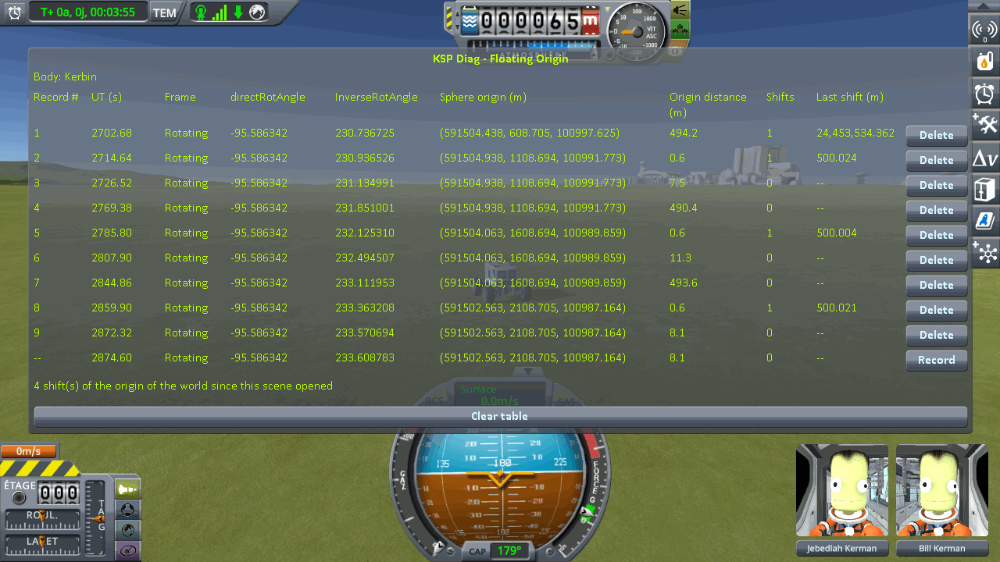
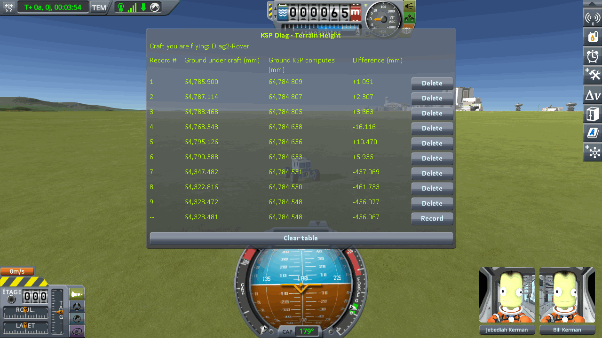
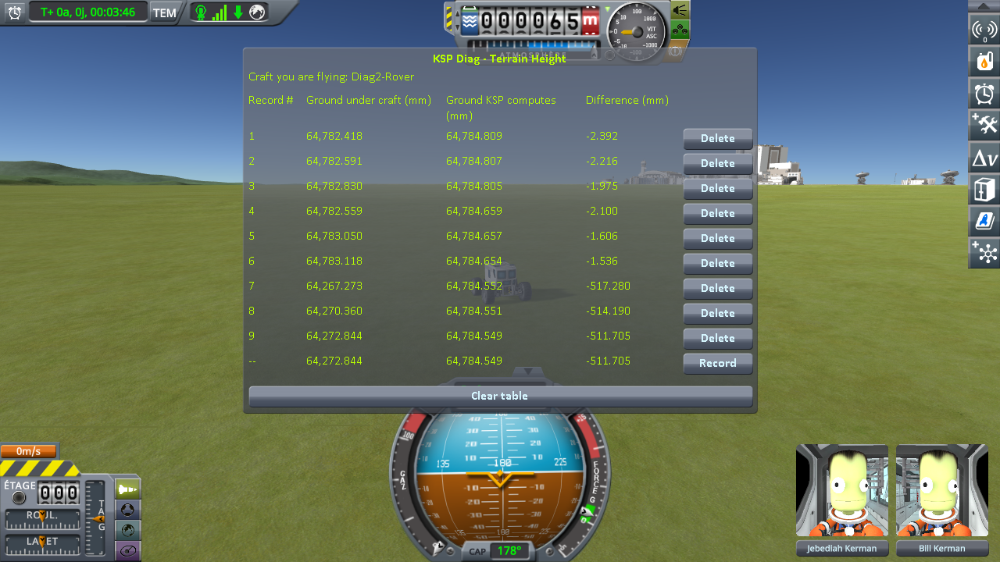
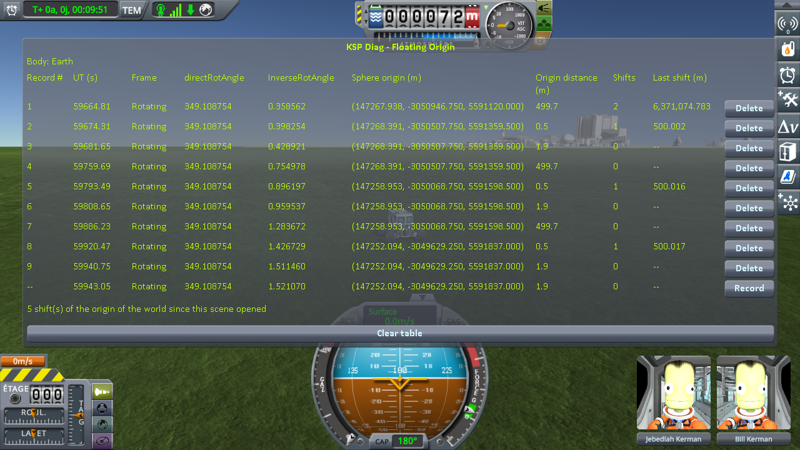
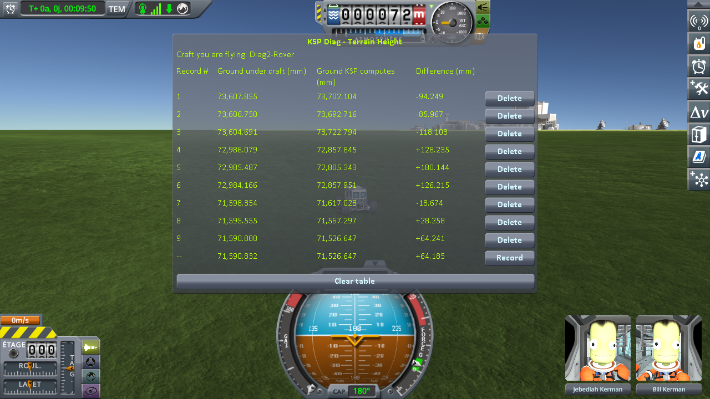

# Checking the ground: driving on while the world moves

Part of [Terrain Precision Fix](../../README.md), one page of
[Checking the culprit: driving on while the world moves](../checking-the-culprit-driving.md): the measurements
that check the first culprit, [the ground](../the-culprit-ground.md), under a rover that keeps driving on the
grass while the game moves its whole world, on stock and with this mod, on Kerbin and on Earth in Real
Solar System. The install and the instruments are described in
[Checking the culprit: driving on while the world moves](../checking-the-culprit-driving.md).

Every 500 m the craft you fly travels, KSP moves the floating origin back onto it, and with it the
terrain sphere: the translation of the frame the ground is converted through
([Why it is different at every load](../the-culprit-ground.md#why-it-is-different-at-every-load)). Stock places the landed quads again at each of
those shifts (`CelestialBody.PreciseUpdateQuadPositions`), through that new frame. A rover alone on the
grass south of the runway of the KSC drives due south; at each shift, three lines: just before it, a few
metres after it, and the same few metres farther on with no shift, which measures what the few metres
do on their own. A shift counts when the first change is at least three times the second. It is
[the driving protocol](the-protocol.md), on its two saves, played by its script,
[`run-driving.py`](../../diag/automation/run-driving.py):
one run of three shifts on each body, without this mod and with it.

## On Kerbin

**On stock**, one run. The session is logged in [`driving-stock.log`](../../diag/checking-the-culprit-driving/driving-stock.log);
what the script printed is in [`driving-stock-script.txt`](../../diag/checking-the-culprit-driving/driving-stock-script.txt), and
every line it recorded in [`driving-stock-lines.json`](../../diag/checking-the-culprit-driving/driving-stock-lines.json). On the
three lines of each shift, **Ground KSP computes** reads the same digits to within six thousandths of a
millimetre, and Diag FloatingOrigin reads one shift of 500.0 m, to within three centimetres, on each
line taken just after a shift, and none on each line taken with no shift. The rover drove 6 to 10 m
from line 1 to line 2 of a shift. *Difference* — the ground under the rover minus the height KSP
computes for that spot — in millimetres:

| shift | just before | just after | same distance again | across the shift | same distance, no shift | counts |
|---|---|---|---|---|---|---|
| 1 | +1.091 | +2.307 | +3.663 | +1.216 | +1.356 | no |
| 2 | −16.116 | +10.470 | +5.935 | **+26.586** | −4.535 | yes |
| 3 | −437.069 | −461.733 | −456.077 | **−24.665** | +5.656 | yes |

**With this mod**, in that same install, on that same save, with this mod as the only difference. The
session is logged in [`driving-diag2-fix.log`](../../diag/checking-the-culprit-driving/driving-diag2-fix.log); what the
script printed is in [`driving-diag2-fix-script.txt`](../../diag/checking-the-culprit-driving/driving-diag2-fix-script.txt), and
every line it recorded in [`driving-diag2-fix-lines.json`](../../diag/checking-the-culprit-driving/driving-diag2-fix-lines.json).
On the three lines of each shift, **Ground KSP computes** reads the same digits to within six
thousandths of a millimetre, and Diag FloatingOrigin reads one shift of 500.0 m, to within two
centimetres, on each line taken just after a shift, and none on each line taken with no shift. In
*Difference*, in millimetres:

| shift | just before | just after | same distance again | across the shift | same distance, no shift |
|---|---|---|---|---|---|
| 1 | −2.392 | −2.216 | −1.975 | +0.176 | +0.241 |
| 2 | −2.100 | −1.606 | −1.536 | +0.493 | +0.070 |
| 3 | −517.280 | −514.190 | −511.705 | +3.089 | +2.485 |

The third shift is read at a spot about a kilometre and a half south of the runway that reads far below
the computed height, with this mod as on stock; see [What the measurements say](#what-the-measurements-say).

## On Earth

The ground around the KSC of Real Solar System is not flat to the millimetre: the height KSP computes
changes by about a centimetre per metre, so the rover stops within two metres of each shift, and again
two metres on.

**On stock**, one run. The session is logged in
[`driving-earth-rss-stock.log`](../../diag/checking-the-culprit-driving/driving-earth-rss-stock.log); what the script printed is in
[`driving-earth-rss-stock-script.txt`](../../diag/checking-the-culprit-driving/driving-earth-rss-stock-script.txt), and every line it
recorded in [`driving-earth-rss-stock-lines.json`](../../diag/checking-the-culprit-driving/driving-earth-rss-stock-lines.json).
**Ground KSP computes** changes by up to 86 mm between two lines of a shift, which the rover reads 0.7
to 1.4 m apart. In *Difference*, in millimetres:

| shift | just before | just after | same distance again | across the shift | same distance, no shift | counts |
|---|---|---|---|---|---|---|
| 1 | +426.907 | +267.768 | +243.492 | **−159.139** | −24.276 | yes |
| 2 | +311.326 | +68.345 | −12.779 | −242.981 | −81.124 | no, 2.995 times |
| 3 | −507.817 | −276.286 | −194.253 | +231.530 | +82.033 | no, 2.8 times |

**With this mod**, in that same install, on that same save. The session is logged in
[`driving-earth-rss-diag2-fix.log`](../../diag/checking-the-culprit-driving/driving-earth-rss-diag2-fix.log); what the
script printed is in [`driving-earth-rss-diag2-fix-script.txt`](../../diag/checking-the-culprit-driving/driving-earth-rss-diag2-fix-script.txt),
and every line it recorded in [`driving-earth-rss-diag2-fix-lines.json`](../../diag/checking-the-culprit-driving/driving-earth-rss-diag2-fix-lines.json).
Diag FloatingOrigin reads one shift of 500.0 m, to within two centimetres, on each line taken just
after a shift, and none on each line taken with no shift; its first line reads two, the moves the game
makes as the scene opens on Earth. In *Difference*, in millimetres:

| shift | just before | just after | same distance again | across the shift | same distance, no shift |
|---|---|---|---|---|---|
| 1 | −94.249 | −85.967 | −118.103 | +8.283 | −32.136 |
| 2 | +128.235 | +180.144 | +126.215 | +51.910 | −53.929 |
| 3 | −18.674 | +28.258 | +64.241 | +46.933 | +35.983 |

None of the three shifts counts: each changes *Difference* about as much as the same few metres do with
no shift, or less. On that slope, the height KSP computes changes between the lines of a shift by up to
90 mm, with this mod as on stock.

## What the measurements say

**On stock, the ground moves under a rover in the middle of a drive.** Across a shift of the floating
origin, *Difference* changes by 26.6 and 24.7 mm on Kerbin, two shifts kept out of three, against
5.7 mm at most over the same few metres with no shift; on Earth, by 159 to 243 mm, against 24 to 82 mm
with no shift on a slope, one shift kept and the two others just short of the rule. Nothing is loaded
and the scene does not change: the quads under the rover are placed again through a new rounding of the
frame, and land somewhere else. On Earth, in two earlier runs played by hand and watched, the rover was
seen to jump at the two shifts where the ground rose under it, by 156 and 150 mm
([`driving-earth-rss-stock-1.log`](../../diag/checking-the-culprit-driving/driving-earth-rss-stock-1.log),
[`driving-earth-rss-stock-2.log`](../../diag/checking-the-culprit-driving/driving-earth-rss-stock-2.log)).

**With this mod, a shift moves nothing.** On Kerbin, on the flat grass, *Difference* changes by 0.18 and
0.49 mm across the two shifts, against 26.6 mm on stock at the second; on Earth, by 8 to 52 mm, against
32 to 54 mm over the same few metres with no shift, on a slope: no shift stands out from what the few
metres do. The logs show this mod placing the quads again at every shift, a burst of 140 to 152 quads
within the same second on Kerbin, 184 to 188 on Earth, which stock would have placed somewhere else.

**On flat grass, the ground with this mod reads 1.5 to 2.4 mm below the height KSP computes**, where on
stock it reads anywhere from 16 mm below it to 10 mm above it. That remainder is geometry, not a
rounding: the collision mesh is made of flat triangles, which miss what the ground does between two
vertices
([KSP Diag - Terrain Height explains why a correct reading is not zero](https://github.com/lhervier/KSP-Diag-TerrainHeight/blob/main/docs/this-mods-demonstration.md#why-a-correct-reading-is-not-zero)).

**One spot on Kerbin, about a kilometre and a half south of the runway, reads far below the computed
height**, on stock (−437 to −462 mm) and with this mod (−512 to −517 mm), and a few metres change the
reading there by 2.5 mm with this mod, 5.7 mm on stock, with no shift. The computed height is flat
there, to a few thousandths of a millimetre. Where that comes from is not established yet; it is not a
shift of the origin.
