# Checking the ground: loading the same save

Part of [Terrain Precision Fix](../../README.md), one page of
[Checking the culprit: loading the same save](../checking-the-culprit-loading.md): the measurements that check
the first culprit, [the ground](../the-culprit-ground.md), on a craft handed back by a save, on bare ground, on
stock and with this mod. The install is described in
[Checking the culprit: loading the same save](../checking-the-culprit-loading.md).

Two instruments take the readings:
[KSP Diag - Landed Vessel](https://github.com/lhervier/KSP-Diag-LandedVessel) measures the craft, and
[KSP Diag - Terrain Height](https://github.com/lhervier/KSP-Diag-TerrainHeight) measures the ground. Each has its own page, with
its method.

The culprit predicts a spread of up to one or two float steps, and a float's step doubles each time the
distance to the centre of the body crosses a power of two. So besides the four stock worlds, the same
test is run on the Moon and on Earth of [Real Solar System](https://github.com/KSP-RO/RealSolarSystem),
which replaces the planets with the real ones, much larger. There, the install is the same, plus its
release 20.1.3.0, and what it requires (Kopernicus 248, Modular Flight Integrator,
KSPTextureLoader, the RSS textures).

A craft is set down on bare ground, saved once, and that same save is loaded six times over. The
craft never changes, the spot never changes, and nothing is touched between two loads. It is
[the loading protocol](the-protocol.md), played by its script,
[`run-loading.py`](../../diag/automation/run-loading.py).

## The craft, over six loads

KSP Diag - Landed Vessel measures the distance from a landed capsule to the centre of the body,
twice per load: as the save hands the capsule back (*On rails*), and once it has settled on the ground
(*Settled*). How, and why those two readings, is in
[This mod's demonstration](https://github.com/lhervier/KSP-Diag-LandedVessel#this-mods-demonstration).

**On stock.** On each of the four stock worlds and on the Moon and Earth, a capsule sitting on a small
flat fuel tank: two parts, because KSP sets a craft of a single part back onto the ground itself at
every load. Each series is saved once and loaded six times, and uses its own spot, chosen by the rules
of [Making the save](making-the-save.md): no `Moving Vessel` line in
`KSP.log`, and a craft that does not slide. In each screenshot, the bottom line is the loading in
progress, still live, and is not counted: after the sixth *Record*, it keeps showing that same sixth
loading.

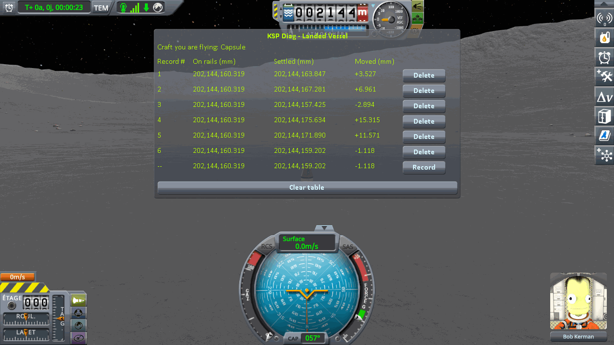

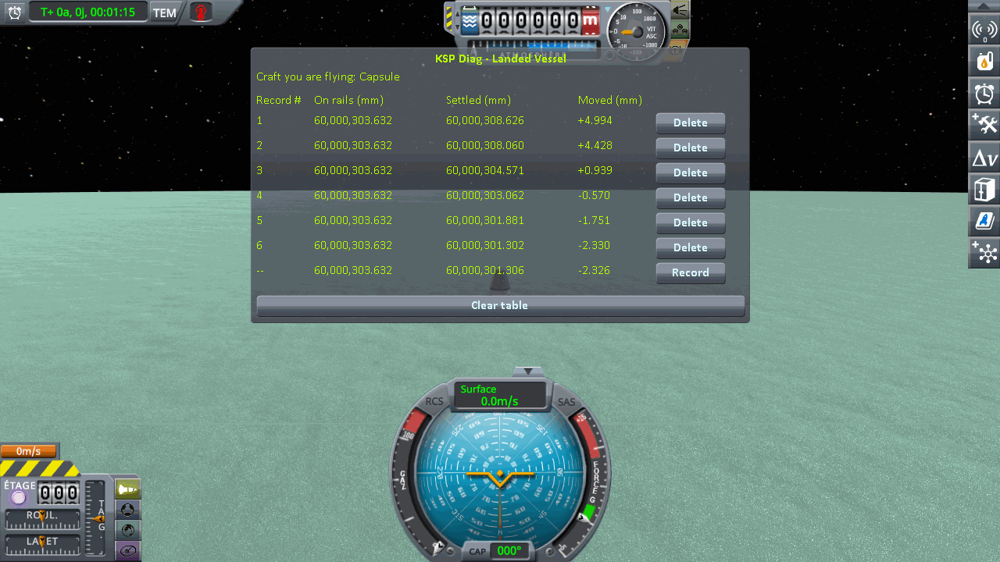

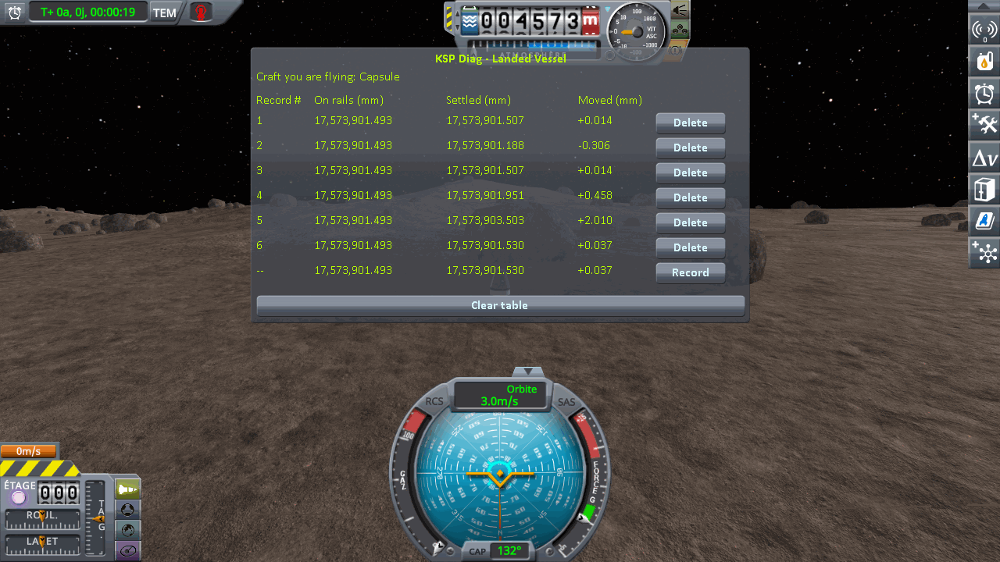

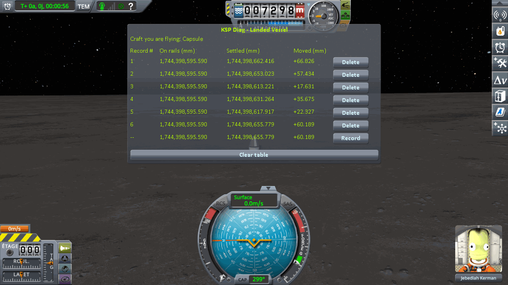

*Moved*, read off those screenshots:

| load | Kerbin | Mun | Minmus | Gilly | the Moon | Earth |
|---|---|---|---|---|---|---|
| 1 | +30.145 mm | +3.527 mm | +4.994 mm | +0.014 mm | +66.826 mm | +70.856 mm |
| 2 | +60.502 mm | +6.961 mm | +4.428 mm | −0.306 mm | +57.434 mm | −165.652 mm *(moved down)* |
| 3 | +16.839 mm | −2.894 mm | +0.939 mm | +0.014 mm | +17.631 mm | −54.965 mm |
| 4 | +53.031 mm | +15.315 mm | −0.570 mm | +0.458 mm | +35.675 mm | −123.276 mm *(moved down)* |
| 5 | +32.949 mm | +11.571 mm | −1.751 mm | +2.010 mm | +22.327 mm | −80.310 mm |
| 6 | +27.332 mm | −1.118 mm | −2.330 mm | +0.037 mm | +60.189 mm | +126.724 mm *(moved up)* |

*(moved up)*, *(moved down)*: the craft came back more than 10 cm inside the ground, or more than 10 cm
above it, and was moved onto it before its physics started, with a `Moving Vessel up` or
`Moving Vessel down` line in `KSP.log` giving about the same distance.

*On rails* reads the same digits on every load: KSP puts the craft back at the same place. *Settled* is not. Here is its spread, set against the step of a float at that distance from the
centre of the body:

| series | loads | distance to the centre | float step there | spread of *Settled* | in steps |
|---|---|---|---|---|---|
| Kerbin | 6 | 600.1 km | 62.5 mm | 43.7 mm | 0.7 |
| Mun | 6 | 202.1 km | 15.6 mm | 18.2 mm | 1.2 |
| Minmus | 6 | 60.0 km | 3.9 mm | 7.3 mm | 1.9 |
| Gilly | 6 | 17.6 km | 1.95 mm | 2.3 mm | 1.2 |
| the Moon | 6 | 1 744.4 km | 125 mm | 49.2 mm | 0.4 |
| Earth | 6 | 6 371.1 km | 500 mm | 292.4 mm | 0.6 |

On Earth, the first rule of the protocol cannot be kept: the craft came back more than 10 cm off the
ground at three of the six loads and was moved onto it before its physics started, by stock's own pass,
twice down and once up, since the craft is in *prelaunch* there (see
[Real Solar System's own workaround](../non-regression/real-solar-system/the-ground-workaround.md)). On the Moon,
Real Solar System's workaround ran at every load and never had to move the craft: it came back inside
the ground by 18 to 67 mm each time, under the 10 cm the workaround acts on, and was pushed out by the
physics engine. *Settled* is read all the same, as a player gets it. The Moon series loads
`reload-moon-rss-resave.sfs`, the Earth series `reload-earth-rss-resave.sfs`, both in
[`diag`](../../diag/README.md#the-loading-protocol).

**With this mod.** The same test, in the same installs, on the same six worlds, with the same craft and
the same saves, loaded six times per series. As before, the bottom line of each screenshot is the
loading in progress, and is not counted.

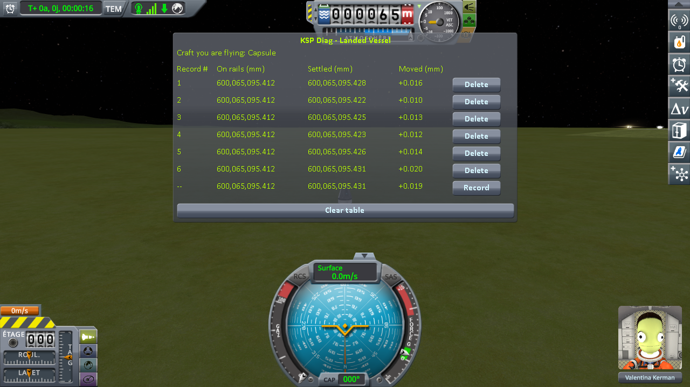

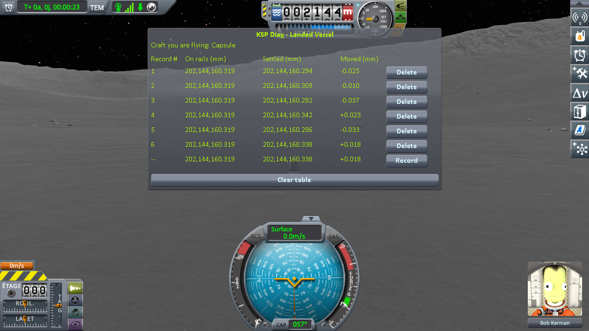

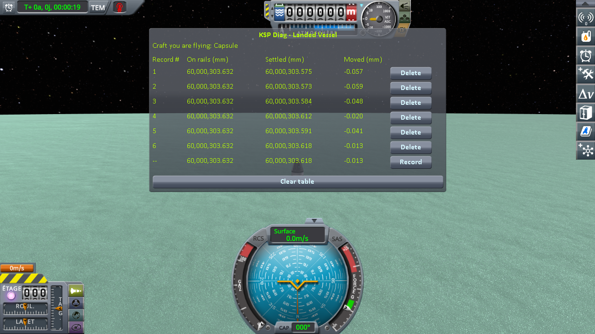

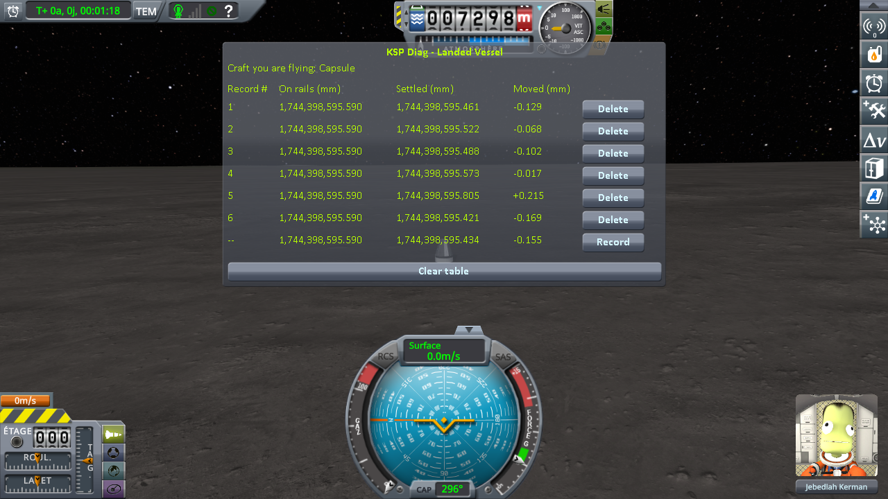

*Real Solar System's own workaround ran at every load and never had to move the craft: no `Moving Vessel` line — see [Real Solar System's own workaround](../non-regression/real-solar-system/the-ground-workaround.md).*

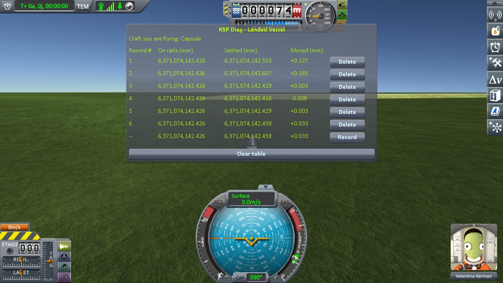

*The craft is in prelaunch, where stock runs the same pass at every load, and it never had to move the craft: no `Moving Vessel` line — see [Real Solar System's own workaround](../non-regression/real-solar-system/the-ground-workaround.md).*

The six series, read off those screenshots:

| series | spread of *Settled*, without this mod | spread of *Settled*, with this mod |
|---|---|---|
| Kerbin | 43.7 mm | 0.010 mm |
| Mun | 18.2 mm | 0.060 mm |
| Minmus | 7.3 mm | 0.045 mm |
| Gilly | 2.3 mm | 0.060 mm |
| the Moon | 49.2 mm | 0.384 mm |
| Earth | 292.4 mm | 0.189 mm |

With this mod, no load of the Moon or Earth series has a `Moving Vessel` line.

The spots of the saves on the Moon and Earth, and what this mod corrected there, are in
[Non-regression tests: Real Solar System](../non-regression/real-solar-system.md).

## The ground, over six loads

KSP Diag - Terrain Height measures the ground, with no craft in the reading at all: the collision
surface a ray pointed straight down hits, against the height KSP computes for that same spot. The second
never moves; the first is what your landing legs touch. *Difference* is the first minus the second. How
both are read is in [This mod's demonstration](https://github.com/lhervier/KSP-Diag-TerrainHeight/blob/main/docs/this-mods-demonstration.md).

**On stock.** The same sessions, read at the same moments under the capsule on its tank. The craft
only marks the spot the ray is fired at. In each screenshot, the bottom line is the loading in
progress, still live, and is not counted.

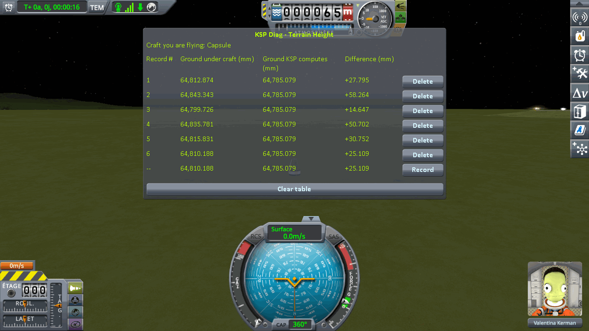

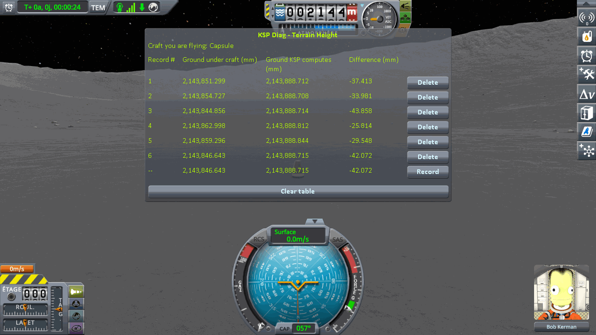

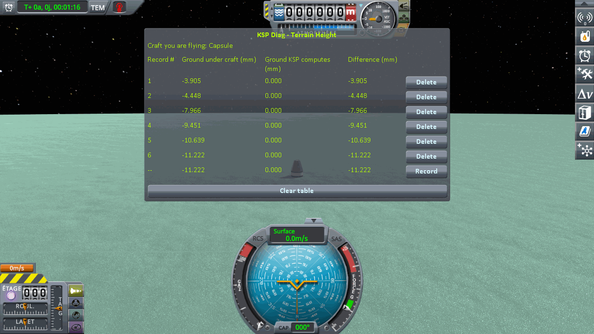

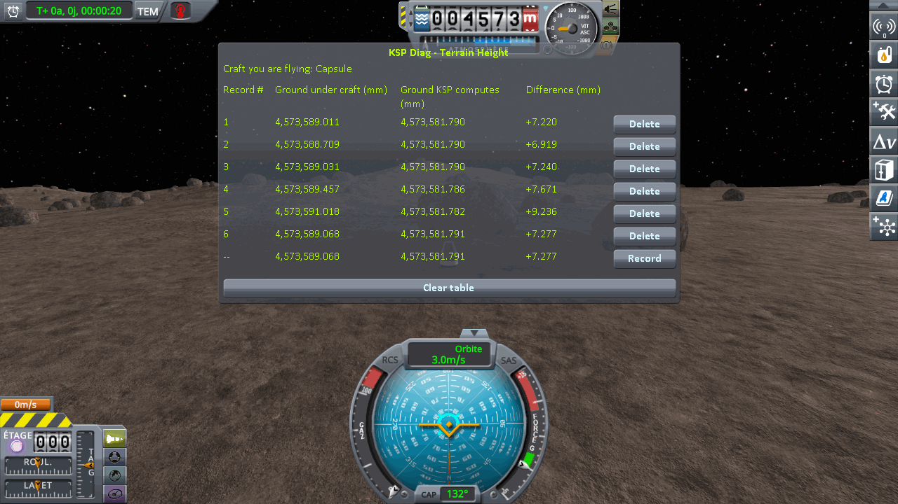

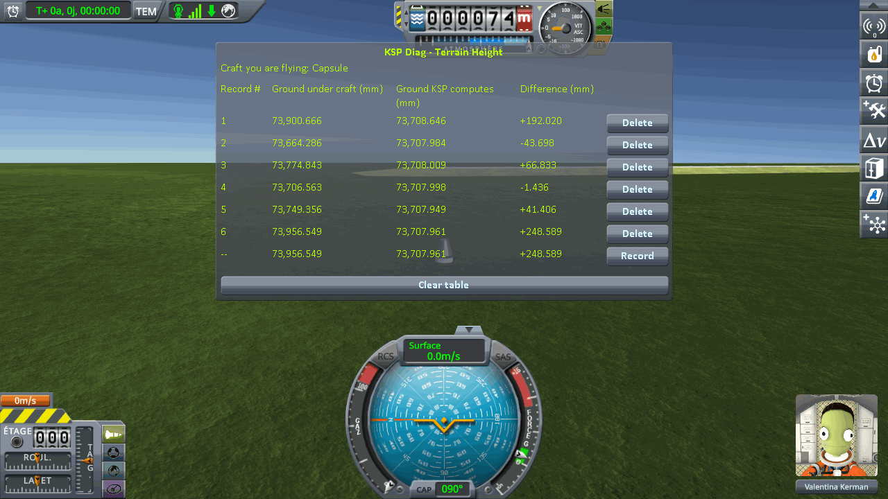

*Difference*, read off those screenshots, carries the whole of the movement of either column:

| load | Kerbin | Mun | Minmus | Gilly | the Moon | Earth |
|---|---|---|---|---|---|---|
| 1 | +27.795 mm | −37.413 mm | −3.905 mm | +7.220 mm | −48.070 mm | +192.020 mm |
| 2 | +58.264 mm | −33.981 mm | −4.448 mm | +6.919 mm | −56.829 mm | −43.698 mm *(moved down)* |
| 3 | +14.647 mm | −43.858 mm | −7.966 mm | +7.240 mm | −96.777 mm | +66.833 mm |
| 4 | +50.702 mm | −25.814 mm | −9.451 mm | +7.671 mm | −74.229 mm | −1.436 mm *(moved down)* |
| 5 | +30.752 mm | −29.548 mm | −10.639 mm | +9.236 mm | −91.447 mm | +41.406 mm |
| 6 | +25.109 mm | −42.072 mm | −11.222 mm | +7.277 mm | −53.370 mm | +248.589 mm *(moved up)* |
| **lowest to highest** | **43.6 mm** | **18.0 mm** | **7.3 mm** | **2.3 mm** | **48.7 mm** | **292.3 mm** |
| *the same, for the height KSP computes* | *0.000 mm* | *0.136 mm* | *0.000 mm* | *0.008 mm* | *4.985 mm* | *0.697 mm* |

*(moved up)*, *(moved down)*: the loads where the craft was moved onto the ground before its physics
started, as in the table of the craft. The pass moves the craft straight up or down, so the spot under
it stays the same: at those three loads, the height KSP computes reads 73,707.984, 73,707.998 and
73,707.961 mm, between the 73,707.949 and 73,708.009 mm of two loads it did not touch.

On the Moon, the craft came back inside the ground at every load and was pushed out of it, coming to
rest a little to one side each time; the height KSP computes follows the spot read, which accounts for
its spread there. On Earth, nearly all of it comes from the first load, where the craft was pushed out
the same way: the five others stay within 0.06 mm.

**With this mod.** The same installs, the same saves, on the same spots, loaded six times; this mod
is the only difference.

As before, the bottom line of each screenshot is the loading in progress, and is not counted.

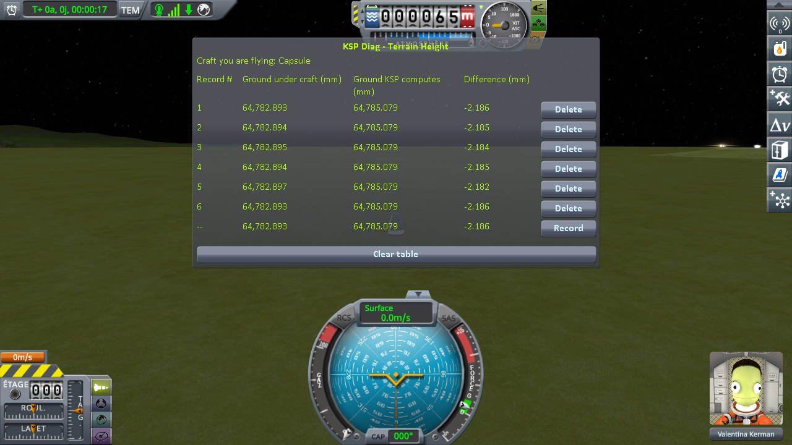

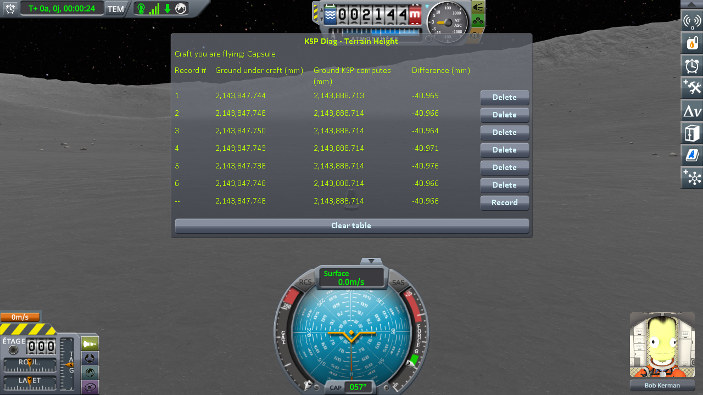

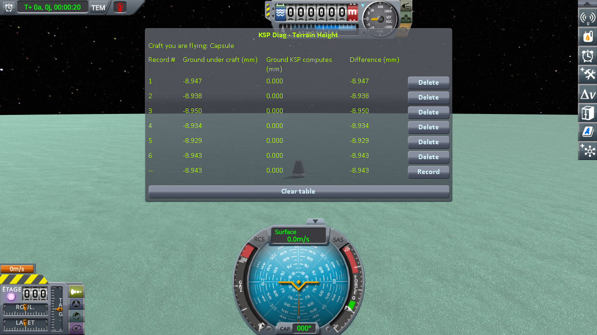

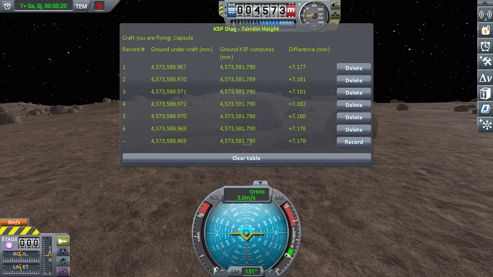

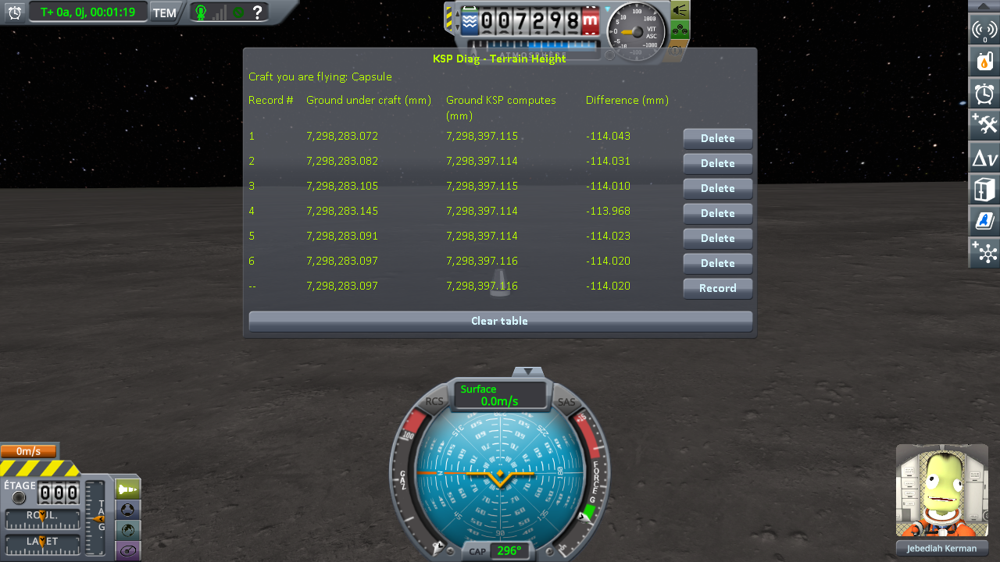

*Real Solar System's own workaround ran at every load and never had to move the craft: no `Moving Vessel` line — see [Real Solar System's own workaround](../non-regression/real-solar-system/the-ground-workaround.md).*

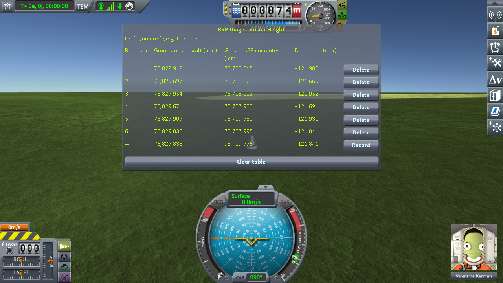

*The craft is in prelaunch, where stock runs the same pass at every load, and it never had to move the craft: no `Moving Vessel` line — see [Real Solar System's own workaround](../non-regression/real-solar-system/the-ground-workaround.md).*

Read off those screenshots:

| series | *Difference*, without this mod | *Difference*, with this mod | spread, without | spread, with |
|---|---|---|---|---|
| Kerbin | +14.647 to +58.264 mm | −2.186 to −2.182 mm | 43.6 mm | 0.004 mm |
| Mun | −43.858 to −25.814 mm | −40.976 to −40.964 mm | 18.0 mm | 0.012 mm |
| Minmus | −11.222 to −3.905 mm | −8.950 to −8.929 mm | 7.3 mm | 0.022 mm |
| Gilly | +6.919 to +9.236 mm | +7.177 to +7.182 mm | 2.3 mm | 0.005 mm |
| the Moon | −96.777 to −48.070 mm | −114.043 to −113.968 mm | 48.7 mm | 0.074 mm |
| Earth | −43.698 to +248.589 mm | +121.669 to +121.952 mm | 292.3 mm | 0.283 mm |

## What the measurements say

**KSP puts the craft back at the same place, and the craft does not come to rest there.** *On rails* is
the same on every load of every series, to within three micrometres; *Settled* is not, once, on any of
the six bodies.

**The spread is the size the culprit predicts.** From Gilly to Earth it goes from 2.3 mm to 292.4 mm,
more than a hundredfold, but counted in float steps at that distance from the centre of the body it stays
within two: 0.4 to 1.9 steps, series after series.

**It is the ground that moves, not only the craft.** The craft never moved and the spot never changed,
yet the height KSP computes held still while the collision surface wandered: by more than four
centimetres on Kerbin, nearly thirty on Earth in Real Solar System. The ground itself is not built in the same
place twice.

**With this mod, both stop moving.** On Kerbin, the craft's spread goes from several centimetres to a
hundredth of a millimetre; on the other stock worlds too, what is left stays in the hundredths of a
millimetre, 0.060 mm at worst, and on the Moon and Earth of Real Solar System within a few tenths, at
most 0.3 % of a float step there — far below the float step at any of these distances. *On rails* is
still identical on every line, so KSP put the craft back at the same place every time, and the craft
now comes to rest at the same place every time too. Under the craft, the ground reading does the same.
Three things to read in its column, *Difference*:

- **It stops varying**, by a factor of three hundred to fifteen hundred on the Mun, Minmus, Gilly, the
  Moon and Earth, and of more than ten thousand on Kerbin. On Kerbin the surface under the craft came
  back somewhere else over a range of more than four centimetres; it now comes back within four
  thousandths of a millimetre. That is the fix, and that is all of it.
- **It does not get smaller, and it is not supposed to.** It stops at a value the stock draws are
  scattered around. On the Mun, Minmus, Gilly and Earth, the fixed reading falls inside the range of the
  six loadings without this mod. On Kerbin and on the Moon it falls just outside, 16.8 and 17.2 mm below
  the lowest of the six — about a quarter of a float step or less.
  Six draws are few for a spread that wide, and a seventh could as well have landed under the fixed
  value. Put the loading on the Mun that landed on −25.814 next to a fixed −40.970 and the fix looks
  like it made things worse; it did not, that line was luck. This mod does not choose a better number
  for that patch of ground; it stops drawing a new one at every loading.
- **What is left is no longer the ground, and it stays.** *Ground KSP computes* is what says the same
  spot was read every time: 64,785.079 mm on all six Kerbin lines, `0.000` on the Minmus flats, within
  a thousandth of a millimetre on the Mun and on Gilly. Where the ground is not perfectly level, that
  column can wander a little by itself, because a craft settling a hair to one side asks for the height
  of a slightly different point — 0.136 mm on the Mun without this mod; on Real Solar System, without
  this mod, a craft pushed out of the ground lands elsewhere, and the column follows. What remains of the
  spread is the craft, not the terrain. What remains of *Difference* itself is geometry: the collision mesh is made of flat
  triangles, and they miss what the ground does between two corners —
  [KSP Diag - Terrain Height explains why a correct reading is not zero](https://github.com/lhervier/KSP-Diag-TerrainHeight/blob/main/docs/this-mods-demonstration.md#why-a-correct-reading-is-not-zero).
  On the levelled grass of Kerbin it is −2.2 mm, on the Mun −41.0 mm, on Minmus −8.9 mm, on
  Gilly +7.2 mm, on the Moon −114.0 mm, on Earth +121.8 mm, the same on every loading. Removing it would
  mean giving that mesh more triangles, which costs frames, for a gap nobody can feel.
