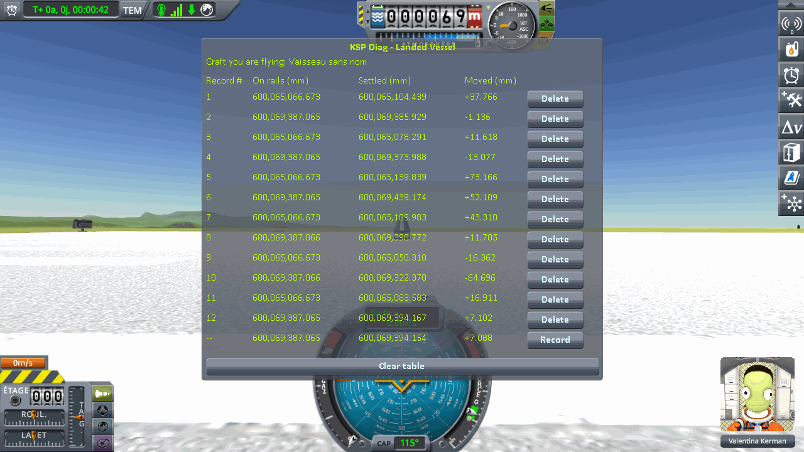
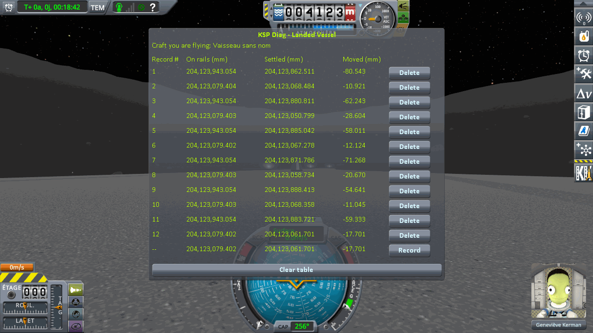
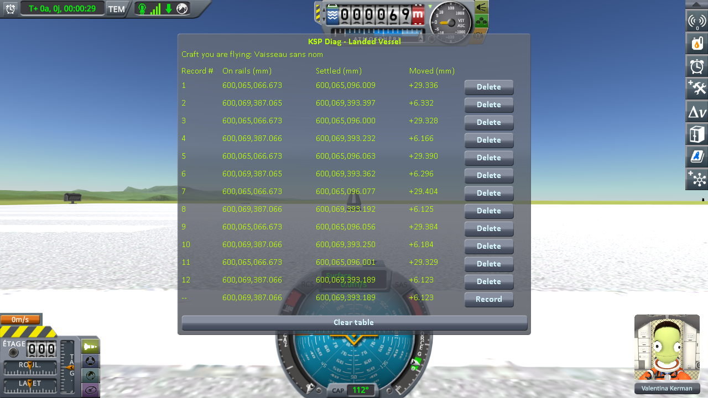
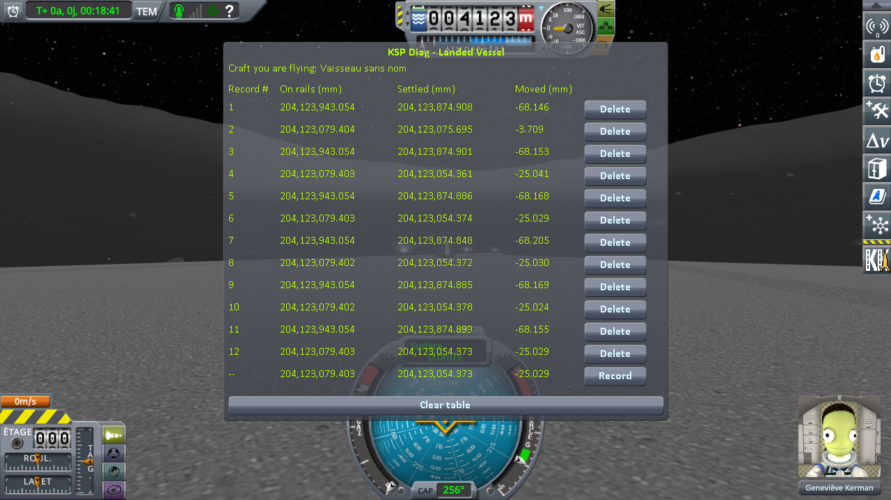
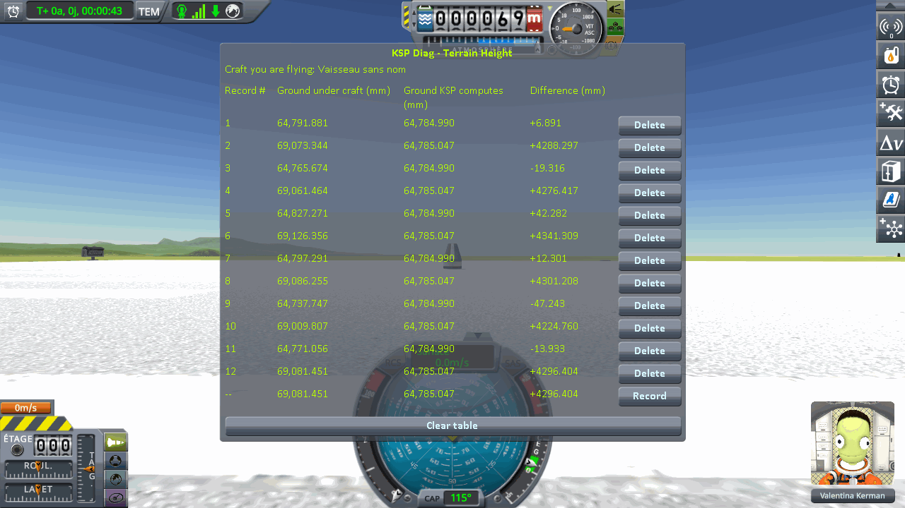
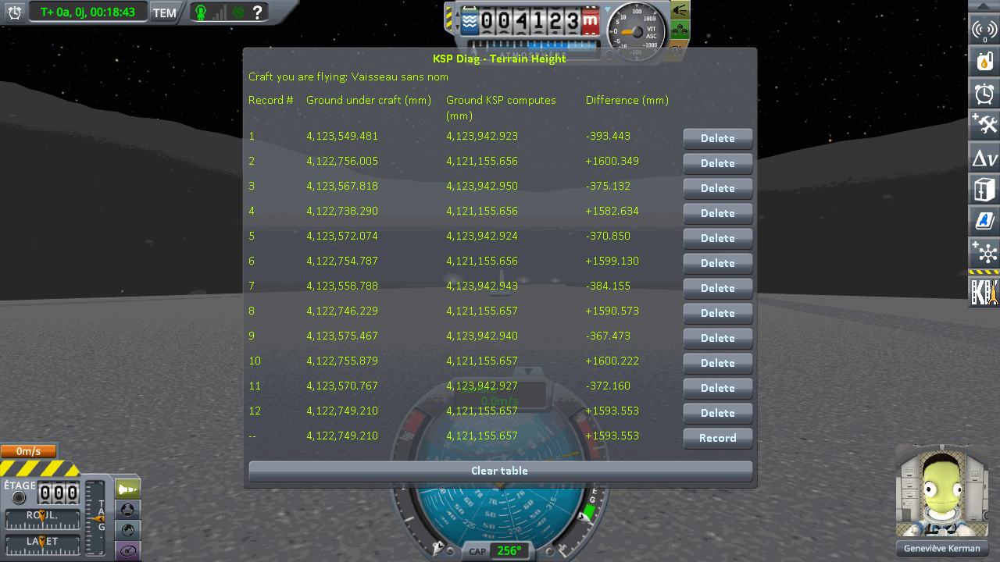
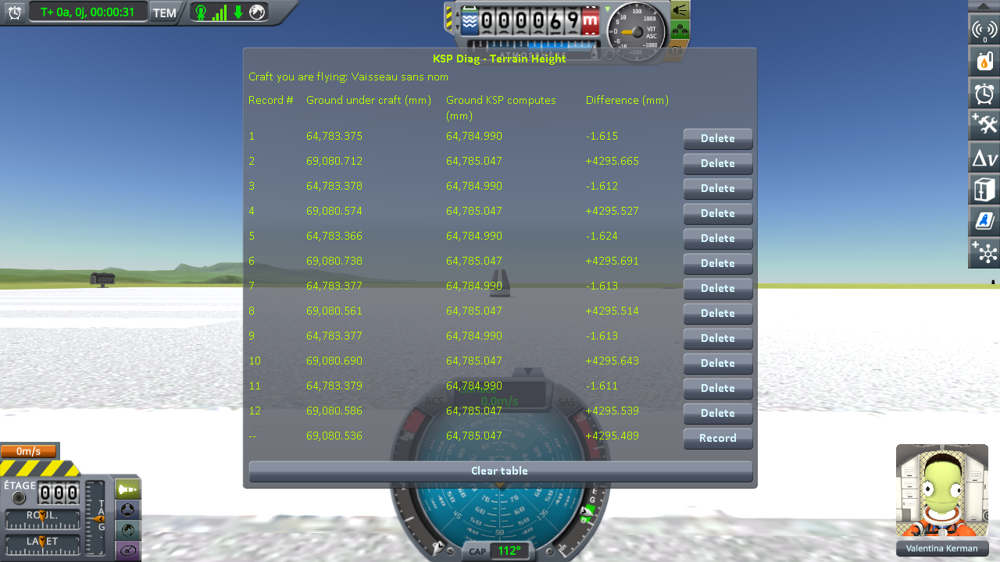
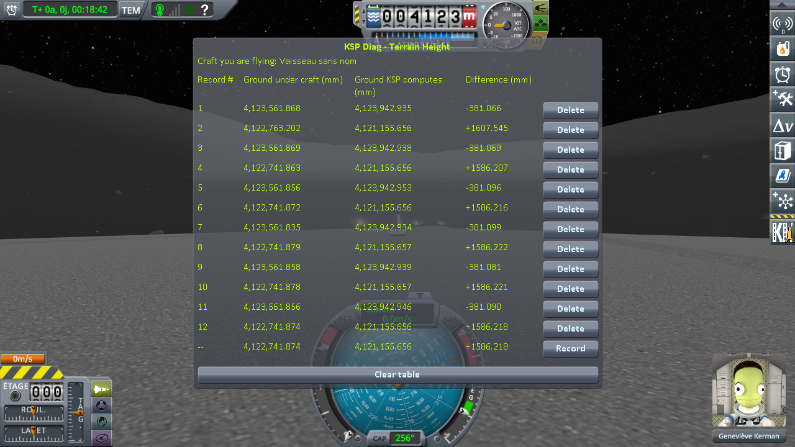

# Checking the statics: loading the same save

Part of [Terrain Precision Fix](../../README.md), one page of
[Checking the culprit: loading the same save](../checking-the-culprit-loading.md): the measurements that check
the second culprit, [the statics](../the-culprit-statics.md), on a craft handed back by a save, on a runway
with the ground beside it, on stock and with this mod. The install is described in
[Checking the culprit: loading the same save](../checking-the-culprit-loading.md).

Two instruments take the readings:
[KSP Diag - Landed Vessel](https://github.com/lhervier/KSP-Diag-LandedVessel) measures the craft, and
[KSP Diag - Terrain Height](https://github.com/lhervier/KSP-Diag-TerrainHeight) measures the ground under
it, here the deck of the runway. Each has its own page, with its method.

Two identical craft, one on a runway and one on the ground beside
it. The save is loaded, a line is recorded on the craft on the ground, then the game's *switch vessel*
key flies the craft on the runway and a second line is recorded there. Six loadings of the same save,
two lines each. It is [the runway protocol](the-runway-protocol.md), on
its two saves, played by its script, [`run-runway.py`](../../diag/automation/run-runway.py):

- **on Kerbin**, the runway of the KSC and the grass beside it, 152 m apart;
- **on the Mun**, a runway placed by [Kerbal Konstructs](https://github.com/KSP-RO/Kerbal-Konstructs) —
  the model of the KSC's runway it offers — and the ground 42 m from it. The runway hangs from a group
  of Kerbal Konstructs, itself a `PQSCity` of its own: the second culprit, placed by a mod. The ground
  there is not flat, so the step between the two spots is not the height of the deck; it does not need
  to be, as long as it does not move. The install has Kerbal Konstructs 1.12.3 and
  CustomPreLaunchChecks 1.8.1, which it requires, as well.

## The craft on a runway

**On a runway, and on the ground beside it, on stock.** The sessions are logged in
[`runway-stock.log`](../../diag/checking-the-culprit-loading/runway-stock.log) and
[`runway-mun-kk-stock.log`](../../diag/checking-the-culprit-loading/runway-mun-kk-stock.log), with what the
script printed and every line it recorded beside them. The odd lines are on the ground, the even lines
on the runway, after switching to it; the bottom line is the reading in progress, not a record.

On Kerbin, on the runway of the KSC:

On the Mun, on a runway placed by Kerbal Konstructs:

*On rails* reads the same height on all six loadings, under every craft, within two thousandths of a
millimetre: 600,065,066.673 mm on the grass of Kerbin and 600,069,387.065 or .066 mm on its runway;
204,123,943.054 mm on the ground of the Mun and 204,123,079.402 to .404 mm on its runway. *Settled*, and
the step between the two craft:

| loading | Kerbin, on the grass | Kerbin, on the runway | **step** | Mun, on the ground | Mun, on the runway | **step** |
|---|---|---|---|---|---|---|
| 1 | 600,065,104.439 mm | 600,069,385.929 mm | 4,281.491 mm | 204,123,862.511 mm | 204,123,068.484 mm | −794.028 mm |
| 2 | 600,065,078.291 mm | 600,069,373.988 mm | 4,295.697 mm | 204,123,880.811 mm | 204,123,050.799 mm | −830.012 mm |
| 3 | 600,065,139.839 mm | 600,069,439.174 mm | 4,299.336 mm | 204,123,885.042 mm | 204,123,067.278 mm | −817.765 mm |
| 4 | 600,065,109.983 mm | 600,069,398.772 mm | 4,288.789 mm | 204,123,871.786 mm | 204,123,058.734 mm | −813.052 mm |
| 5 | 600,065,050.310 mm | 600,069,322.370 mm | 4,272.059 mm | 204,123,888.413 mm | 204,123,068.358 mm | −820.055 mm |
| 6 | 600,065,083.583 mm | 600,069,394.167 mm | 4,310.584 mm | 204,123,883.721 mm | 204,123,061.701 mm | −822.020 mm |
| **lowest to highest** | **89.5 mm** | **116.8 mm** | **38.5 mm** | **25.9 mm** | **17.7 mm** | **36.0 mm** |

The step is the runway minus the ground: on Kerbin, 4.3 m, the height of the deck above the grass.

*Moved*, once physics has the craft:

| loading | 1 | 2 | 3 | 4 | 5 | 6 |
|---|---|---|---|---|---|---|
| Kerbin, on the grass, without this mod | +37.766 mm | +11.618 mm | +73.166 mm | +43.310 mm | −16.362 mm | +16.911 mm |
| Kerbin, on the grass, with this mod | +29.336 mm | +29.328 mm | +29.390 mm | +29.404 mm | +29.384 mm | +29.329 mm |
| Kerbin, on the runway, without this mod | −1.136 mm | −13.077 mm | +52.109 mm | +11.705 mm | −64.696 mm | +7.102 mm |
| Kerbin, on the runway, with this mod | +6.332 mm | +6.166 mm | +6.296 mm | +6.125 mm | +6.184 mm | +6.123 mm |
| Mun, on the ground, without this mod | −80.543 mm | −62.243 mm | −58.011 mm | −71.268 mm | −54.641 mm | −59.333 mm |
| Mun, on the ground, with this mod | −68.146 mm | −68.153 mm | −68.168 mm | −68.205 mm | −68.169 mm | −68.155 mm |
| Mun, on the Kerbal Konstructs runway, without this mod | −10.921 mm | −28.604 mm | −12.124 mm | −20.670 mm | −11.045 mm | −17.701 mm |
| Mun, on the Kerbal Konstructs runway, with this mod | **−3.709 mm** | −25.041 mm | −25.029 mm | −25.030 mm | −25.024 mm | −25.029 mm |

**On a runway, with this mod**, in that same install, on those same saves, with this mod as the only
difference. The sessions are logged in [`runway-fix.log`](../../diag/checking-the-culprit-loading/runway-fix.log) and
[`runway-mun-kk-fix.log`](../../diag/checking-the-culprit-loading/runway-mun-kk-fix.log), with what the script printed and every
line it recorded beside them. *On rails* still reads the same height, within three thousandths of a
millimetre.

On Kerbin, on the runway of the KSC:

On the Mun, on a runway placed by Kerbal Konstructs:

On Kerbin, the craft on the grass comes to rest across a spread of 89.5 mm without this mod, and
0.076 mm with it; the craft on the runway, 116.8 mm without it, and 0.208 mm with it; the step between
the two, 38.5 mm without it, 0.274 mm with it. On the Mun, the craft on the ground, 25.9 mm without this
mod, and 0.059 mm with it; the craft on the runway, 17.7 mm without it; with it, 0.017 mm from the second
loading to the sixth, the first loading apart.

## The deck of a runway

**On a runway, and on the ground beside it, on stock.** The same sessions as for the craft; the odd
lines under the craft on the ground, the even lines under the craft on the runway.

On Kerbin, on the runway of the KSC:

On the Mun, on a runway placed by Kerbal Konstructs:

The height KSP computes reads the same under each craft at every loading: 64,784.990 mm on the grass of
Kerbin and 64,785.047 mm under its runway; on the Mun, 4,123,942.923 to 4,123,942.950 mm under the
ground and 4,121,155.656 or .657 mm under the runway. On a runway, the ray meets the deck, above that
height: on the Mun, where the ground slopes, the deck stands 1.6 m above the terrain KSP computes under
it, and the ground the ray meets beside it 0.4 m below. *Ground under craft*:

| loading | 1 | 2 | 3 | 4 | 5 | 6 |
|---|---|---|---|---|---|---|
| Kerbin, on the grass, without this mod | 64,791.881 mm | 64,765.674 mm | 64,827.271 mm | 64,797.291 mm | 64,737.747 mm | 64,771.056 mm |
| Kerbin, on the grass, with this mod | 64,783.375 mm | 64,783.378 mm | 64,783.366 mm | 64,783.377 mm | 64,783.377 mm | 64,783.379 mm |
| Kerbin, on the runway, without this mod | 69,073.344 mm | 69,061.464 mm | 69,126.356 mm | 69,086.255 mm | 69,009.807 mm | 69,081.451 mm |
| Kerbin, on the runway, with this mod | 69,080.712 mm | 69,080.574 mm | 69,080.738 mm | 69,080.561 mm | 69,080.690 mm | 69,080.586 mm |
| Mun, on the ground, without this mod | 4,123,549.481 mm | 4,123,567.818 mm | 4,123,572.074 mm | 4,123,558.788 mm | 4,123,575.467 mm | 4,123,570.767 mm |
| Mun, on the ground, with this mod | 4,123,561.868 mm | 4,123,561.869 mm | 4,123,561.856 mm | 4,123,561.835 mm | 4,123,561.858 mm | 4,123,561.856 mm |
| Mun, on the Kerbal Konstructs runway, without this mod | 4,122,756.005 mm | 4,122,738.290 mm | 4,122,754.787 mm | 4,122,746.229 mm | 4,122,755.879 mm | 4,122,749.210 mm |
| Mun, on the Kerbal Konstructs runway, with this mod | **4,122,763.202 mm** | 4,122,741.863 mm | 4,122,741.872 mm | 4,122,741.879 mm | 4,122,741.878 mm | 4,122,741.874 mm |

**On a runway, with this mod**, in that same install, the same sessions. The height KSP computes reads
the same digits as on stock.

On Kerbin, on the runway of the KSC:

On the Mun, on a runway placed by Kerbal Konstructs:

On Kerbin, the grass spreads over 89.5 mm without this mod, and 0.013 mm with it; the deck of the runway,
over 116.5 mm without it, and 0.177 mm with it; the step between the two, over 38.3 mm without it, and
0.188 mm with it. On the Mun, the ground, over 26.0 mm without this mod, and 0.034 mm with it; the deck,
over 17.7 mm without it; with it, over 0.015 mm from the second loading to the sixth — and the first
loading stands 21.3 mm above them, as with Diag LandedVessel.

## What the measurements say

**A runway moves on its own, and this mod stops it.** On stock, the step between the deck and the ground
beside it changes by up to 38.3 mm on Kerbin and 36.1 mm on the Mun from one loading to the next: the
runway does not follow the ground, it draws a rounding of its own. That is the second culprit, a static
placed through a float at planet scale — by the game on Kerbin, by Kerbal Konstructs on the Mun. With
this mod, the deck of the KSC comes back within 0.177 mm, and the step within 0.188 mm.

**On the runway, both instruments agree.** The craft on the runway of the KSC comes to rest within
0.208 mm, the deck under it comes back within 0.177 mm: the craft rests on the deck, and the deck no
longer moves.

**The runway of the KSC keeps a larger remainder than the grass.** About two tenths of a millimetre on
the runway, with both instruments; on the grass, a hundredth of a millimetre for the ground, eight
hundredths for the craft. Where the remainder of the runway comes from is not established yet. It is still several
hundred times smaller than what stock does.

**On the Mun, the first loading reads another surface.** Listing every collider under each craft at each
loading ([`runway-mun-kk-colliders-fix.log`](../../diag/checking-the-culprit-loading/runway-mun-kk-colliders-fix.log),
four loadings with this mod): at the first loading of the session, one more collider of the runway is
active under the craft, a section of the deck, `Section3_Mesh`, 21.3 mm above the deck's own
`runway_collider`; from the second loading on, it is gone, and the craft rests on `runway_collider`,
which comes back within eight thousandths of a millimetre at every loading, the first one included. The
group of Kerbal Konstructs the runway hangs from comes back at the same height every time too, within a
few micrometres. This is not a rounding, and this mod does not touch it. On stock, the first loading of
this series does not stand apart from the five others: the deck comes back 0.1 mm above the highest of
them, inside the spread of the stock draws. Why that section is only there at the first loading is not
established; on the runway of the KSC on Kerbin, nothing of the kind shows.
