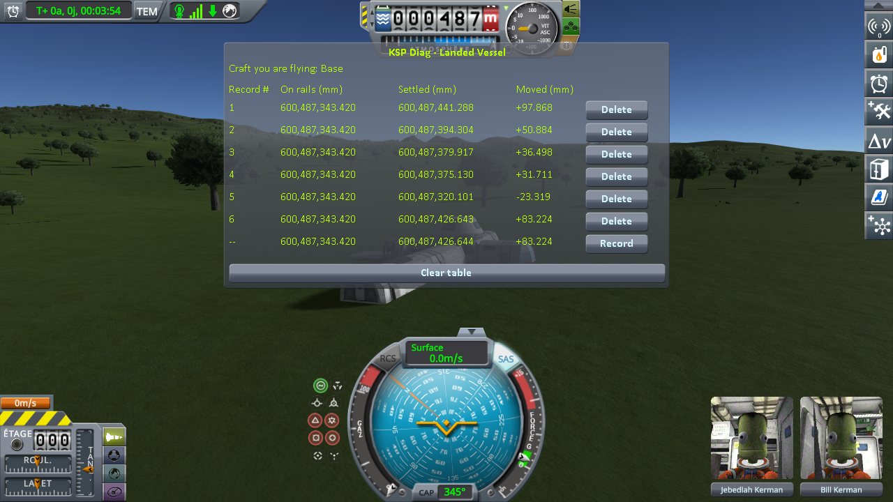
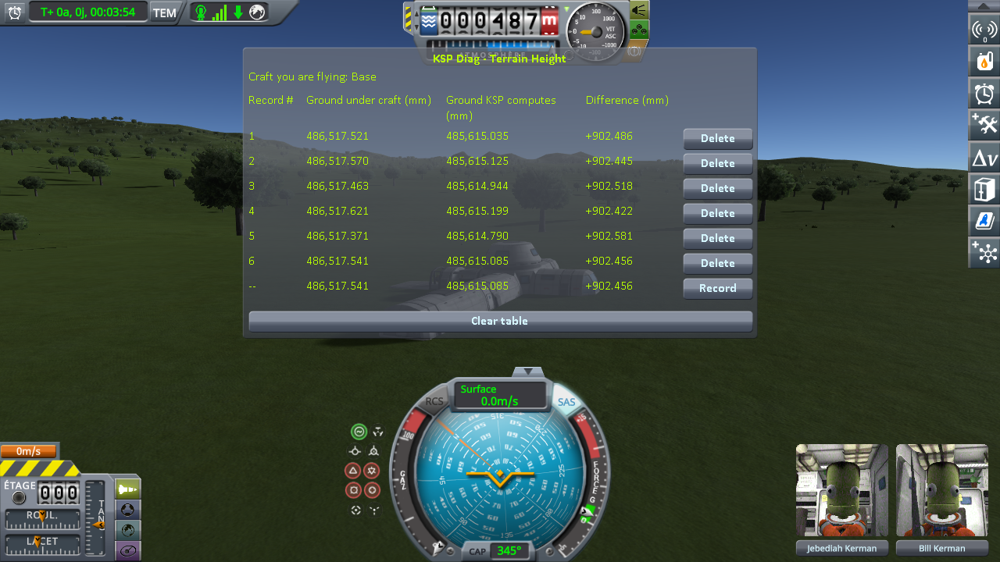

# Kerbal Planetary Base Systems: a base on the ground

Part of [Terrain Precision Fix](../../../../README.md), [the ground](../../README.md#non-regression-tests): one non-regression test, on Kerbal Planetary Base Systems.

**Status: checked on Kerbin, and read in the source — a base stands on the ground as a stock craft does,
and this mod keeps it in place.**
[Kerbal Planetary Base Systems](https://github.com/n116-software/KerbalPlanetaryBaseSystems), one of the
most popular part mods, adds parts to build bases on the ground, the very thing this mod places: checking
it is only logical. Its plugin never reads or moves the ground, a static or a scatter holder, and its parts
reach the ground through stock modules only: its legs, its landing gear and its drills work on the ground
this mod places as stock parts do. A base of its parts, loaded six times on a slope of Kerbin, came back
over 121.2 mm without this mod, jumping when the ground came back higher, and within 0.617 mm with it.

## What its plugin does

Read in the source of Kerbal Planetary Base Systems 1.6.16 (`Sources/PlanetarySurfaceStructures`).

Its plugin has no Harmony patch, casts no ray, and reads or writes no position. Its part modules:

- **switch parts of a model on and off**: `PlanetaryModule` (a module deployed or packed),
  `ModuleKPBSModelSwitch` (a variant), `ModuleKPBSMeshToggle` (a mesh shown or hidden),
  `ModuleKPBSCorridorNodes` (a corridor where another part is attached). The colliders of a switched
  model go with it, inside the part, which this mod does not touch;
- **run the game logic** of a base: converters, greenhouse, nuclear storage, lights, the editor filter,
  the upgrade of old saves.

It never looks up a terrain sphere, a `PQSCity`, a `PQSCity2` or a scatter holder: neither the statics fix
nor the scatter fix moves anything it looks for.

It also ships two small plugins whose source is not in its repository: Community Category Kit, which adds
its category to the editor's part list, and KSPModFileLocalizer, which translates its files. Neither names
anything of the terrain, of physics or of a craft.

## Its parts on the ground

What touches the ground is configured in its part files, with stock modules:

- **its legs**, the K&K "Bigfoot" and K&K "Little Bigfoot" landing legs, are stock wheels of type `LEG`
  (`ModuleWheelBase`, `ModuleWheelSuspension`), and **its K&K Attachable Landing Gear** a stock motorized
  wheel;
- **its drills**, the K&K Inline Drill and, with a life support mod, the K&K Inline Water Drill, are stock
  harvesters (`ModuleResourceHarvester`, `ModuleAsteroidDrill`). A stock harvester checks that it touches
  the ground with a ray from its impact transform, 5 m long on these drills (KSP 1.12.5):

```csharp
// ModuleResourceHarvester.CheckForImpact
Ray ray = new Ray(position, impactTransformCache.forward);
return Physics.Raycast(ray, out impactHitInfo, ImpactRange, layerMask);
```

That ray hits the collider of the terrain quad, the one this mod places, as it does for a stock drill. A
base of Kerbal Planetary Base Systems stands, rolls and drills on the ground as any stock craft does, and
what this mod changes for it is what it changes for any craft: see the checks of
[the ground](../../README.md), and a base measured below.

## A base loaded six times

KSP 1.12.5 with Harmony, ModuleManager, KSP Community Fixes 1.41.1, Kerbal Planetary Base Systems 1.6.16
with Community Category Kit and Community Resource Pack, which it requires, both instruments,
[KSP Diag - Landed Vessel](https://github.com/lhervier/KSP-Diag-LandedVessel) and
[KSP Diag - Terrain Height](https://github.com/lhervier/KSP-Diag-TerrainHeight), and
[KSP-MCPServer](https://github.com/lhervier/KSP-MCPServer), which plays the protocol; this mod with its
defaults (at `logLevel = Debug`), or not.

**The save**, [`kpbs-kerbin-hull-2.sfs`](../../../../diag/ground/non-regression/kerbal-planetary-base-systems/a-base-on-the-ground/kpbs-kerbin-hull-2.sfs):
a base of 28 parts — a central hub, habitats, a greenhouse, a centrifuge, cupolas, airlocks and a drill —
built in the SPH and set down by hand on a slope of about 7° on Kerbin, west of the KSC, where the ground is
not flat on purpose. Its ten legs are retracted: it rests on its hulls. It follows the rules of
[Making the save](../../checking/making-the-save.md): *landed*, throttle closed, SAS on,
no `Moving Vessel` line in `KSP.log` when it is loaded, and it does not slide.

**The protocol**: [the loading protocol](../../checking/loading-protocol.md), played by its
script, [`run-loading.py`](../../../../diag/ground/automation/run-loading.py): the save loaded six times without this
mod, then six times with it, both instruments recording at each load.

**Without this mod**, the ground under the base comes back at another height at every load, and the base
with it. When the ground comes back higher, the base is inside it, and the physics engine throws it up:
*Moved* reaches +97.9 mm. Each jump also leaves it a little elsewhere on the slope, so that the height KSP
computes for the ground under it moves too.

**With this mod**, the ground and the base come back to the same place. *Moved* is the same +34 mm at
every load: the save was made without this mod, and the base settles once on the corrected ground, always
at the same place, as any save made without it does
([Existing saves](../../../common/existing-saves.md)).

Spread over the six loads, read off the screenshots below:

| | without this mod | with this mod |
|---|---|---|
| *Settled* (KSP Diag - Landed Vessel) | 121.187 mm | 0.617 mm |
| *Moved* (KSP Diag - Landed Vessel) | −23.319 to +97.868 mm | +33.642 to +34.259 mm |
| *Ground under craft* (KSP Diag - Terrain Height) | 120.973 mm | 0.250 mm |
| *Ground KSP computes* (KSP Diag - Terrain Height) | 17.445 mm | 0.409 mm |

<p class="thumbs">
<a href="../../../../imgs/ground/non-regression/kerbal-planetary-base-systems/a-base-on-the-ground/landed-vessel-without-this-mod.png"></a>
<a href="../../../../imgs/ground/non-regression/kerbal-planetary-base-systems/a-base-on-the-ground/terrain-height-without-this-mod.png"></a>
<a href="../../../../imgs/ground/non-regression/kerbal-planetary-base-systems/a-base-on-the-ground/landed-vessel-fix.png"></a>
<a href="../../../../imgs/ground/non-regression/kerbal-planetary-base-systems/a-base-on-the-ground/terrain-height-fix.png"></a>
</p>

<details>
<summary>The 4 screenshots, without this mod then with it</summary>


</details>

No load of either series has a `Moving Vessel` line, and no part broke. The logs, what the script printed
and every line it recorded are in [`diag`](../../../../diag/ground/README.md#with-kerbal-planetary-base-systems).
