# Kopernicus: a landed craft reloaded in flight

Part of [Terrain Precision Fix](../../../../README.md), [the ground](../../README.md#non-regression-tests): one non-regression test, on Kopernicus.

**Status: checked, no problem — a landed craft reloaded in flight comes back where it was.** Under
Kopernicus, its capsule came back within 0.068 mm at most with this mod, on four bodies; without it, the
ground still moved by up to 141 mm. Watched by eye as well, ten loads per body: with this mod, neither the
capsule nor the ground moved while the flight loaded.

## What Kopernicus changes

Kopernicus patches `FlightDriver.Start`: when a save is resumed into flight, it places the floating origin
from the focused craft's orbit, in double, instead of the craft's position in float
(`PreciseFloatingOrigin.cs`), a landed craft included.

For a landed craft, the orbit it reads may not be written yet at that moment: `ProtoVessel.Load` creates
its `OrbitDriver` without setting its position, and the first one written comes from `OrbitDriver.Start`,
after the floating origin is placed. This mod's terrain fix places the quads in double, but from where the
game builds them. If it did not hold across that first placement, a landed craft would be seen moving or
bouncing as the flight loads, or the ground around it would open along the borders of its quads.

## The test

KSP 1.12.5 with Harmony, ModuleManager, KSP Community Fixes 1.41.1,
[Kopernicus](https://github.com/Kopernicus/Kopernicus) release 252 and what it requires (Modular Flight
Integrator 1.2.10, KSPTextureLoader 1.0.36), both instruments,
[KSP Diag - Landed Vessel](https://github.com/lhervier/KSP-Diag-LandedVessel) and
[KSP Diag - Terrain Height](https://github.com/lhervier/KSP-Diag-TerrainHeight), and
[KSP-Util-MCPServer](https://github.com/lhervier/KSP-Util-MCPServer), which plays the protocol; this mod with its
defaults (at `logLevel = Debug`), or not.

**The protocol**: [the loading protocol](../../checking/loading-protocol.md), played by its
script, [`run-loading.py`](../../../../diag/ground/automation/run-loading.py), on its four saves: a Mk1
capsule on a flat FL-T100 tank, landed on
[Kerbin](../../../../diag/ground/checking/loading/reload-kerbin-2parts.sfs),
[the Mun](../../../../diag/ground/checking/loading/reload-mune-2parts.sfs),
[Minmus](../../../../diag/ground/checking/loading/reload-minmus-2parts.sfs) and
[Gilly](../../../../diag/ground/checking/loading/reload-gilly-2parts.sfs). Each save loaded six times
without this mod, then six times with it, both instruments recording at each load.

**By eye**: each save loaded ten times in a row, ten seconds apart, while a player watched the capsule and
the ground around it as the flight loaded: Kerbin (its save moved to noon, the craft untouched), the Mun and
Minmus with this mod, Kerbin again without it.

## The six loads

**Without this mod**, the ground comes back at another height at every load, and the capsule with it, as
without Kopernicus: on Kerbin, the capsule was thrown up to 1.24 m above where it landed.

**With this mod**, the ground and the capsule come back to the same place.

Spread over the six loads, read off the screenshots below:

| | Kerbin | the Mun | Minmus | Gilly |
|---|---|---|---|---|
| *Ground under craft*, without this mod | 141.200 mm | 23.312 mm | 5.283 mm | 0.883 mm |
| *Ground under craft*, with this mod | 0.005 mm | 0.012 mm | 0.019 mm | 0.002 mm |
| *Settled*, without this mod | 142.106 mm | 23.312 mm | 5.268 mm | 0.872 mm |
| *Settled*, with this mod | 0.016 mm | 0.031 mm | 0.068 mm | 0.028 mm |
| *Moved*, without this mod | −36.271 to +105.834 mm | +10.283 to +33.595 mm | −1.702 to +3.566 mm | −0.547 to +0.325 mm |
| *Moved*, with this mod | +0.004 to +0.020 mm | −0.045 to −0.014 mm | −0.076 to −0.008 mm | −0.020 to +0.008 mm |
| *Highest*, without this mod | 1237.953 mm | 616.565 mm | 33.436 mm | 3.892 mm |
| *Highest*, with this mod | 0.023 mm | 0.000 mm | 0.004 mm | 0.084 mm |

In the log with this mod, its safeguard never fired, and every body was reported with its terrain placed in
double precision.

<a href="../../../../imgs/ground/non-regression/kopernicus/a-landed-craft-reloaded-in-flight/kerbin-landed-vessel-without-this-mod.jpg">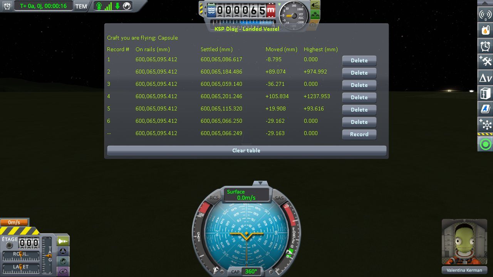</a>

<a href="../../../../imgs/ground/non-regression/kopernicus/a-landed-craft-reloaded-in-flight/kerbin-landed-vessel-fix.jpg">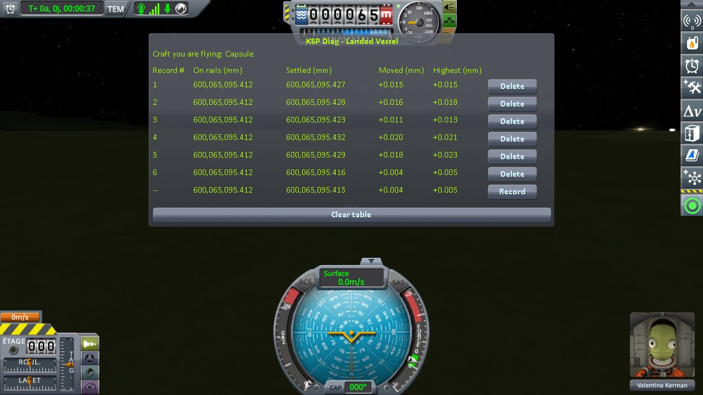</a>
<a href="../../../../imgs/ground/non-regression/kopernicus/a-landed-craft-reloaded-in-flight/kerbin-terrain-height-fix.jpg">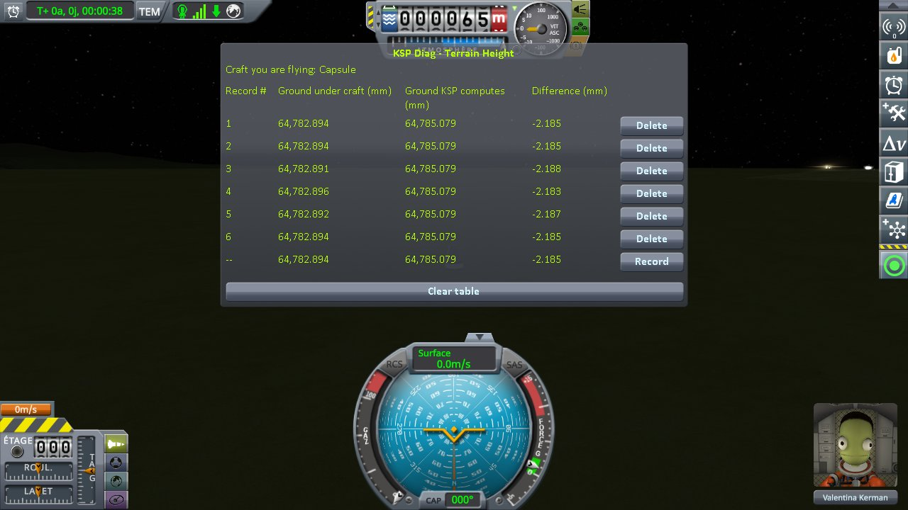</a>

The tables of Kerbin

<a href="../../../../imgs/ground/non-regression/kopernicus/a-landed-craft-reloaded-in-flight/mune-landed-vessel-without-this-mod.jpg">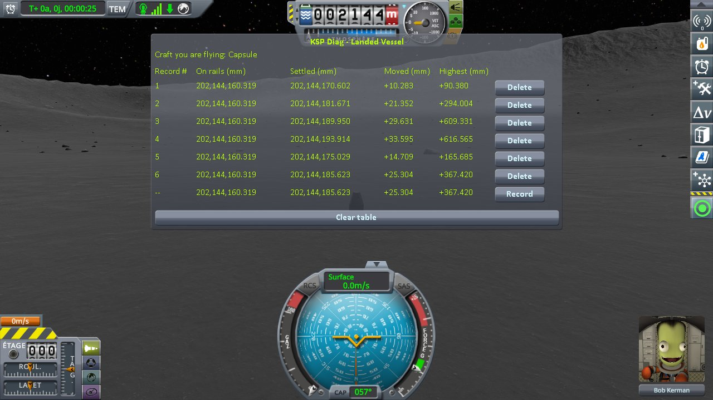</a>
<a href="../../../../imgs/ground/non-regression/kopernicus/a-landed-craft-reloaded-in-flight/mune-terrain-height-without-this-mod.jpg">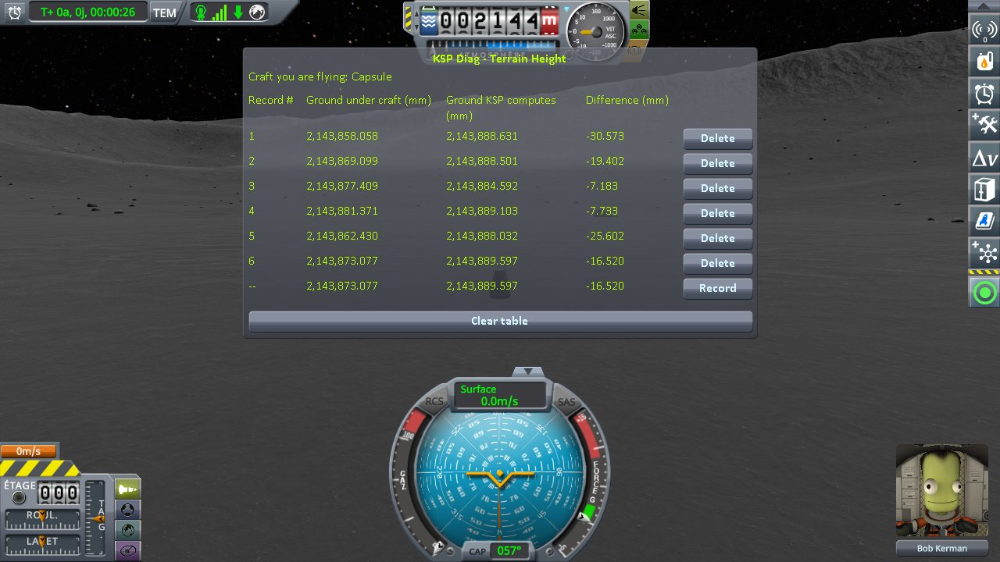</a>
<a href="../../../../imgs/ground/non-regression/kopernicus/a-landed-craft-reloaded-in-flight/mune-landed-vessel-fix.jpg">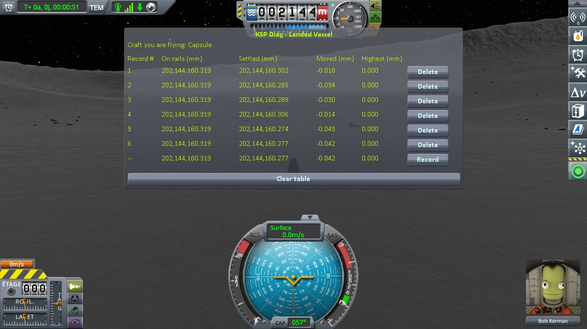</a>
<a href="../../../../imgs/ground/non-regression/kopernicus/a-landed-craft-reloaded-in-flight/mune-terrain-height-fix.jpg">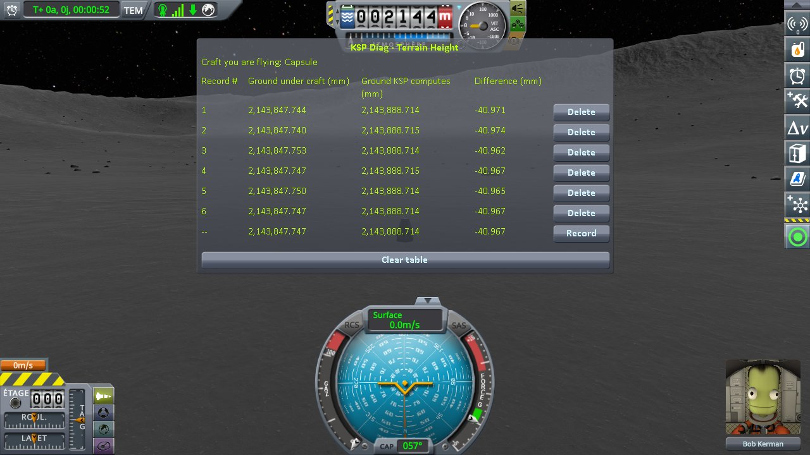</a>

The tables of the Mun

<a href="../../../../imgs/ground/non-regression/kopernicus/a-landed-craft-reloaded-in-flight/minmus-landed-vessel-fix.jpg">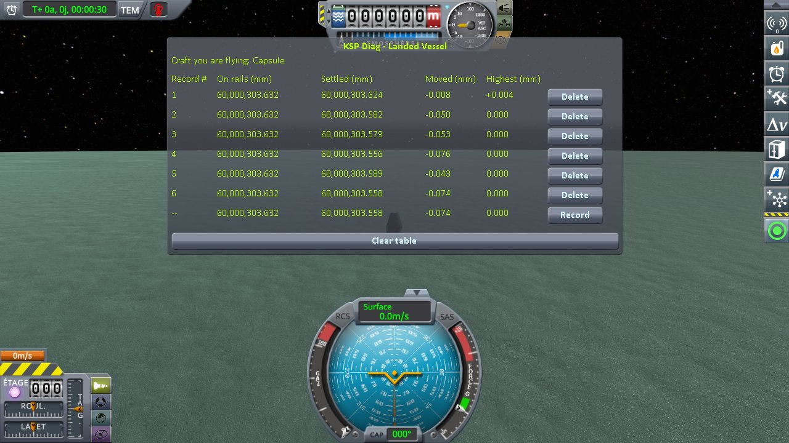</a>
<a href="../../../../imgs/ground/non-regression/kopernicus/a-landed-craft-reloaded-in-flight/minmus-terrain-height-fix.jpg">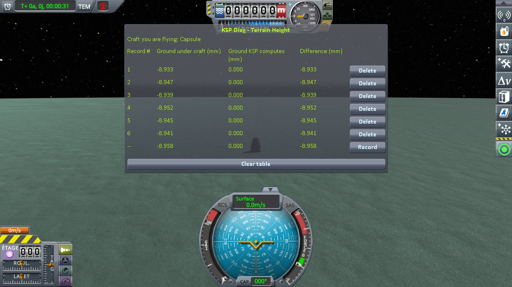</a>

The tables of Minmus

<a href="../../../../imgs/ground/non-regression/kopernicus/a-landed-craft-reloaded-in-flight/gilly-landed-vessel-without-this-mod.jpg">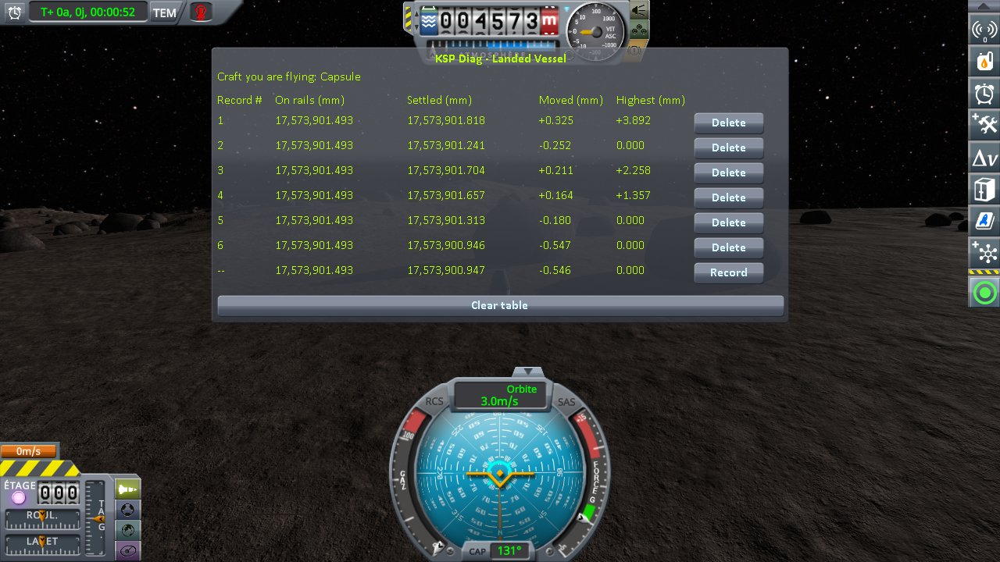</a>
<a href="../../../../imgs/ground/non-regression/kopernicus/a-landed-craft-reloaded-in-flight/gilly-terrain-height-without-this-mod.jpg">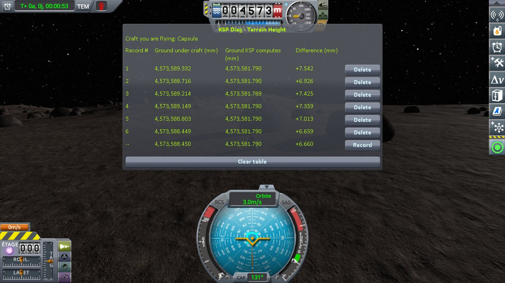</a>

<a href="../../../../imgs/ground/non-regression/kopernicus/a-landed-craft-reloaded-in-flight/gilly-terrain-height-fix.jpg">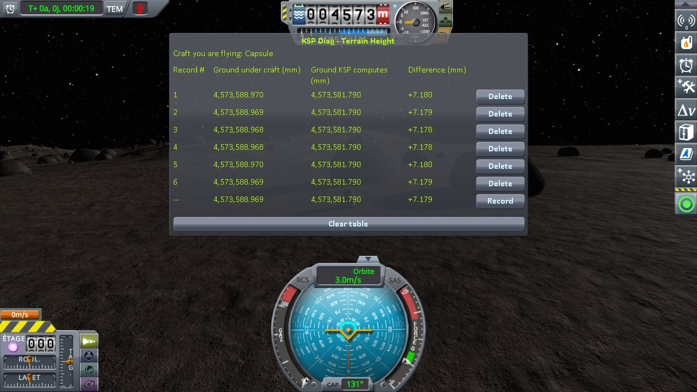</a>

The tables of Gilly

## By eye

With this mod, on Kerbin, the Mun and Minmus, ten loads each: the capsule never moved, and the ground
around it stayed whole and still while the flight loaded. Without it, on Kerbin, the capsule sometimes
jumped as it went off rails, as the table above expects.

The logs, what the script printed and every line it recorded, are in
[`diag`](../../../../diag/ground/README.md#with-kopernicus).
