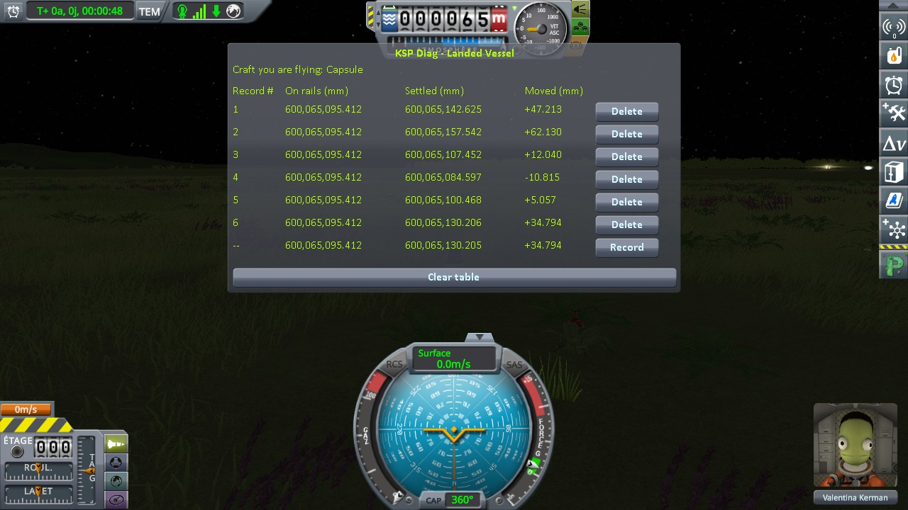
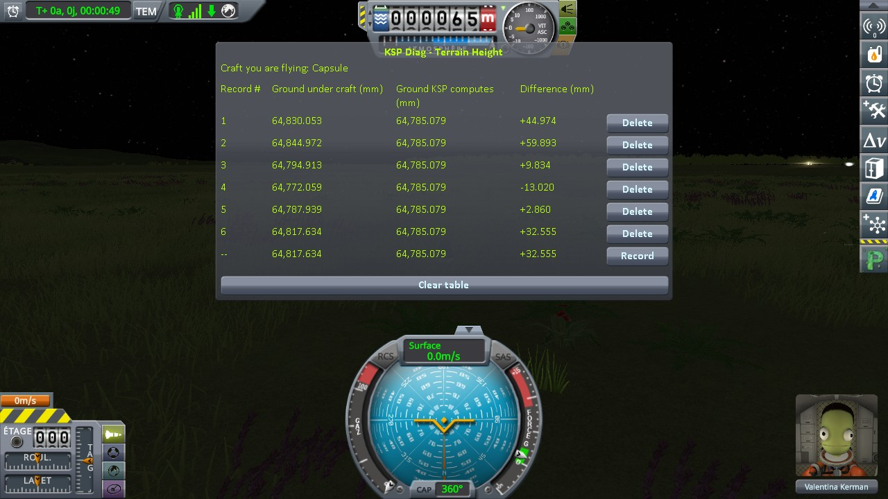
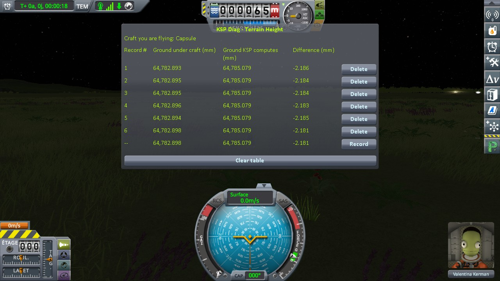
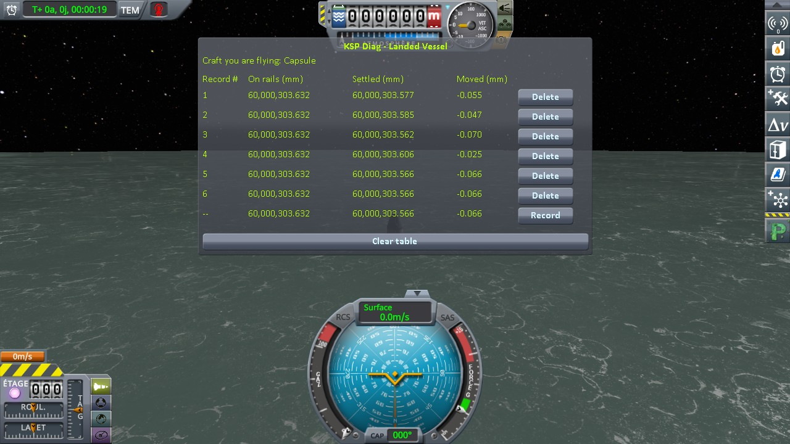
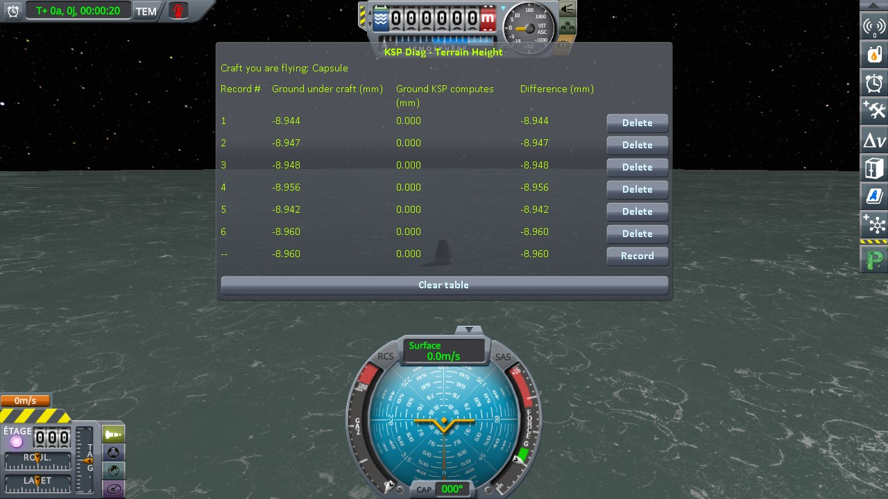
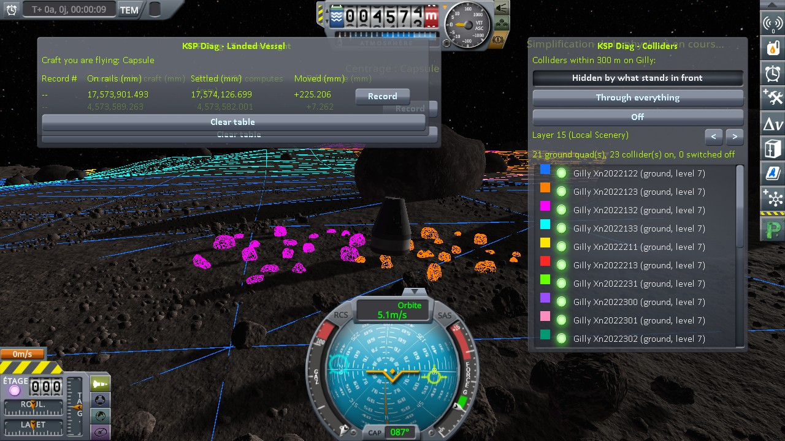
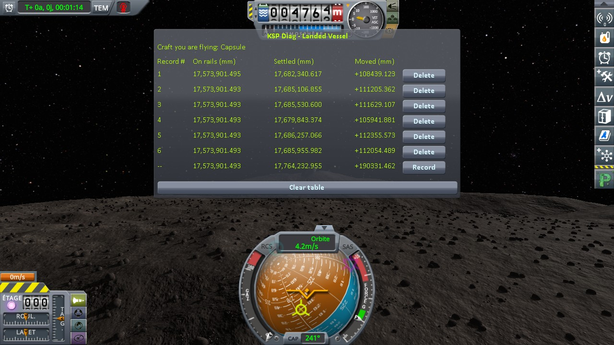
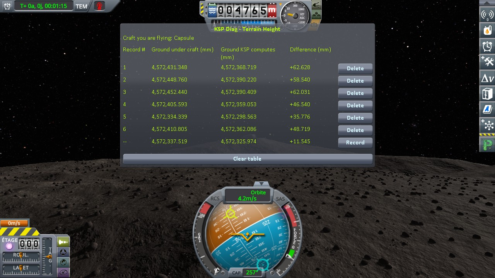
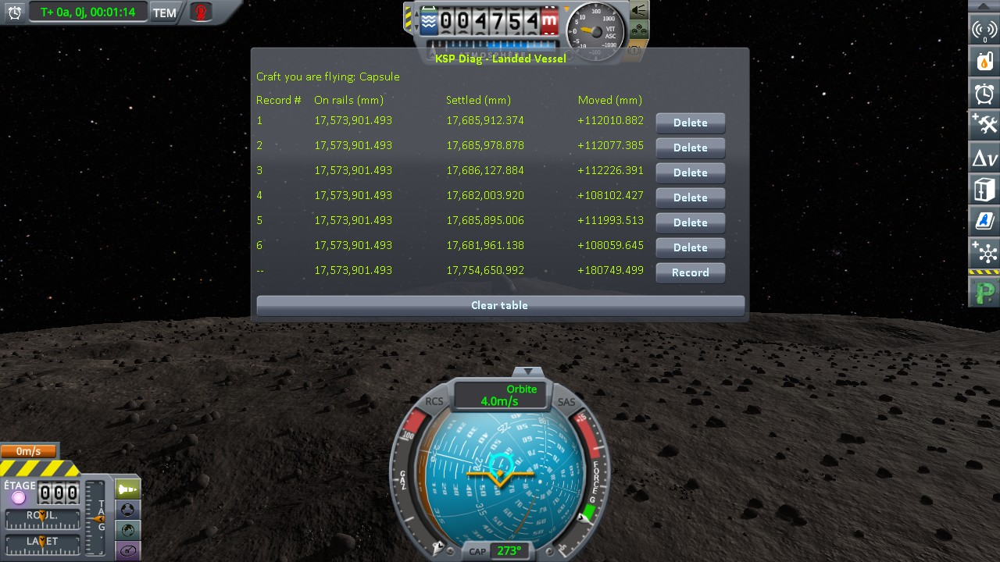
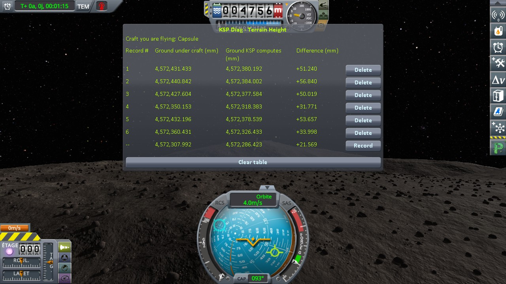

# Parallax: loading a craft on its ground

Part of [Terrain Precision Fix](../../../../README.md), [the ground](../../README.md#non-regression-tests): one non-regression test, on Parallax.

**Status: checked on Kerbin and Minmus — with Parallax installed, a craft loaded again and again
comes back as it does without Parallax.** Its capsule came back within 73 and 14 mm without this
mod, and within 0.010 and 0.044 mm with it. On Gilly, the save of the loading protocol cannot be used
with Parallax: its rocks grow where the capsule stands.

## The test

KSP 1.12.5 with Harmony, ModuleManager, KSP Community Fixes 1.41.1,
[Parallax Continued](https://github.com/Gameslinx/Parallax-Continued) 1.0.5 with its stock textures and what
it requires, Deferred, both instruments,
[KSP Diag - Landed Vessel](https://github.com/lhervier/KSP-Diag-LandedVessel) and
[KSP Diag - Terrain Height](https://github.com/lhervier/KSP-Diag-TerrainHeight), and
[KSP-Util-MCPServer](https://github.com/lhervier/KSP-Util-MCPServer), which plays the protocol; this mod with its
defaults (at `logLevel = Debug`), or not.

**The protocol**: [the loading protocol](../../checking/loading-protocol.md), played by its
script, [`run-loading.py`](../../../../diag/ground/automation/run-loading.py), on three of its saves, made without
Parallax: a Mk1 capsule on a flat FL-T100 tank, landed on
[Kerbin](../../../../diag/ground/checking/loading/reload-kerbin-2parts.sfs),
[Minmus](../../../../diag/ground/checking/loading/reload-minmus-2parts.sfs) and
[Gilly](../../../../diag/ground/checking/loading/reload-gilly-2parts.sfs). Each save loaded six times
without this mod, then six times with it, both instruments recording at each load.

## Kerbin and Minmus

**Without this mod**, the ground comes back at another height at every load, and the capsule with it, as
without Parallax.

**With this mod**, the ground and the capsule come back to the same place.

Spread over the six loads, read off the screenshots below:

| | Kerbin, without this mod | Kerbin, with this mod | Minmus, without this mod | Minmus, with this mod |
|---|---|---|---|---|
| *Settled* (KSP Diag - Landed Vessel) | 72.945 mm | 0.010 mm | 13.866 mm | 0.044 mm |
| *Moved* (KSP Diag - Landed Vessel) | −10.815 to +62.130 mm | +0.007 to +0.017 mm | −5.927 to +7.939 mm | −0.070 to −0.025 mm |
| *Ground under craft* (KSP Diag - Terrain Height) | 72.913 mm | 0.005 mm | 13.879 mm | 0.017 mm |

The tables of Kerbin

The tables of Minmus

## Gilly: its rocks grow where the capsule stands

The save of Gilly was made on bare ground, without Parallax. With Parallax, two groups of its rocks grow
right there, around the tank. The capsule goes off rails inside them at every load and is thrown off; on
Gilly, nothing holds it back: *Moved* from +105.9 to +112.4 m without this mod, and from +108.1 to
+112.2 m with it. The test reads nothing there, without this mod as with it.

*The save of Gilly loaded without this mod, the game paused right after the load, with
[KSP Diag - Colliders](https://github.com/lhervier/KSP-Diag-Colliders) installed.*

The tables of Gilly

The logs, what the script printed and every line it recorded are in
[`diag`](../../../../diag/ground/README.md#with-parallax).
