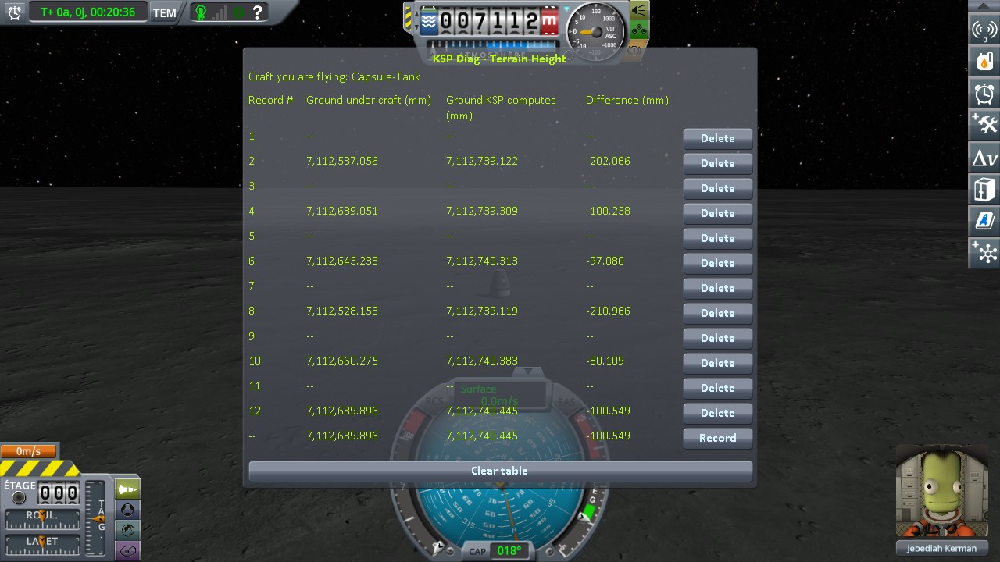
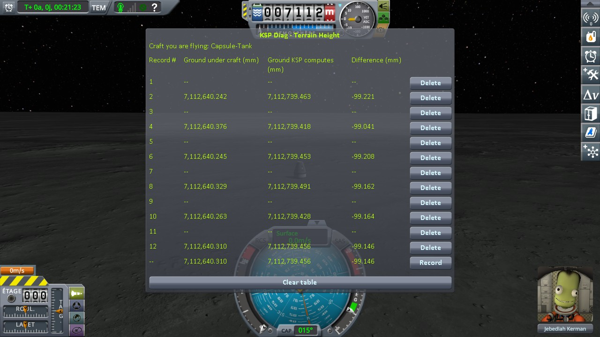
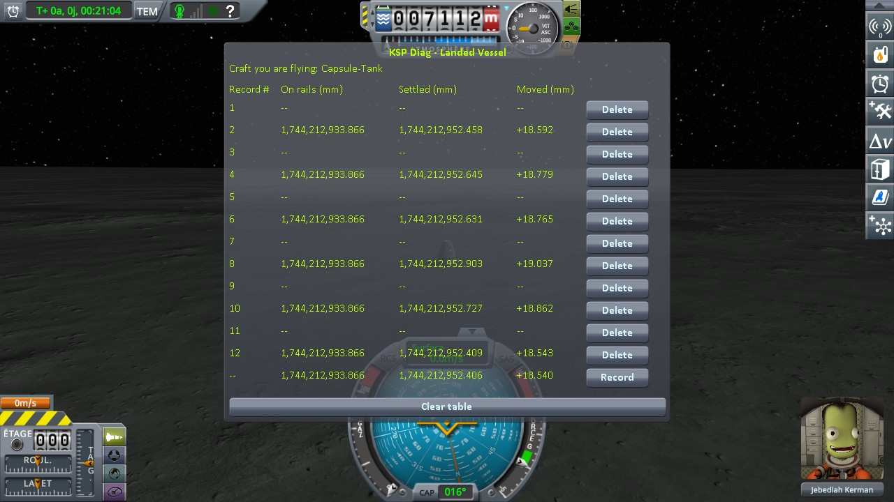
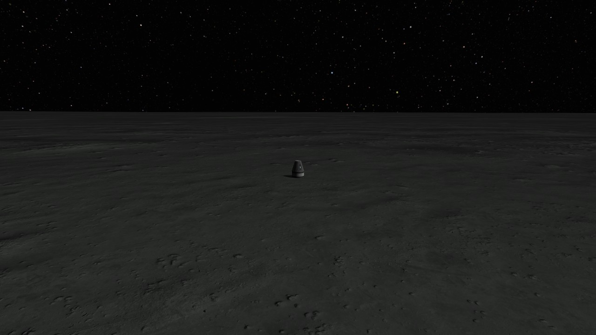
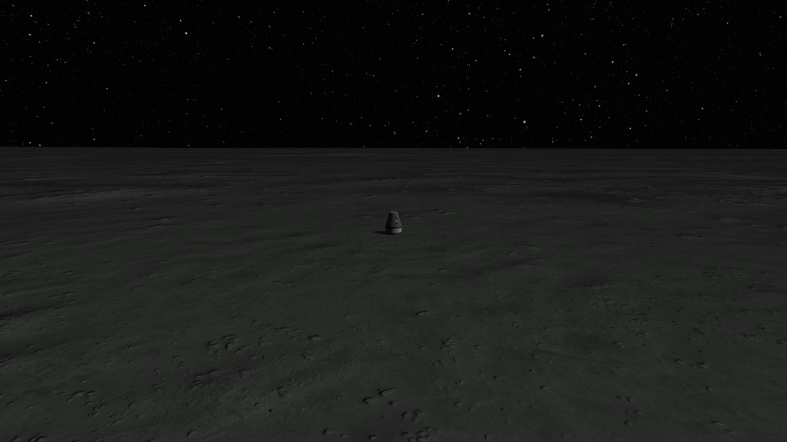
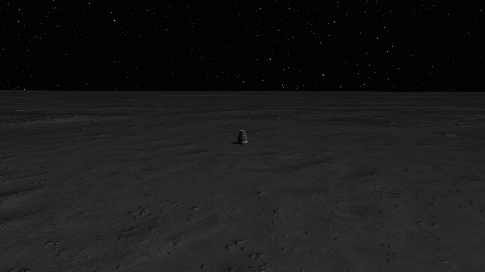
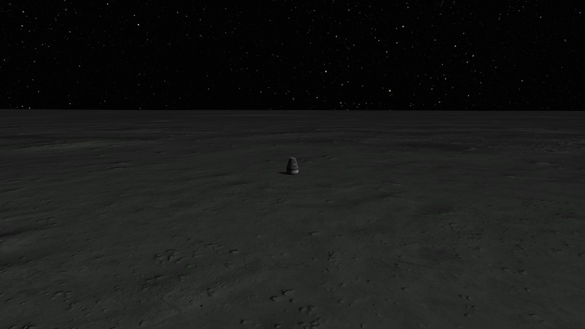
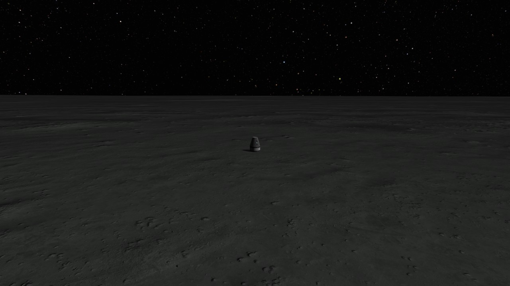
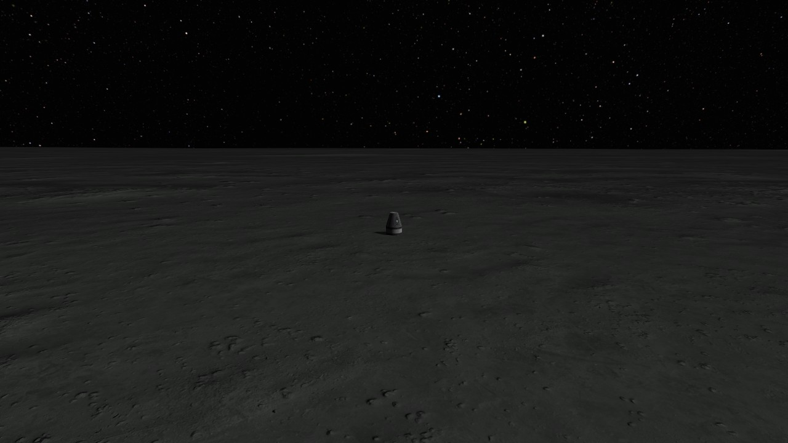

# Real Solar System: switching to a craft left parked, on the Moon

Part of [Terrain Precision Fix](../../../../README.md), [the ground](../../README.md#non-regression-tests): one non-regression test, on Real Solar System.

**Status: checked on the Moon — switched to from 3 km away, a craft left parked comes back to the same
ground, and Real Solar System's ground workaround, which runs at that moment, has nothing to correct.**
Over six switches, the parked capsule came to rest within 0.380 mm with this mod, 0.494 mm with the
workaround built out, against 132.0 mm without this mod.

## Why

Real Solar System's ground workaround runs whenever a landed craft goes off rails
([Real Solar System: the ground workaround](the-ground-workaround.md)). A save loaded is one of those
moments; another is the player switching to a craft left parked far away. A craft beyond the distance at
which the game keeps it loaded is not loaded at all: switched to from the map view (*Switch To*), the game
opens the flight again on it, builds the quads under it, and hands it back to physics, where the workaround
runs. If this mod and the workaround got in each other's way, the workaround would move the capsule
(`Moving Vessel` in `KSP.log`), or the capsule would come to rest at another height at each switch.

The Moon, for the reasons given in
[Coming back to a craft left parked, on the Moon](coming-back-to-a-craft-left-parked-on-the-moon.md#why):
the same capsule, the same site, and a rover that drives there.

## The test

KSP 1.12.5 with Harmony, ModuleManager, KSP Community Fixes 1.41.1, Real Solar System 20.1.3.0 and what it
requires (Kopernicus 248, Modular Flight Integrator, KSPTextureLoader, the RSS textures), both instruments,
[KSP Diag - Landed Vessel](https://github.com/lhervier/KSP-Diag-LandedVessel) and
[KSP Diag - Terrain Height](https://github.com/lhervier/KSP-Diag-TerrainHeight), and
[KSP-MCPServer](https://github.com/lhervier/KSP-MCPServer), which plays the protocol. Three sessions:

- without this mod, Real Solar System as released;
- with this mod at its defaults (at `logLevel = Debug`), Real Solar System as released;
- with this mod, Real Solar System built without its ground workaround, as in
  [Turning it off](the-ground-workaround.md#what-it-does)
  ([`rss-20.1.3-without-its-ground-workaround.diff`](../../../../diag/ground/non-regression/real-solar-system/the-ground-workaround/rss-20.1.3-without-its-ground-workaround.diff)).

**The save**, [`switch-moon-rss.sfs`](../../../../diag/ground/non-regression/real-solar-system/switching-to-a-craft-left-parked-on-the-moon/switch-moon-rss.sfs),
made without this mod from the save of
[Coming back to a craft left parked, on the Moon](coming-back-to-a-craft-left-parked-on-the-moon.md#the-test):
the same Mk1 command pod on an FL-T100 tank, landed at latitude 0.6741°, longitude 23.4730°, and the same
rover, driven due south from its starting spot to latitude 0.5741°, about 3 km from the capsule, then
saved. You
are flying the rover when the save opens, the capsule is its target, and it is too far away to be loaded:
the instruments read nothing until you switch to it.

**The protocol**:
[the protocol of switching to a craft far away](../../checking/switching-protocol.md),
with the switch made from the map view, the capsule being out of reach of the switch vessel key. Load the
save and press *Record* (the line stays empty, the capsule is not loaded); open the map view, select the
capsule, *Switch To*; once the flight is open on it, give it four seconds, and press *Record*. Six rounds,
the same save loaded each time. Played by the protocol's script,
[`run-switching.py`](../../../../diag/ground/automation/run-switching.py), which makes the same switch, and takes a
screenshot of the scene after each one:

```
python run-switching.py --folder <your game> --save switch-moon-rss --rounds 6 --scene-shots
```

## Six switches

Read off the screenshots below:

| | without this mod | with this mod | with this mod, workaround built out |
|---|---|---|---|
| *Moved* after each switch, rounds 1 to 6 (KSP Diag - Landed Vessel) | −84.528, +17.492, +21.707, −93.372, +38.645, +18.399 mm | +18.812, +18.781, +18.711, +18.853, +18.593, +18.974 mm | +18.592, +18.779, +18.765, +19.037, +18.862, +18.543 mm |
| *Settled*, spread over the six switches (KSP Diag - Landed Vessel) | 132.018 mm | 0.380 mm | 0.494 mm |
| *Ground under craft*, spread over the six switches (KSP Diag - Terrain Height) | 132.122 mm | 0.134 mm | 0.160 mm |

**Without this mod**, the ground under the capsule is built at another height at each switch, and the
capsule comes to rest with it.

**With this mod**, the ground comes back to the same place at every switch, and the capsule with it, within
half a millimetre, with or without the workaround. The capsule comes to rest 18.8 mm above the height the
save holds, the same at every switch: the save was made without this mod, and every round starts from
that same saved height ([Existing saves](../../../common/existing-saves.md)).

**The workaround.** Real Solar System logs `[RSS-VGPE] CheckGroundCollision()` each time it runs: twice per
round as released, once as the save is loaded, for the rover, and once at the switch, for the capsule. It
never moved the capsule, in either session: no `Moving Vessel` line names it. Without this mod, it moved
the rover once, as a save was loaded (`Moving Vessel up 0.116m`). Built out, it logs
`[RSS-VGPE] VesselGroundPositionEnhancer neutralized` instead, and nothing else.

<p class="thumbs">
<a href="../../../../imgs/ground/non-regression/real-solar-system/switching-to-a-craft-left-parked-on-the-moon/landed-vessel-without-this-mod.jpg"></a>
<a href="../../../../imgs/ground/non-regression/real-solar-system/switching-to-a-craft-left-parked-on-the-moon/terrain-height-without-this-mod.jpg"></a>
<a href="../../../../imgs/ground/non-regression/real-solar-system/switching-to-a-craft-left-parked-on-the-moon/landed-vessel-fix.jpg"></a>
<a href="../../../../imgs/ground/non-regression/real-solar-system/switching-to-a-craft-left-parked-on-the-moon/terrain-height-fix.jpg"></a>
<a href="../../../../imgs/ground/non-regression/real-solar-system/switching-to-a-craft-left-parked-on-the-moon/landed-vessel-fix-workaround-built-out.jpg"></a>
<a href="../../../../imgs/ground/non-regression/real-solar-system/switching-to-a-craft-left-parked-on-the-moon/terrain-height-fix-workaround-built-out.jpg"></a>
</p>

<details>
<summary>The tables, session by session</summary>


</details>

<p class="thumbs">
<a href="../../../../imgs/ground/non-regression/real-solar-system/switching-to-a-craft-left-parked-on-the-moon/round1-without-this-mod.jpg"></a>
<a href="../../../../imgs/ground/non-regression/real-solar-system/switching-to-a-craft-left-parked-on-the-moon/round2-without-this-mod.jpg"></a>
<a href="../../../../imgs/ground/non-regression/real-solar-system/switching-to-a-craft-left-parked-on-the-moon/round3-without-this-mod.jpg"></a>
<a href="../../../../imgs/ground/non-regression/real-solar-system/switching-to-a-craft-left-parked-on-the-moon/round4-without-this-mod.jpg"></a>
<a href="../../../../imgs/ground/non-regression/real-solar-system/switching-to-a-craft-left-parked-on-the-moon/round5-without-this-mod.jpg"></a>
<a href="../../../../imgs/ground/non-regression/real-solar-system/switching-to-a-craft-left-parked-on-the-moon/round6-without-this-mod.jpg"></a>
</p>

<details>
<summary>The capsule after each switch, without this mod</summary>


</details>

The logs, what the script printed and every line it recorded are in
[`diag`](../../../../diag/ground/README.md#on-real-solar-system).
