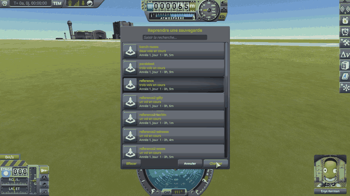

# How KSP builds the ground

Part of [Terrain Precision Fix](../../README.md): how KSP 1.12.5 builds the ground under a craft, and places what
stands on it — the runways and buildings, the rocks, the grass and the trees, Breaking Ground's surface features —
and why none of it comes back at the same height twice. This page describes the stock game.

## When KSP builds the ground again

KSP does not keep the ground it built: it builds it again, over and over, while you play. And every
time it does, the surface lands at a slightly different height — a little higher or a little lower,
at random, a few centimetres on Kerbin and up to seventy on Earth in Real Solar System. The runway, the
launchpad and the buildings of the KSC, and the bases a mod such as Kerbal Konstructs plants on a body,
are placed the same way, each at a height of its own, apart from the ground beside it. Loading a save
is only the moment everybody notices. It happens just as well:

- **when a save is loaded**, or the scene changes: the whole ground is built anew, and every runway and
  building is placed again;
- **when you come back to a craft left parked.** Its position was recorded while it rested on the
  ground as it stood then. As you fly back towards it, KSP builds that ground again, at a different
  height, and puts the craft back at its recorded position — on a ground that is no longer the one it
  was resting on;
- **when you switch to a craft far away**, which is put down the same way, on a ground it was not
  standing on when it was left;
- **while you drive.** Every 500 m the craft you fly travels, KSP moves its whole world back onto it,
  builds the ground under you again, and moves the runway beside you with it — in the middle of the
  drive, with nothing loaded and no scene changed.

## Why the moving ground matters

Each time, it is a coin toss between two outcomes.

**The ground comes back lower than it was.** Your craft is now hovering a couple of centimetres above
it, so it drops those two centimetres. You never notice, and nothing breaks.

**The ground comes back higher than it was.** Your craft is now *inside* the ground — and the physics
engine will not leave two solid things overlapping. It pushes them apart, hard, in the only direction
available: up. Your craft gets launched.



*KSP 1.12 without this mod, with [KSP Community Fixes](https://github.com/KSPModdingLibs/KSPCommunityFixes)
as the only mod installed. A pod on an empty fuel tank, parked in the grass at the KSC, saved, then reloaded
from the pause menu, several times if needed — nothing touched in between.*

That second case is the symptom everybody already knows. The lander that twitches, hops or flips the
moment the scene finishes loading. The base that sat perfectly flush yesterday and is buried up to
the hatches today. The big base that tears itself apart the very first time you load it, and never
again afterwards. A craft with many parts spread over a wide area gives the coin toss more chances
to land the wrong way up. The other moments do the same damage, only less visibly: from 200 m away you
see little of a parked craft jumping, and a rover that hops while driving looks like a bump in the
road — on Earth, it was seen to jump when the ground rose under it.

## A float at planet scale

KSP places the ground, and everything that stands on it, from the centre of the body. The position of a terrain
quad is a vector from that centre to the quad, computed in double precision, as long as the radius of the body.
It is then handed to a Unity `Transform`, whose position is a float:

```csharp
// PQ.SetupQuad — positionPlanet is a Vector3d, localPosition a Vector3 of floats
quadTransform.localPosition = positionPlanet;
```

A float has 24 significant bits. Holding a length that large, it can only change in steps, and the value is
rounded to the nearest one, up or down. The step grows with the body:

| body | radius | float step |
|---|---|---|
| Gilly | 13 km | 0.98 mm |
| Minmus | 60 km | 3.9 mm |
| the Mun | 200 km | 15.6 mm |
| Kerbin | 600 km | 62.5 mm |
| the Moon, in Real Solar System | 1 737 km | 125 mm |
| Earth, in Real Solar System | 6 371 km | 500 mm |

The same long vector goes into a float for everything the ground carries:

- **the ground**: each quad, in `PQ.SetupQuad`, and then each vertex inside its quad, in
  `PQS.BuildVertexSurfaceRelative`, which goes through the same long vectors. The quad origin and each vertex are
  rounded on their own, so the mesh is not only moved but slightly bent;
- **the statics** — the runway, the launchpad and the buildings of the KSC, the launch sites of Making History,
  the bases of Kerbal Konstructs — in `PQSCity.Orientate` and its twin `PQSCity2`: a static hangs from the
  terrain sphere, whose origin is the centre of the body, at a position as long as its radius;
- **the scatter** — the rocks, the grass and the trees — and **Breaking Ground's surface features**: their
  objects are built on the vertices of a quad, but under a holder of their own, which stays under the terrain
  sphere with `localPosition = quad.positionPlanet`. Unity draws that holder from its matrix, which rounds the
  long vector its own way, not as the quad's position does: the objects stand a few steps above or below the
  ground.

Near the craft, what is left once two such vectors cancel out — the centre of the body on one side, the ground on
the other — is a short distance, but it carries the roundings of both: a few centimetres on Kerbin, tens on
Earth.

## A frame that moves: the floating origin

A rounding on its own would land the same way every time: the doubles above are exactly the same at every load
of a save. What changes is the frame they are converted into, the world position and orientation of the terrain
sphere, itself held in floats. KSP moves that frame all the time:

- **its rotation** is how the body is turned in Unity's world. KSP splits the rotation of a body between two
  angles, `CelestialBody.directRotAngle` and `Planetarium.InverseRotAngle`, and saves neither. When a save is
  loaded, the jump of the clock back to the date of the save goes into the body's own angle, which comes back
  turned by the rotation of the body over the time played since that save;
- **its translation** is where the centre of the body stands relative to the floating origin. To keep the
  numbers small around the craft, KSP moves the whole world back onto the craft you fly every time it travels
  500 m. While another landed craft is loaded nearby, it waits, and catches up all at once when that craft is
  unloaded.

A load turns the frame; flying back to a craft left parked, and driving, move it with the floating origin, as
[measured with KSP Diag - Floating Origin](https://github.com/lhervier/KSP-Diag-FloatingOrigin) on a stock
install.

The slightest change of that frame is enough. At 600 km, turning it by a thousandth of a degree moves a point by
more than 10 m, some 170 float steps: every value is rounded again, and lands on another step. That this new
frame is what draws a new rounding is read from the stock code, and every measurement taken agrees with it.
