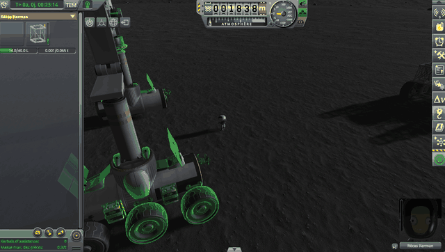
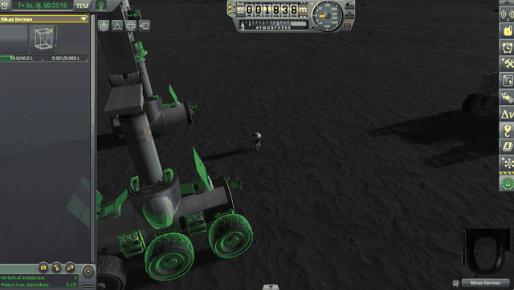

# Parts lying alone

Part of [Terrain Precision Fix](../../README.md): a part lying alone on the ground, a craft of a single part,
such as a battery, a strut or a wheel dropped in EVA construction. Unlike the ground, the statics and the
scatter, its culprit is not a rounding: stock makes such a part much heavier for 3 seconds, which softens
the pops of the parts without a suspension on the moving ground, and throws the parts with one. What it does, how this mod
takes it away, how that is checked, and what is still to check.

> **Set a wheel down on the ground in EVA construction, or reload your save: sometimes it flies off. The
> culprit is a huge weight stock adds, for 3 seconds, to every part lying alone.** That weight makes
> the pops of the parts without a suspension smaller on a ground that moves, but it throws the ones with
> a suspension higher. With the ground fixed, the parts without a suspension no longer need it, while the
> wheels keep flying off: so this mod takes that weight away.

*KSP 1.12 without this mod, with [KSP Community Fixes](https://github.com/KSPModdingLibs/KSPCommunityFixes)
and [KSP-Util-MCPServer](https://github.com/lhervier/KSP-Util-MCPServer) as the only mods installed. On the
Mun, the save [`wheel-drop-mun.sfs`](../../diag/lone-parts/checking/wheel-drop/wheel-drop-mun.sfs): in EVA
construction, Récas Kerman takes a wheel off the crane and sets it down on the ground a few metres away,
nothing touched afterwards. The countdown, added to the film, runs from the moment the wheel is let go to
the moment it moves.*

## Why it matters

EVA construction puts parts on the ground all the time: a wheel taken off a rover, a strut or a battery
set down for later. Seeing them bounce into the air and come down on the base is not pleasant.

*The film above, played again with this mod installed: KSP 1.12 with this mod,
[KSP Community Fixes](https://github.com/KSPModdingLibs/KSPCommunityFixes) and
[KSP-Util-MCPServer](https://github.com/lhervier/KSP-Util-MCPServer), the same save, the same wheel set
down at the same spot. The countdown, added to the film, runs as long after the wheel is let go as in the
film above.*

## The culprit

On stock's moving ground, a part lying alone sometimes starts inside the ground at a load, and pops out of
it. Stock, written as if the ground came back at the same height, answered the way we read it: every time
such a part goes off rails, it makes it much heavier for 3 seconds, 4 t on Kerbin, 20 t on the Mun. It
works: the pops are two to three times smaller. But a wheel, a landing leg or a landing gear presses its
spring under those tons, and is thrown high in the air when its own mass comes back, with or without the
fix of the ground.

**→ Full chapter: [The culprit: parts lying alone](the-culprit.md)**

## The fix

With the ground fixed, no part starts inside it any more, and the extra mass has nothing left to soften.
A setting of its own, `fixLonePartMass`, on by default, gives every part its own mass back as soon as stock
raises it. It does not depend on the fix of the ground: with `fixTerrain = false`, it shows what the extra
mass does on stock's moving ground.

**→ Full chapter: [The fix: parts lying alone](the-fix.md)**

## Checked

Measured on stock, then with this mod and one of its settings turned off, then with this mod as installed,
in an install with [KSP Community Fixes](https://github.com/KSPModdingLibs/KSPCommunityFixes): KSP 1.12.5,
Harmony, ModuleManager, KSP Community Fixes 1.41.1,
[KSP Diag - Landed Vessel](https://github.com/lhervier/KSP-Diag-LandedVessel), which reads how high each part
goes above where it starts (*Highest*), and [KSP-Util-MCPServer](https://github.com/lhervier/KSP-Util-MCPServer),
which plays the protocols.

- **Loading the same save**, ten times, six parts lying alone on the Mun. On stock's ground, the extra mass
  makes the pops smaller: the solar panels pop up 105 mm in the median with it, 303 mm without it. On this
  mod's ground, the parts start where they were, and read the same at every load, with it or without it.
  The wheels are thrown by metres at every load with it, on either ground, and settle within 15 mm without
  it.

  **→ Full chapter: [Checking parts lying alone: loading the same save](checking/loading.md)**

- **A wheel dropped in EVA construction**, five drops on Kerbin and five on the Mun. On stock and with
  `fixLonePartMass = false`, the wheel is thrown 13 to 15 m up on Kerbin whenever it lands on its tyre, 0.7
  to 5.3 m on the Mun at every drop; with this mod as installed, never.

  **→ Full chapter: [Checking parts lying alone: a wheel dropped in EVA construction](checking/wheel-drop.md)**

- **On the runway**, ten loads, six parts lying alone on the runway of the KSC. With this mod, the batteries
  and the panels read the same with the extra mass and without it; the wheels are thrown 13 to 14 m up
  with it, and stay within 23 mm without it.

  **→ Full chapter: [Checking parts lying alone: on the runway](checking/runway.md)**

The saves, the scripts and the `KSP.log` of every session are in
[the runs of parts lying alone](../../diag/lone-parts/README.md).

## Limits and solutions

What this mod makes worse, with the solution to each.

### Existing saves

**A part lying alone in a save made without this mod can pop up once, higher than in stock: not fixed —
read in the code, not measured.** The part was saved on the ground of one stock draw, and comes back on
this mod's ground, which can be a few centimetres higher. Under 10 cm, `Vessel.CheckGroundCollision` leaves
it where it was saved: it starts inside the ground, as at a stock load
([The culprit: parts lying alone](the-culprit.md#a-part-alone-on-the-moving-ground)), but this mod has taken
away the extra mass that made that pop smaller, and the physics pushes the part out under its own mass. It
happens at one load at most: once the save is made again with this mod, the part rests on this mod's ground,
which comes back at the same height at every load. The solution is to load the save and save it again; a
part already pushed out stays where it came to rest. The same one-time draw, for every craft, is in
[Existing saves](../common/existing-saves.md).

## Work in progress

What is still to check: why it is a question, and the test planned to answer it.

### Stock

**A tall part on a steep slope: on hold — no candidate part found yet.** Stock sinks a craft put back onto
a slope, whatever the ground, and a part alone over 3 m tall standing there could still need the extra
mass. A flat part is never sunk: a structural panel slid off a slope of 30° and came to rest on 21.9°.

**→ Full chapter: [A tall part on a steep slope](work-in-progress/a-large-part-on-a-steep-slope.md)**

### KAS

**A pylon linked to a craft: planned — read in the source, not played.** A pylon of KAS set on the ground is
a part lying alone, linked to another craft: with this mod, whatever pulls on the link at a load pulls on
the pylon's own mass, 20 kg, instead of tons.

**→ Full chapter: [KAS: a pylon linked to a craft](work-in-progress/kas/a-pylon-linked-to-a-craft.md)**
