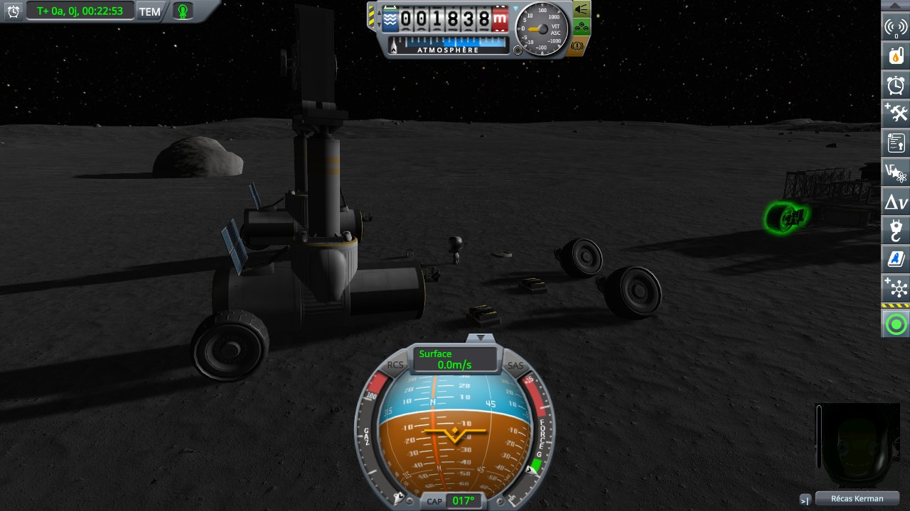
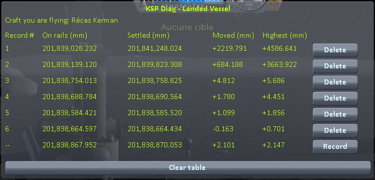
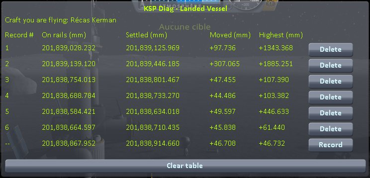
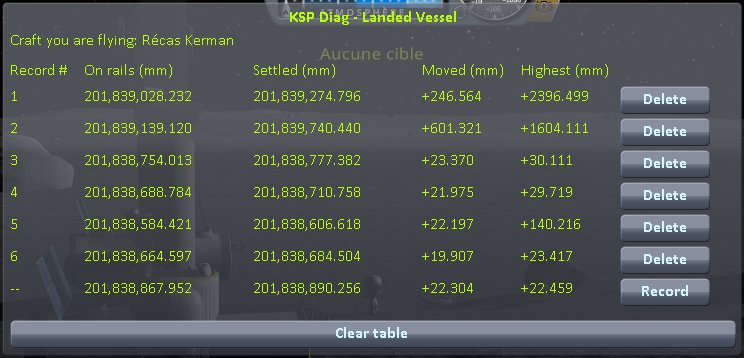
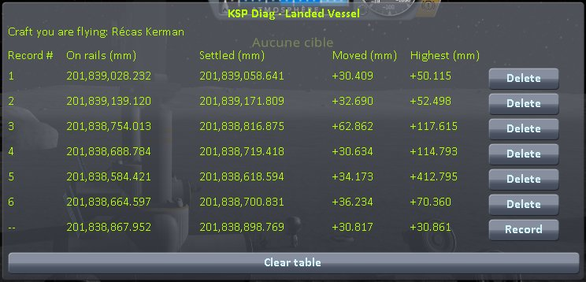
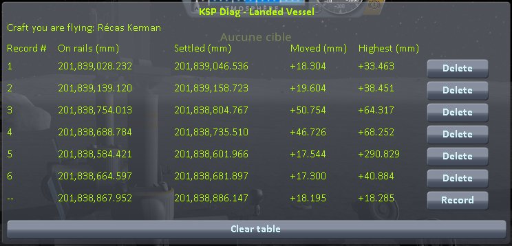
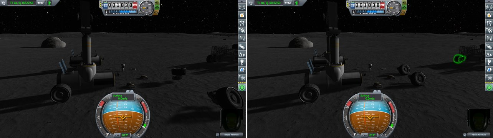

# Checking parts lying alone: loading the same save

Part of [Terrain Precision Fix](../../../README.md), [parts lying alone](../README.md#checked): the measurements that check [their culprit](../the-culprit.md), parts left alone on the Mun around a crane, the same save loaded ten times in each of four installs: with and without this mod's ground, with and without stock's extra mass.

[KSP Diag - Landed Vessel](https://github.com/lhervier/KSP-Diag-LandedVessel) takes the readings, on its
target. *On rails* is the distance from the centre of the body to the part where the load puts it, before
physics starts; *Highest*, how far above that the part went once physics started, before it came to rest.
A part that pops out of the ground reads its pop there; a part that drops onto the ground reads 0. The
instrument keeps both for every craft loaded around, so each part can be set as target once they have all
come to rest. Its page has its method.

This fix is built on top of [KSP Community Fixes](https://github.com/KSPModdingLibs/KSPCommunityFixes),
the base most players run, so the campaign on this page is run in an install that has it: KSP 1.12.5 with
Harmony, ModuleManager, KSP Community Fixes 1.41.1, the instrument, and
[KSP-Util-MCPServer](https://github.com/lhervier/KSP-Util-MCPServer), which plays the protocol — and this
mod, or not. The game is played in French: the parts are named in French in the window.

## The protocol

Copy [`lone-parts-mun.sfs`](../../../diag/lone-parts/checking/loading/lone-parts-mun.sfs) into the folder of
a sandbox game and load it: Récas Kerman on EVA on the Mun, next to a crane and a truck, and around them six
parts lying alone, each a craft of a single part: two TR-2L rover wheels, two Z-400 batteries, SP-W 3x2
solar panels and a cubic octagonal strut. They were taken off the crane in EVA construction and dropped
there. Then, by hand, ten times:

1. load the save, and wait 15 seconds: every part has come to rest;
2. set each part as target in turn, in the order of the table below, and *Record*;
3. clear the table before the next load.



*The save loaded with this mod as installed, 5.5 seconds in: the crane on the left, the truck on the right,
Récas between them, the parts lying around.*

Four installs, ten loads each, from the same save:

| Install | The ground | Stock's extra mass |
|---|---|---|
| **on stock**: without this mod | stock's | on |
| **this mod, `fixTerrain = false`** | stock's | turned off by this mod |
| **this mod, `fixLonePartMass = false`** | this mod's | on |
| **this mod as installed** | this mod's | turned off by this mod |

The campaign is played by [`run-lone-parts.py`](../../../diag/lone-parts/automation/run-lone-parts.py), which
does what the protocol asks, and takes a screenshot of the table after each load and one of the scene 5.5
seconds into each load. In each install, the log of the session, what the script printed and every line it
recorded are in [`diag/lone-parts/checking/loading/`](../../../diag/lone-parts/checking/loading/). With this
mod and `fixLonePartMass` on, the log says, for each part at each load:

```
[KSPFixTerrainPrecision] [DEBUG] Lone part mass fix: 'Pile rechargeable Z-400' given back its own mass, 0.020 t, instead of 20 t
```

60 such lines in each of the two installs where it is on, none in the two others.

## On stock

*Highest*, in millimetres, as recorded:

| load | wheel 1 | wheel 2 | battery 1 | battery 2 | solar panels | strut |
|---|---|---|---|---|---|---|
| 1 | +4,586.6 | +3,663.9 | +5.7 | +4.5 | +1.9 | +0.7 |
| 2 | +1,343.4 | +1,885.3 | +107.4 | +103.4 | +446.6 | +61.4 |
| 3 | +2,212.4 | +2,737.6 | +101.8 | +56.4 | +367.6 | +49.0 |
| 4 | +2,734.9 | +3,145.0 | +27.9 | +27.1 | +109.8 | +19.8 |
| 5 | +2,396.5 | +1,604.1 | +30.1 | +29.7 | +140.2 | +23.4 |
| 6 | +3,245.8 | +1,743.9 | +24.4 | +25.2 | +100.1 | +18.2 |
| 7 | +1,736.6 | +1,656.4 | +20.2 | +19.4 | +70.5 | +15.6 |
| 8 | +3,832.7 | +4,889.5 | +38.7 | +35.5 | +188.6 | +30.5 |
| 9 | +2,378.9 | +13,720.3 | +5.9 | +4.8 | +7.8 | +2.0 |
| 10 | +2,265.6 | +1,650.5 | +4.5 | +3.4 | +0.0 | +0.0 |

The ground comes back at another height at every load, and the parts with it: at the first and the last
loads, close to where it was, and the parts barely move; at the others, a few centimetres higher, and
they pop out of it, the solar panels by up to 44.7 cm. The two wheels are thrown at every load, by 1.3 to
13.7 m.

<p class="thumbs">
<a href="../../../imgs/lone-parts/checking/loading/stock-load01.jpg"></a>
<a href="../../../imgs/lone-parts/checking/loading/stock-load02.jpg"></a>
<a href="../../../imgs/lone-parts/checking/loading/stock-load03.jpg"></a>
<a href="../../../imgs/lone-parts/checking/loading/stock-load04.jpg"></a>
<a href="../../../imgs/lone-parts/checking/loading/stock-load05.jpg"></a>
<a href="../../../imgs/lone-parts/checking/loading/stock-load06.jpg"></a>
<a href="../../../imgs/lone-parts/checking/loading/stock-load07.jpg"></a>
<a href="../../../imgs/lone-parts/checking/loading/stock-load08.jpg"></a>
<a href="../../../imgs/lone-parts/checking/loading/stock-load09.jpg"></a>
<a href="../../../imgs/lone-parts/checking/loading/stock-load10.jpg"></a>
</p>

<details>
<summary>The 10 screenshots</summary>


</details>

## This mod, `fixTerrain = false`

Stock's ground, without stock's extra mass:

| load | wheel 1 | wheel 2 | battery 1 | battery 2 | solar panels | strut |
|---|---|---|---|---|---|---|
| 1 | +56.1 | +56.9 | +103.4 | +186.2 | +432.9 | +118.5 |
| 2 | +50.1 | +52.5 | +117.6 | +114.8 | +412.8 | +70.4 |
| 3 | +33.5 | +38.5 | +64.3 | +68.3 | +290.8 | +40.9 |
| 4 | +37.1 | +38.9 | +72.5 | +76.6 | +315.6 | +42.1 |
| 5 | +10.6 | +12.4 | +7.5 | +4.4 | +0.0 | +0.0 |
| 6 | +32.8 | +32.9 | +35.2 | +30.3 | +211.2 | +33.6 |
| 7 | +54.7 | +53.5 | +132.1 | +123.1 | +412.6 | +87.0 |
| 8 | +33.5 | +32.7 | +42.4 | +36.6 | +234.6 | +37.2 |
| 9 | +37.6 | +37.6 | +54.8 | +69.4 | +357.8 | +41.8 |
| 10 | +13.0 | +14.5 | +8.7 | +5.8 | +0.0 | +0.0 |

The parts without a suspension pop out of the ground at 8 loads out of 10, and higher than on stock: the
batteries by 60 to 69 mm in the median, against 26 on stock; the solar panels by 303 mm, against 105; the
strut by 41 mm, against 19. The wheels pop out like the others, by 11 to 57 mm, and are no longer thrown.

<p class="thumbs">
<a href="../../../imgs/lone-parts/checking/loading/no-terrain-load01.jpg"></a>
<a href="../../../imgs/lone-parts/checking/loading/no-terrain-load02.jpg"></a>
<a href="../../../imgs/lone-parts/checking/loading/no-terrain-load03.jpg"></a>
<a href="../../../imgs/lone-parts/checking/loading/no-terrain-load04.jpg"></a>
<a href="../../../imgs/lone-parts/checking/loading/no-terrain-load05.jpg"></a>
<a href="../../../imgs/lone-parts/checking/loading/no-terrain-load06.jpg"></a>
<a href="../../../imgs/lone-parts/checking/loading/no-terrain-load07.jpg"></a>
<a href="../../../imgs/lone-parts/checking/loading/no-terrain-load08.jpg"></a>
<a href="../../../imgs/lone-parts/checking/loading/no-terrain-load09.jpg"></a>
<a href="../../../imgs/lone-parts/checking/loading/no-terrain-load10.jpg"></a>
</p>

<details>
<summary>The 10 screenshots</summary>


</details>

## This mod, `fixLonePartMass = false`

This mod's ground, with stock's extra mass:

| load | wheel 1 | wheel 2 | battery 1 | battery 2 | solar panels | strut |
|---|---|---|---|---|---|---|
| 1 | +2,243.4 | +2,037.5 | +4.8 | +3.6 | +0.0 | +0.0 |
| 2 | +3,533.9 | +2,000.7 | +4.8 | +3.6 | +0.0 | +0.0 |
| 3 | +886.4 | +1,673.5 | +4.8 | +3.6 | +0.0 | +0.0 |
| 4 | +5,554.3 | +3,151.3 | +4.8 | +3.6 | +0.0 | +0.0 |
| 5 | +3,265.6 | +1,662.7 | +4.8 | +3.6 | +0.0 | +0.0 |
| 6 | +5,450.5 | +2,190.8 | +4.8 | +3.6 | +0.0 | +0.0 |
| 7 | +2,246.0 | +1,264.1 | +4.8 | +3.6 | +0.0 | +0.0 |
| 8 | +1,774.2 | +1,512.3 | +4.8 | +3.6 | +0.0 | +0.0 |
| 9 | +1,709.0 | +2,579.2 | +4.8 | +3.6 | +0.0 | +0.0 |
| 10 | +3,432.4 | +1,503.1 | +4.8 | +3.6 | +0.0 | +0.0 |

The parts without a suspension read the same at every load, to the tenth of a millimetre: the ground
comes back where it was, and they start where they were. The solar panels and the strut never go above
it; the batteries go 3.6 and 4.8 mm up. The wheels are still thrown at every load, by 0.9 to 5.6 m.

<p class="thumbs">
<a href="../../../imgs/lone-parts/checking/loading/no-lone-part-mass-load01.jpg"></a>
<a href="../../../imgs/lone-parts/checking/loading/no-lone-part-mass-load02.jpg"></a>
<a href="../../../imgs/lone-parts/checking/loading/no-lone-part-mass-load03.jpg"></a>
<a href="../../../imgs/lone-parts/checking/loading/no-lone-part-mass-load04.jpg"></a>
<a href="../../../imgs/lone-parts/checking/loading/no-lone-part-mass-load05.jpg"></a>
<a href="../../../imgs/lone-parts/checking/loading/no-lone-part-mass-load06.jpg"></a>
<a href="../../../imgs/lone-parts/checking/loading/no-lone-part-mass-load07.jpg"></a>
<a href="../../../imgs/lone-parts/checking/loading/no-lone-part-mass-load08.jpg"></a>
<a href="../../../imgs/lone-parts/checking/loading/no-lone-part-mass-load09.jpg"></a>
<a href="../../../imgs/lone-parts/checking/loading/no-lone-part-mass-load10.jpg"></a>
</p>

<details>
<summary>The 10 screenshots</summary>


</details>

## This mod as installed

This mod's ground, without stock's extra mass:

| load | wheel 1 | wheel 2 | battery 1 | battery 2 | solar panels | strut |
|---|---|---|---|---|---|---|
| 1 | +13.4 | +14.4 | +7.9 | +5.4 | +0.0 | +0.0 |
| 2 | +13.4 | +14.2 | +7.9 | +5.3 | +0.0 | +0.0 |
| 3 | +13.0 | +14.9 | +7.9 | +5.3 | +0.0 | +0.0 |
| 4 | +13.3 | +14.2 | +7.9 | +5.3 | +0.0 | +0.0 |
| 5 | +13.1 | +14.3 | +7.9 | +5.3 | +0.0 | +0.0 |
| 6 | +13.1 | +15.0 | +7.9 | +5.3 | +0.0 | +0.0 |
| 7 | +13.2 | +14.2 | +7.9 | +5.3 | +0.0 | +0.0 |
| 8 | +13.3 | +14.1 | +7.9 | +5.4 | +0.0 | +0.0 |
| 9 | +13.0 | +14.1 | +8.0 | +5.4 | +0.0 | +0.0 |
| 10 | +13.1 | +14.2 | +7.9 | +5.3 | +0.0 | +0.0 |

Every part reads the same at every load. The solar panels and the strut never go above where they
start; the batteries go 5.3 and 7.9 mm up, the wheels 13 and 15 mm, and none is thrown.

<p class="thumbs">
<a href="../../../imgs/lone-parts/checking/loading/fix-load01.jpg"></a>
<a href="../../../imgs/lone-parts/checking/loading/fix-load02.jpg"></a>
<a href="../../../imgs/lone-parts/checking/loading/fix-load03.jpg"></a>
<a href="../../../imgs/lone-parts/checking/loading/fix-load04.jpg"></a>
<a href="../../../imgs/lone-parts/checking/loading/fix-load05.jpg"></a>
<a href="../../../imgs/lone-parts/checking/loading/fix-load06.jpg"></a>
<a href="../../../imgs/lone-parts/checking/loading/fix-load07.jpg"></a>
<a href="../../../imgs/lone-parts/checking/loading/fix-load08.jpg"></a>
<a href="../../../imgs/lone-parts/checking/loading/fix-load09.jpg"></a>
<a href="../../../imgs/lone-parts/checking/loading/fix-load10.jpg"></a>
</p>

<details>
<summary>The 10 screenshots</summary>


</details>



*5.5 seconds into the second load: on stock, left; with this mod as installed, right.*

## What the measurements say

- **On stock's ground, the extra mass helps the parts without a suspension.** The ground moves at every
  load, the parts start inside it, and the physics pushes them out; with the extra mass, they pop out
  about half as high.
- **On this mod's ground, it has nothing left to help.** The parts start where they were, at every load,
  and settle the same way, with or without it: a few millimetres at most, the same at every load.
- **It throws the parts with a suspension, on either ground.** With it, the wheels go up by metres at
  every load, as high on this mod's ground as on stock's; without it, they settle as the other parts do.
