# Checking parts lying alone: on the runway

Part of [Terrain Precision Fix](../../../README.md), [parts lying alone](../README.md#checked): the measurements that check [their culprit](../the-culprit.md) on a static, parts left alone on the runway of the KSC, the same save loaded ten times on stock, with this mod and `fixLonePartMass = false`, and with this mod as installed.

A part dropped on the runway lies on a static, not on the terrain, and stock makes it heavier there as
anywhere else. The runway moves at every load on stock, as the ground does
([the statics](../../statics/README.md)); this mod places it where it was. The readings, the install and the
script are those of [Loading the same save](loading.md).

## The protocol

Copy [`lone-parts-runway.sfs`](../../../diag/lone-parts/checking/runway/lone-parts-runway.sfs) into the
folder of a sandbox game and load it: Bill Kerman on EVA on the runway of the KSC, next to the rover of
[`Diag2-Rover.craft`](../../../diag/lone-parts/checking/runway/Diag2-Rover.craft), and around them six parts
lying alone, each a craft of a single part, taken off the rover in EVA construction and dropped there: two
OX-STAT photovoltaic panels, two Z-400 batteries and two TR-2L rover wheels. Then, by hand, ten times:

1. load the save, and wait 15 seconds: every part has come to rest;
2. set each part as target in turn, in the order of the table below, and *Record*;
3. clear the table before the next load.

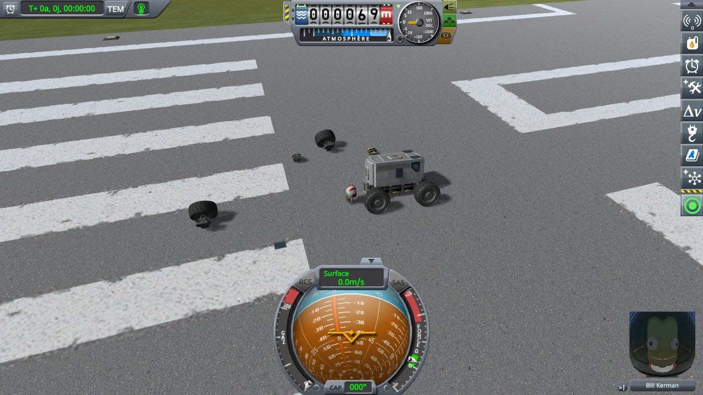

*The save loaded with this mod as installed, 5.5 seconds in.*

The campaign is played by [`run-lone-parts.py`](../../../diag/lone-parts/automation/run-lone-parts.py). In
each install, the log of the session, what the script printed and every line it recorded are in
[`diag/lone-parts/checking/runway/`](../../../diag/lone-parts/checking/runway/). With this mod as installed,
the log has the line of the fix 60 times, once for each part at each load; none in the two other installs.

## On stock

*Highest*, in millimetres, as recorded:

| load | panel 1 | panel 2 | battery 1 | battery 2 | wheel 1 | wheel 2 |
|---|---|---|---|---|---|---|
| 1 | +120.1 | +120.1 | +5.6 | +5.8 | +14,444.5 | +14,408.8 |
| 2 | +105.0 | +105.0 | +0.0 | +0.0 | +13,453.3 | +13,588.7 |
| 3 | +101.7 | +101.7 | +0.0 | +0.0 | +13,510.6 | +13,575.8 |
| 4 | +101.5 | +101.5 | +0.0 | +0.0 | +13,501.6 | +13,439.3 |
| 5 | +110.4 | +110.4 | +0.0 | +1.0 | +13,455.1 | +13,267.5 |
| 6 | +128.5 | +128.5 | +13.8 | +10.6 | +14,434.1 | +14,416.0 |
| 7 | +0.0 | +0.0 | +0.0 | +0.0 | +15,741.3 | +137.2 |
| 8 | +135.4 | +135.5 | +20.7 | +14.6 | +14,554.8 | +14,254.8 |
| 9 | +130.1 | +130.1 | +15.3 | +11.6 | +14,475.6 | +14,527.7 |
| 10 | +125.0 | +124.9 | +10.1 | +8.7 | +14,437.0 | +14,409.4 |

The runway comes back at another height at every load, and the panels and the batteries pop out of it at
most loads, the batteries by up to 21 mm. The wheels are thrown 13 to 16 m up at every load but one.

<a href="../../../imgs/lone-parts/checking/runway/stock-load02.jpg">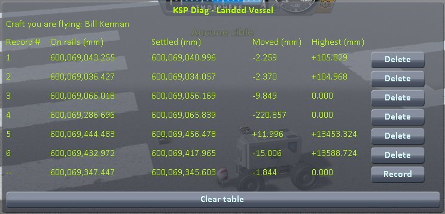</a>

<a href="../../../imgs/lone-parts/checking/runway/stock-load07.jpg">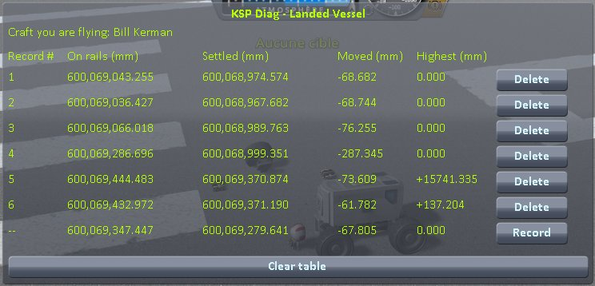</a>

<a href="../../../imgs/lone-parts/checking/runway/stock-load09.jpg">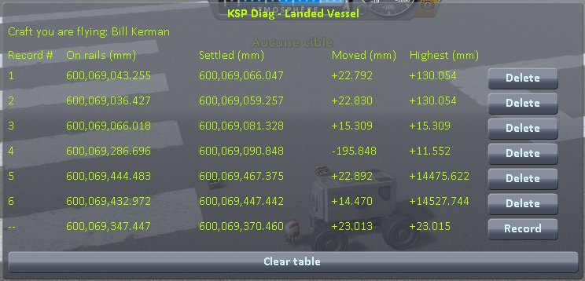</a>

The 10 screenshots

## This mod, `fixLonePartMass = false`

| load | panel 1 | panel 2 | battery 1 | battery 2 | wheel 1 | wheel 2 |
|---|---|---|---|---|---|---|
| 1 | +107.1 | +107.1 | +0.0 | +0.0 | +13,401.2 | +188.5 |
| 2 | +107.3 | +107.3 | +0.0 | +0.0 | +195.6 | +13,403.7 |
| 3 | +107.2 | +107.2 | +0.0 | +0.0 | +13,555.5 | +13,421.2 |
| 4 | +107.3 | +107.3 | +0.0 | +0.0 | +13,219.0 | +13,438.7 |
| 5 | +107.3 | +107.3 | +0.0 | +0.0 | +13,463.1 | +13,507.4 |
| 6 | +107.4 | +107.3 | +0.0 | +0.0 | +13,362.5 | +13,567.7 |
| 7 | +107.3 | +107.3 | +0.0 | +0.0 | +13,587.0 | +13,302.4 |
| 8 | +107.3 | +107.2 | +0.0 | +0.0 | +13,443.9 | +13,538.4 |
| 9 | +107.4 | +107.3 | +0.0 | +0.0 | +13,502.5 | +13,477.8 |
| 10 | +107.3 | +107.3 | +0.0 | +0.0 | +13,317.8 | +13,547.7 |

The batteries never go above where they start; the panels go 107 mm up and fall back at every load, the
same to the tenth of a millimetre. The wheels are still thrown 13 to 14 m up, at every load but one each.

<a href="../../../imgs/lone-parts/checking/runway/no-lone-part-mass-load06.jpg">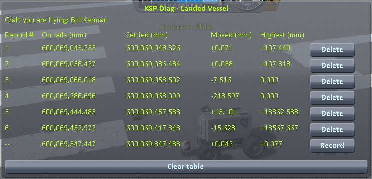</a>
<a href="../../../imgs/lone-parts/checking/runway/no-lone-part-mass-load07.jpg">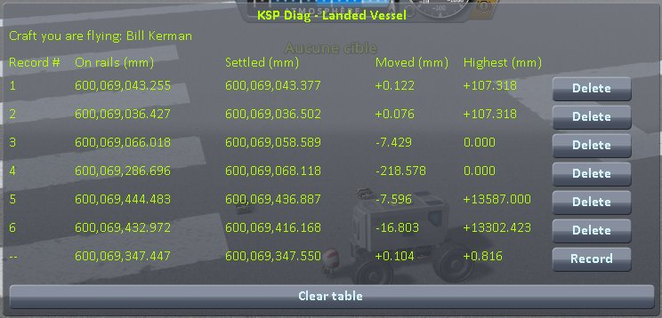</a>
<a href="../../../imgs/lone-parts/checking/runway/no-lone-part-mass-load08.jpg">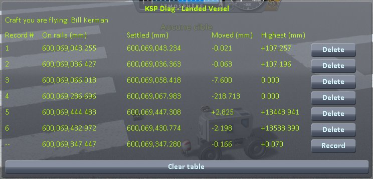</a>

The 10 screenshots

## This mod as installed

| load | panel 1 | panel 2 | battery 1 | battery 2 | wheel 1 | wheel 2 |
|---|---|---|---|---|---|---|
| 1 | +107.0 | +107.0 | +0.0 | +0.0 | +18.1 | +19.0 |
| 2 | +107.4 | +107.3 | +0.0 | +0.0 | +22.0 | +21.8 |
| 3 | +107.5 | +107.4 | +0.0 | +0.0 | +21.2 | +22.6 |
| 4 | +107.3 | +107.3 | +0.0 | +0.0 | +21.9 | +22.4 |
| 5 | +107.2 | +107.3 | +0.0 | +0.0 | +20.3 | +21.8 |
| 6 | +107.3 | +107.2 | +0.0 | +0.0 | +21.0 | +21.3 |
| 7 | +107.4 | +107.3 | +0.0 | +0.0 | +20.6 | +22.3 |
| 8 | +107.3 | +107.2 | +0.0 | +0.0 | +20.8 | +21.7 |
| 9 | +107.2 | +107.1 | +0.0 | +0.0 | +20.7 | +21.8 |
| 10 | +107.1 | +107.1 | +0.0 | +0.0 | +21.0 | +22.5 |

The batteries and the panels read as with `fixLonePartMass = false`, panels included. The wheels go 18 to
23 mm up, and none is thrown.

<a href="../../../imgs/lone-parts/checking/runway/fix-load01.jpg">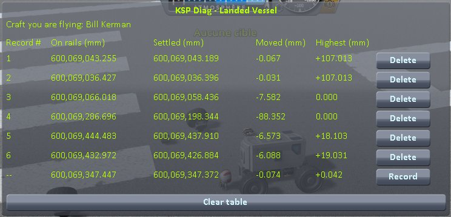</a>

<a href="../../../imgs/lone-parts/checking/runway/fix-load03.jpg">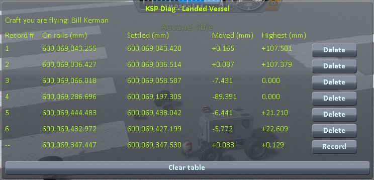</a>

<a href="../../../imgs/lone-parts/checking/runway/fix-load05.jpg">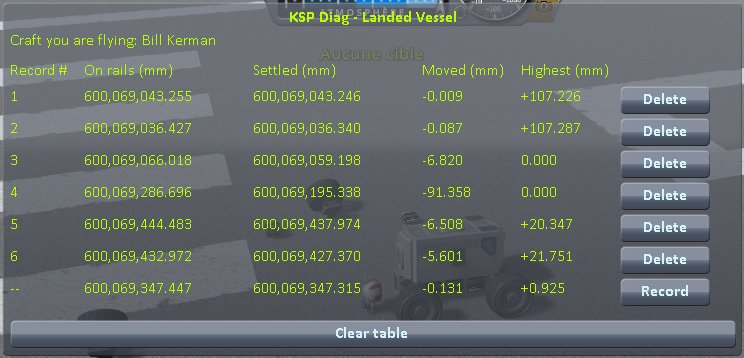</a>

The 10 screenshots

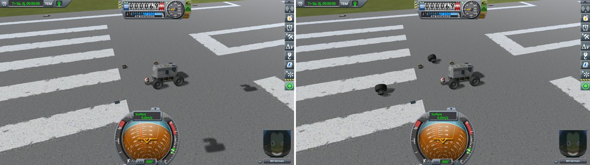

*5.5 seconds into the second load: on stock, left; with this mod as installed, right.*

## What the measurements say

- **On this mod's runway, the extra mass changes nothing for the parts without a suspension.** The batteries
  and the panels read the same with it and without it, at every load.
- **It throws the wheels**, on the runway as on the ground, and this mod takes it away.
- **The panels' 107 mm are not the extra mass**: they read the same with it and without it, and on stock
  as well, where the moving runway adds to them or takes from them.
