# Checking parts lying alone: a wheel dropped in EVA construction

Part of [Terrain Precision Fix](../../../README.md), [parts lying alone](../README.md#checked): the measurements that check [their culprit](../the-culprit.md) where a player meets it, a rover wheel taken off a rover in EVA construction and dropped on the ground, on Kerbin and on the Mun, on stock, with this mod and `fixLonePartMass = false`, and with this mod as installed.

[KSP Diag - Landed Vessel](https://github.com/lhervier/KSP-Diag-LandedVessel) takes the readings, on the
wheel dropped, set as target once it has come to rest. *On rails* is where the wheel was held when it was
dropped; *Highest*, how far above that it went before it came to rest; *Moved*, where it ended, a drop of
about half a metre when it falls and stays. The install is the one of
[Loading the same save](loading.md): KSP 1.12.5 with Harmony, ModuleManager, KSP Community Fixes 1.41.1, the
instrument and KSP-Util-MCPServer — and this mod, or not. The game is played in French.

## The protocol

Copy the save into the folder of a sandbox game and load it:
[`wheel-drop-kerbin.sfs`](../../../diag/lone-parts/checking/wheel-drop/wheel-drop-kerbin.sfs), Bill Kerman
on EVA on the grass north-west of the runway, between two rovers, Jebediah Kerman beside him to help lift
the wheel; or [`wheel-drop-mun.sfs`](../../../diag/lone-parts/checking/wheel-drop/wheel-drop-mun.sfs), Récas
Kerman on EVA next to a crane on the Mun. Then, by hand, five times:

1. load the save;
2. open the construction panel, pick the *Place* tool, click a front wheel of the rover (of the crane, on the
   Mun), and click the ground a few metres away: the wheel drops there;
3. wait 15 seconds, set the wheel as target, and *Record*.

The campaign is played by [`run-wheel-drop.py`](../../../diag/lone-parts/automation/run-wheel-drop.py), which
does what the protocol asks, the same wheel and the same spot at every drop, and takes a screenshot of the
scene 4.5 seconds after each drop and one of the table at the end. In each install, the log of the session,
what the script printed and every line it recorded are in
[`diag/lone-parts/checking/wheel-drop/`](../../../diag/lone-parts/checking/wheel-drop/).

## On Kerbin

*Highest*, in millimetres, as recorded:

| drop | on stock | with this mod and fixLonePartMass = false | with this mod as installed |
|---|---|---|---|
| 1 | +14,782.7 | +0.0 | +0.0 |
| 2 | +14,750.0 | +13,437.2 | +0.0 |
| 3 | +0.0 | +0.0 | +0.0 |
| 4 | +13,053.9 | +13,435.8 | +0.0 |
| 5 | +0.0 | +13,017.8 | +0.0 |

<a href="../../../imgs/lone-parts/checking/wheel-drop/kerbin-stock-table.jpg">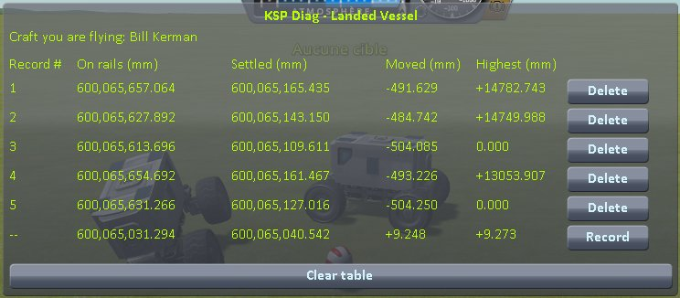</a>
<a href="../../../imgs/lone-parts/checking/wheel-drop/kerbin-no-lone-part-mass-table.jpg">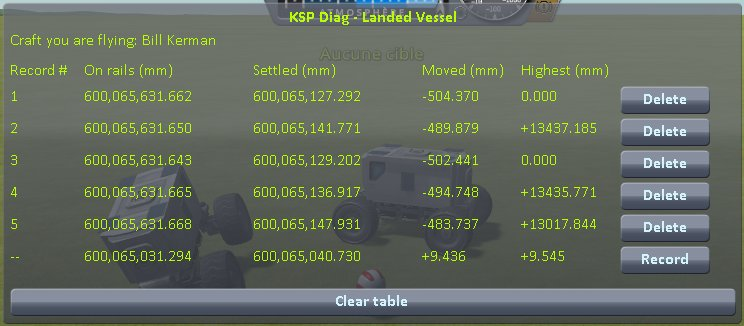</a>
<a href="../../../imgs/lone-parts/checking/wheel-drop/kerbin-fix-table.jpg">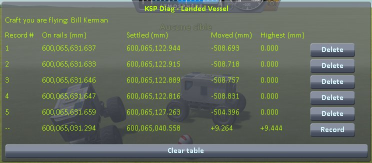</a>

The 3 tables and the 15 scenes

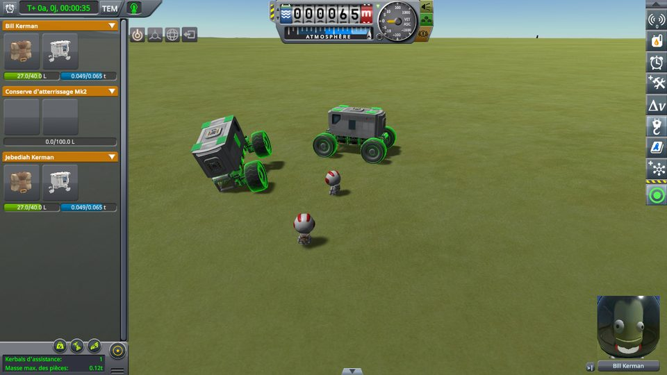

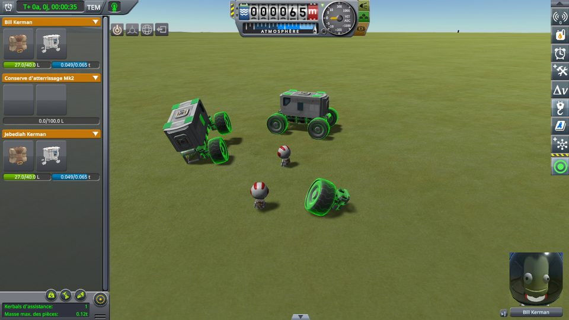

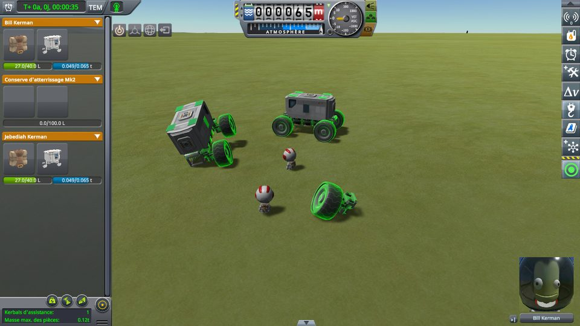

On stock and with `fixLonePartMass = false`, the wheel is thrown 13 to 15 m up three times out of five.
The other two times it falls on its side, its tyre off the ground, and its suspension takes no load. With
this mod as installed, it never goes above where it was dropped.

## On the Mun

| drop | on stock | with this mod and fixLonePartMass = false | with this mod as installed |
|---|---|---|---|
| 1 | +742.5 | +1,903.4 | +0.0 |
| 2 | +1,200.3 | +1,865.1 | +0.0 |
| 3 | +1,756.4 | +5,321.1 | +0.0 |
| 4 | +1,177.3 | +2,522.5 | +0.0 |
| 5 | +1,873.9 | +1,631.1 | +0.0 |

<a href="../../../imgs/lone-parts/checking/wheel-drop/mun-stock-table.jpg">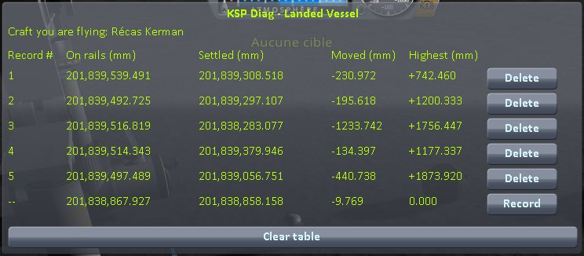</a>
<a href="../../../imgs/lone-parts/checking/wheel-drop/mun-no-lone-part-mass-table.jpg">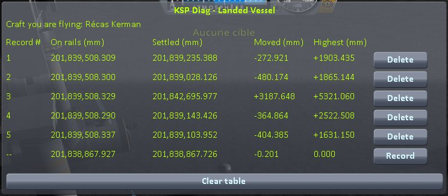</a>
<a href="../../../imgs/lone-parts/checking/wheel-drop/mun-fix-table.jpg">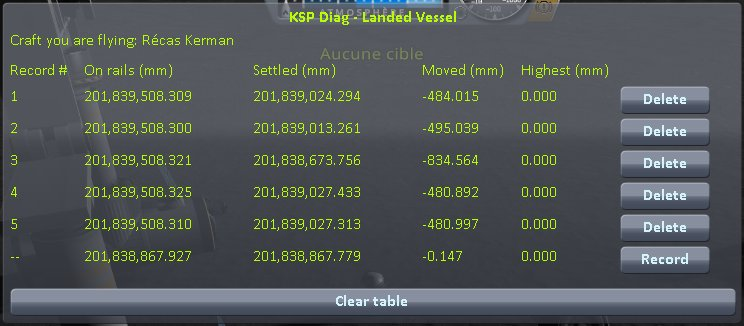</a>

The 3 tables and the 15 scenes

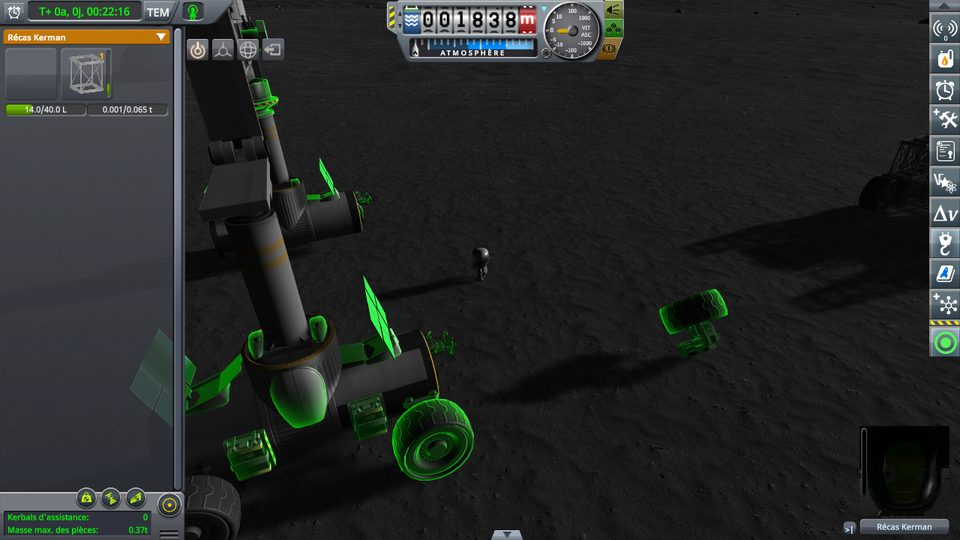

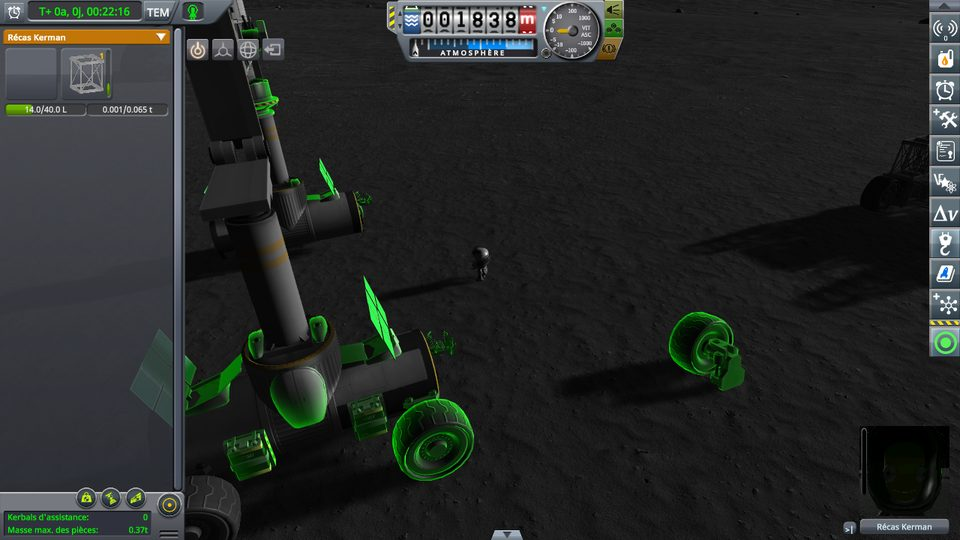

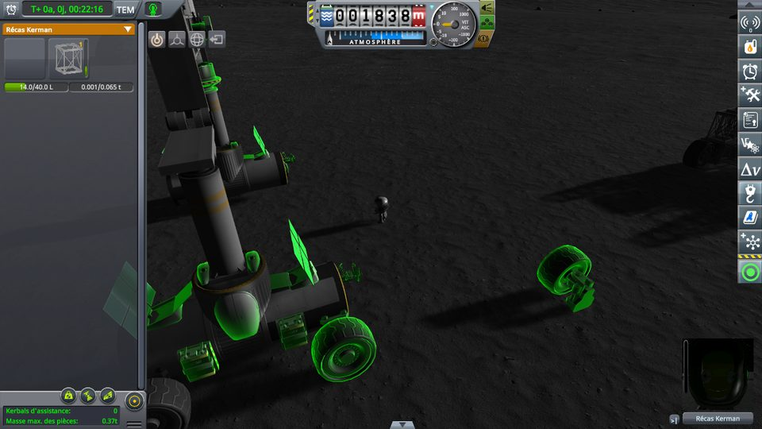

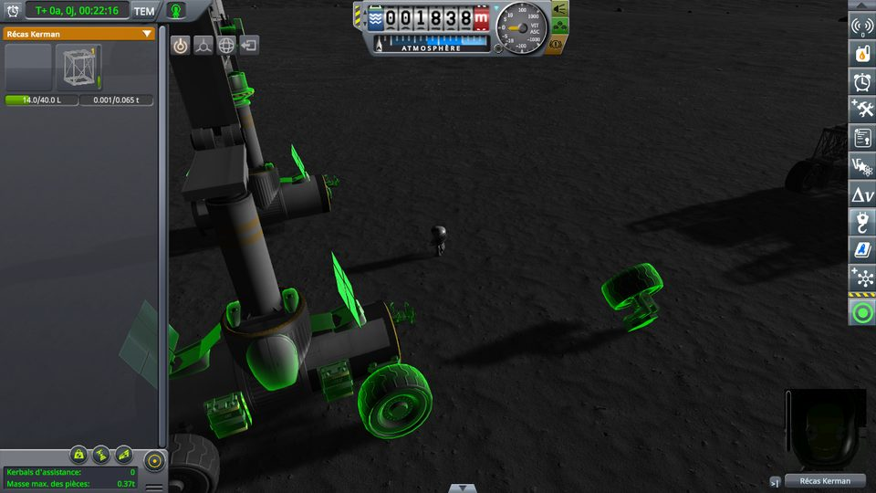

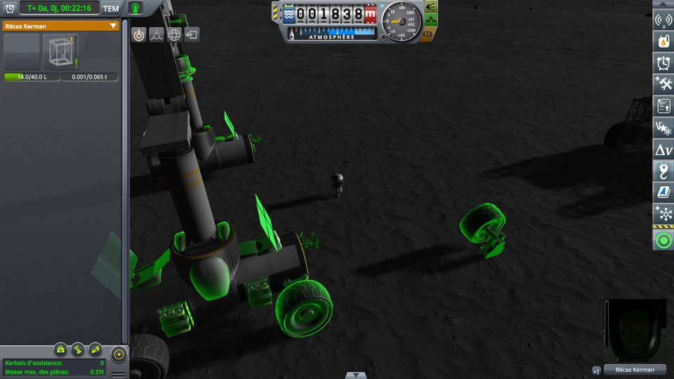

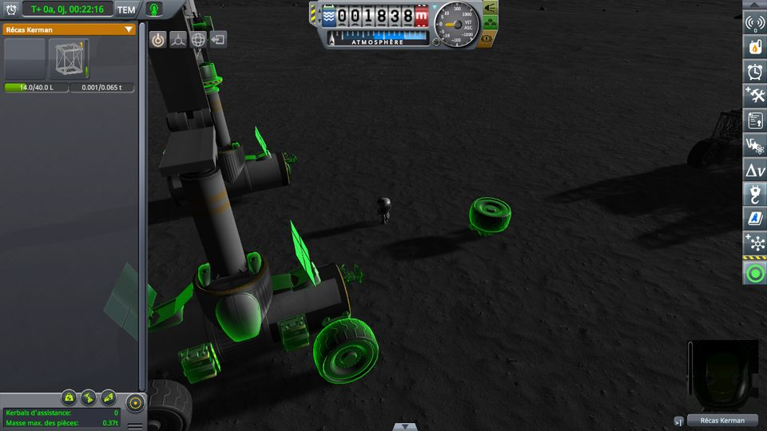

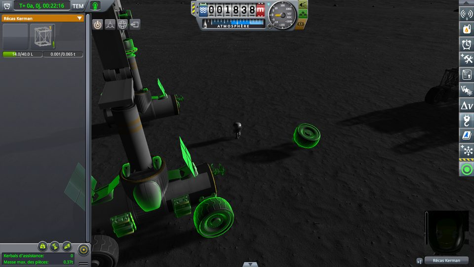

On stock, the wheel is thrown at every drop, 0.7 to 1.9 m up; with `fixLonePartMass = false`, at every drop
too, 1.6 to 5.3 m up. With this mod as installed, never.

## What the measurements say

- **A wheel dropped in EVA construction is thrown by the extra mass**, with or without this mod's ground:
  every time it lands on its tyre.
- **With this mod as installed, it stays where it fell**, on both bodies, at every drop.
