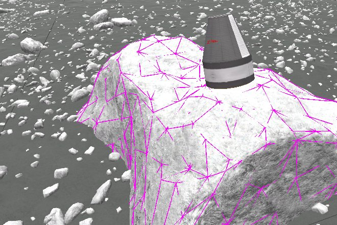
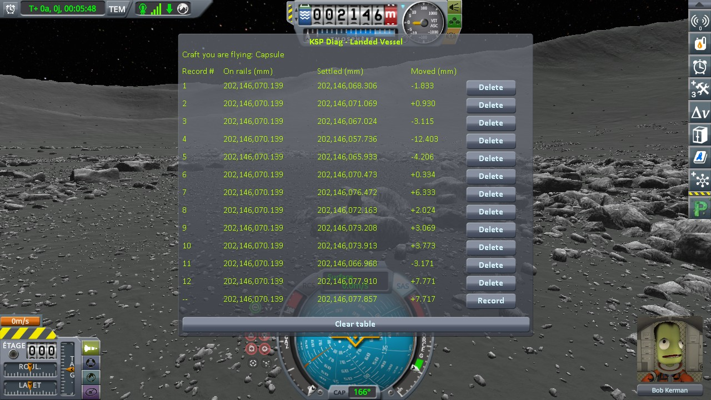
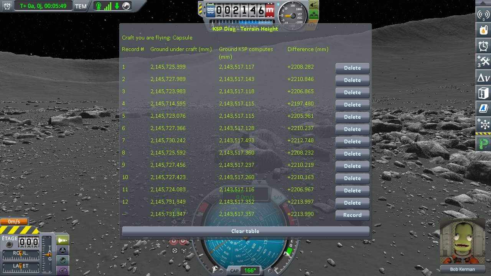
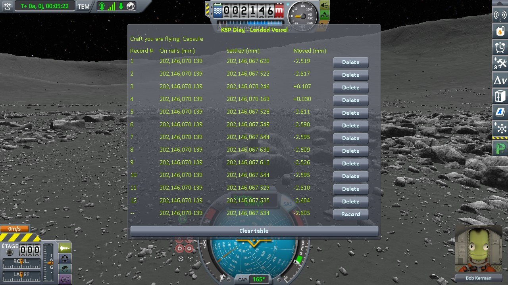
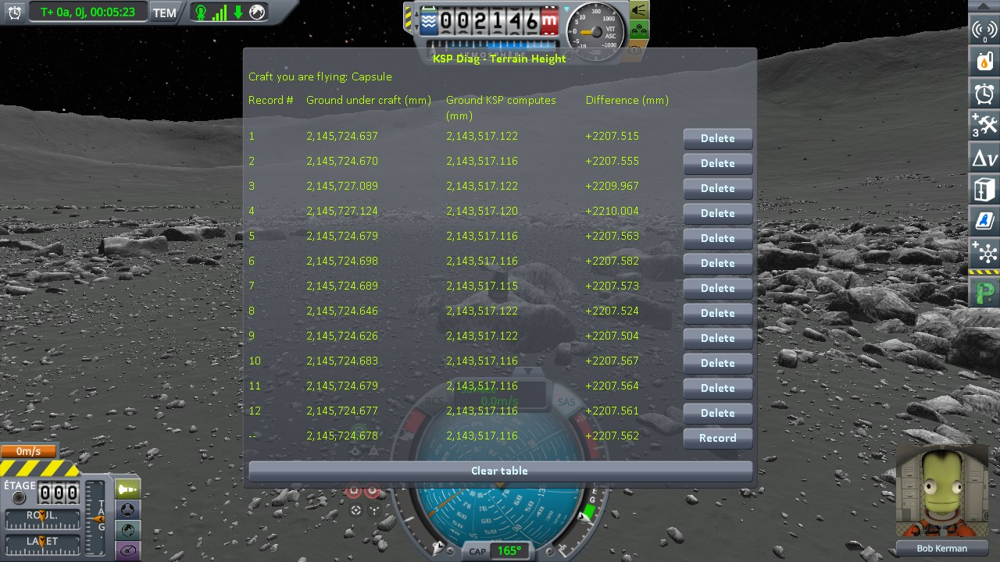
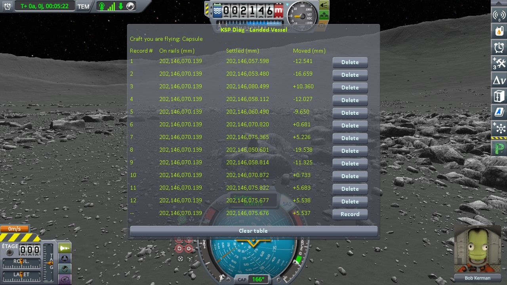
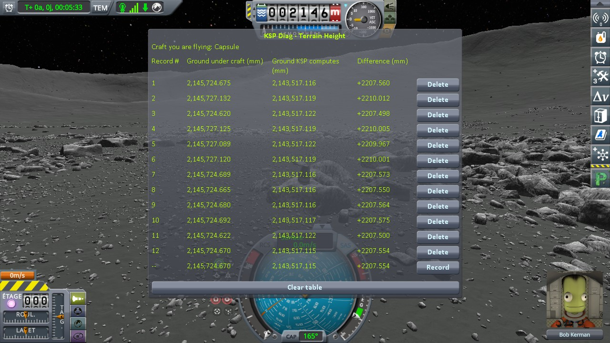

# Parallax: a craft on one of its rocks

Part of [Terrain Precision Fix](../../../README.md), one test of [Non-regression tests](../../non-regression.md), on [Parallax](../parallax.md).

**Status: checked on the Mun — a craft resting on a rock of Parallax stays on it, load after load, an hour
of time warp before each, and after a restart of KSP, without this mod as with it.** A rock of Parallax
hangs from its terrain quad, and follows the ground wherever it is placed: without this mod, the capsule
came back within 30 mm, with the rock; with it, within 3 mm.

## The test

KSP 1.12.5 with Harmony, ModuleManager, KSP Community Fixes 1.41.1,
[Parallax Continued](https://github.com/Gameslinx/Parallax-Continued) 1.0.5 with its stock textures and what
it requires, Deferred, both instruments,
[KSP Diag - Landed Vessel](https://github.com/lhervier/KSP-Diag-LandedVessel) and
[KSP Diag - Terrain Height](https://github.com/lhervier/KSP-Diag-TerrainHeight), and
[KSP-MCPServer](https://github.com/lhervier/KSP-MCPServer), which plays the protocol; this mod with its
defaults (at `logLevel = Debug`), or not.

**The save**, [`capsule-on-a-rock-mun.sfs`](../../../diag/non-regression/parallax/a-craft-on-one-of-its-rocks/capsule-on-a-rock-mun.sfs):
a Mk1 capsule on an empty FL-T100 fuel tank, landed on top of a rock of the Mun. A craft of two parts on
purpose: KSP puts a craft of a single part back down on whatever is under it at every load
(`Vessel.CheckGroundCollision`), which would hide where the rock came back.

*The capsule on its rock, with [KSP Diag - Colliders](https://github.com/lhervier/KSP-Diag-Colliders)
outlining the collider Parallax gives the rock; taken with Parallax Continued 1.0.4 rebuilt with our change,
which orients the rock as 1.0.5 does.*

**The protocol**: [the loading protocol](../../checking-the-culprit-loading/the-protocol.md), played by its
script, [`run-loading.py`](../../../diag/automation/run-loading.py), with time played between the loads:
the save loaded twelve times, with an hour of game time of time warp before each load
(`--loads 12 --warp 3600`), both instruments recording at each load. Then KSP started again, and the same
twelve loads. Each session is played without this mod, then with it.

The hour of time warp is what turned every rock up to Parallax 1.0.4: KSP turns the body in the scene by
the time played, and the rock came back turned under the capsule
([Its rocks no longer turn at every load](what-it-does-with-the-ground.md#its-rocks-no-longer-turn-at-every-load)).

## Twelve loads, an hour apart

**Without this mod**, the rock follows the ground of stock, which comes back at another height at every
load, and the capsule with it: the top of the rock under the capsule (*Ground under craft*) moves by
16.8 mm, and the capsule settles on it, *Moved* from −12.4 to +7.8 mm. It never leaves the rock.

**With this mod**, the ground KSP computes under the capsule is the same within 0.007 mm at every load,
and the top of the rock comes back at one of two heights, 2.5 mm apart: at loads 3 and 4, and at the other
ten. The capsule follows it, *Moved* from −2.6 to +0.1 mm.

## After a restart of KSP

The same twelve loads, an hour apart, in a KSP started again: the capsule stays on its rock at every load,
without this mod as with it. With this mod, the rock comes back at the same two heights as in the first
session.

The tables of the second session

## In figures

Spread over the twelve loads of each session, read off those screenshots:

| | first session, without this mod | first session, with this mod | after a restart, without this mod | after a restart, with this mod |
|---|---|---|---|---|
| *Settled* (KSP Diag - Landed Vessel) | 20.173 mm | 2.724 mm | 29.898 mm | 2.734 mm |
| *Moved* (KSP Diag - Landed Vessel) | −12.403 to +7.771 mm | −2.617 to +0.107 mm | −19.538 to +10.360 mm | −2.615 to +0.119 mm |
| *Ground under craft* (KSP Diag - Terrain Height) | 16.754 mm | 2.498 mm | 44.743 mm | 2.511 mm |
| *Ground KSP computes* (KSP Diag - Terrain Height) | 0.379 mm | 0.007 mm | 7.811 mm | 0.007 mm |

The logs, what the script printed and every line it recorded are in
[`diag`](../../../diag/README.md#with-parallax).
