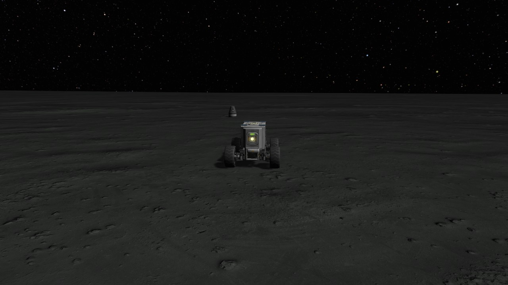
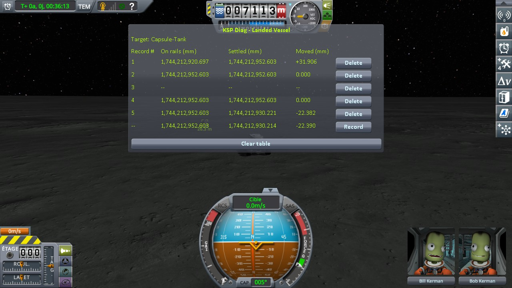
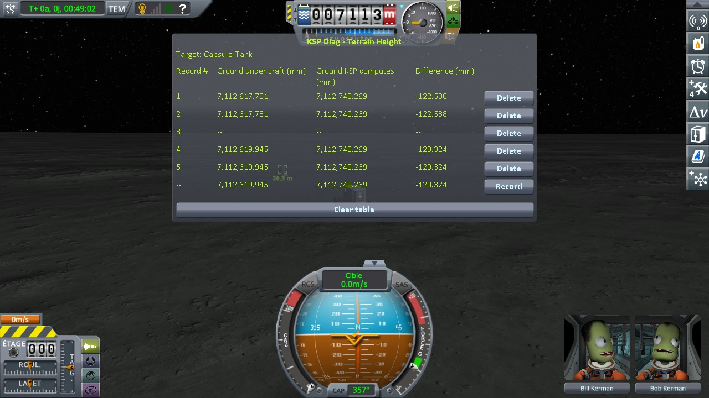
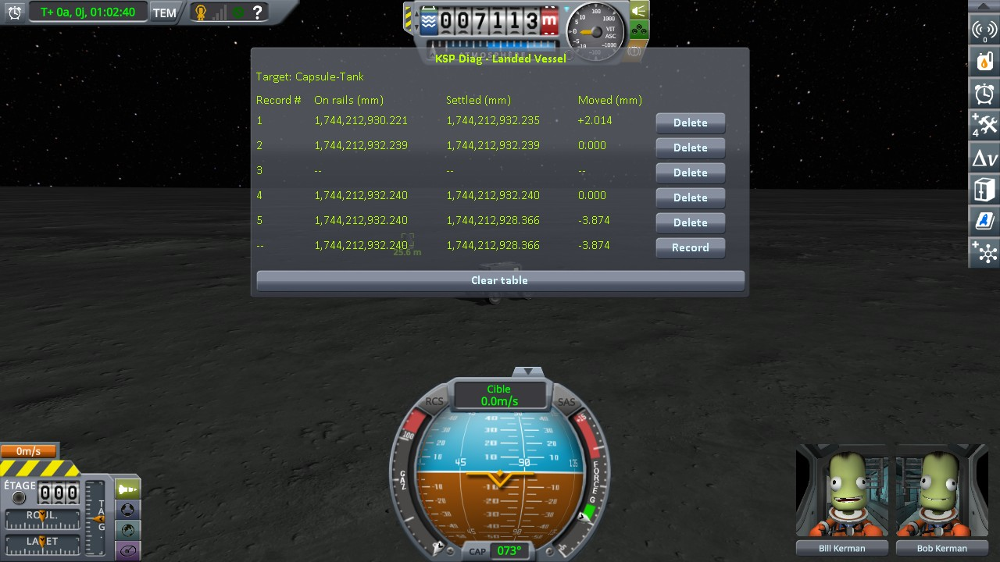
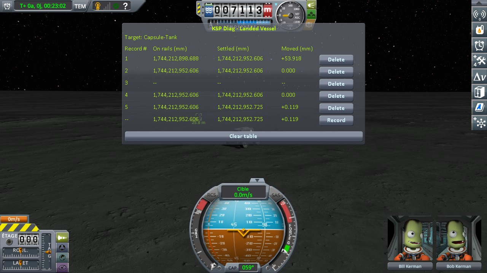
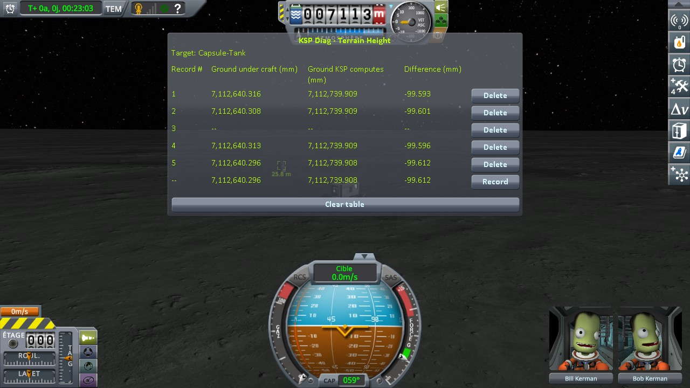
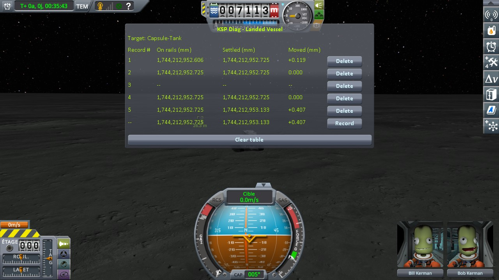
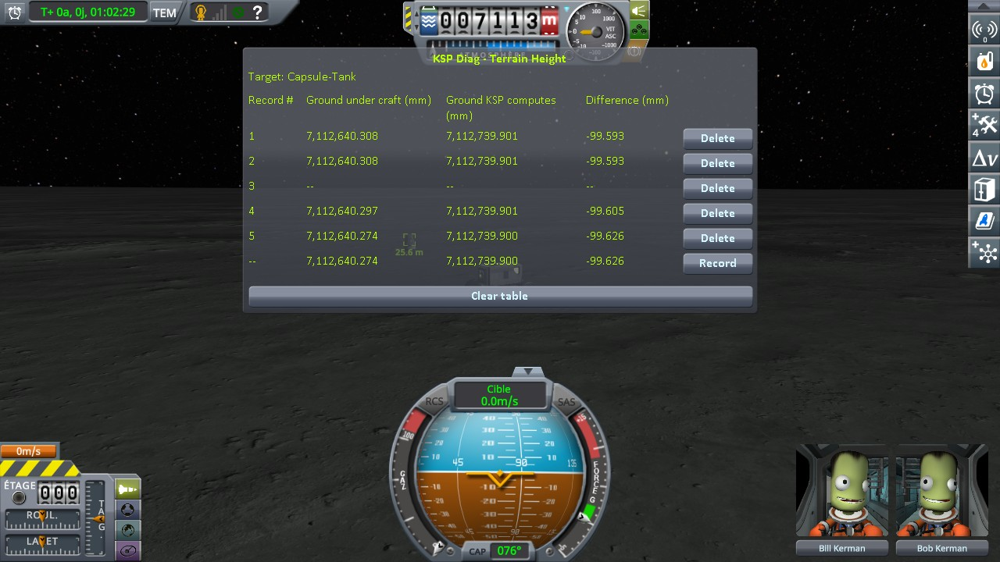
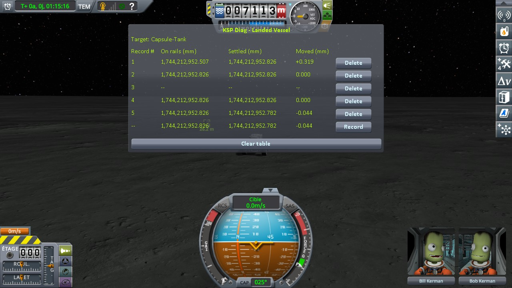
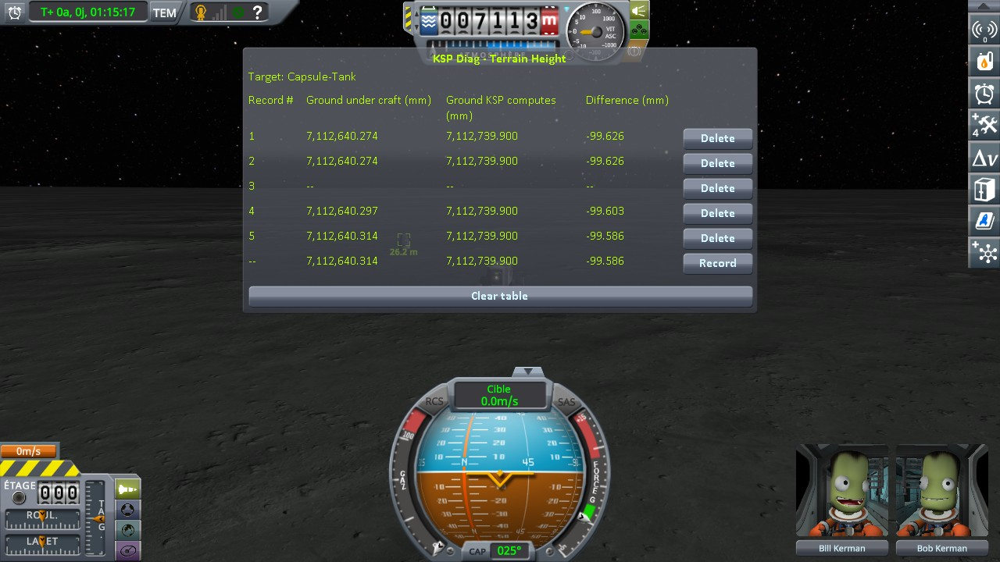

# Real Solar System: coming back to a craft left parked, on the Moon

Part of [Terrain Precision Fix](../../../README.md), one test of [Non-regression tests](../../non-regression.md), on [Real Solar System](../real-solar-system.md).

**Status: checked on the Moon — a craft left parked comes back to the same ground, as on Kerbin.** Over six
round trips of a rover, the ground under the parked capsule came back within 31.9 mm without this mod, and
within 0.042 mm with it.

## Why

Every other reading of the ground under Real Solar System loads a landed craft again. A craft left parked
and come back to is not loaded from a save: the game unloads it when the rover drives away, and builds the
quads under it again when the rover comes back, after the floating origin has moved. If this mod broke
something there, the parked craft would sit higher or lower than its ground when the player comes back to
it. On stock, that is [Checking the culprit: coming back to a craft left parked](../../checking-the-culprit-approach.md),
on Kerbin.

**Why the Moon rather than Earth.** Once the parked craft is unloaded, the rover crosses a move of the
floating origin every 500 m, at full speed. On Earth, without this mod, the ground under a rover jumps by
159 to 243 mm at such a move
([Checking the ground: driving on while the world moves](../../checking-the-culprit-driving/the-ground.md#on-earth)):
a step the rover would take several times per round trip, in the session that has to bring it back to its
starting spot each time. The bodies of Real Solar System as large as Kerbin, whose float step is Kerbin's
62.5 mm, are too light to drive on: from 0.15 m/s² on Tethys to 0.36 m/s² on Titania, against 0.49 m/s²
on Minmus. The Moon has the gravity of the Mun, 1.62 m/s², and a float step of 125 mm at the ground,
twice Kerbin's and a quarter of Earth's; it is still a body of Kopernicus, almost nine times the size of
the Mun.

## The test

KSP 1.12.5 with Harmony, ModuleManager, KSP Community Fixes 1.41.1, Real Solar System 20.1.3.0 as released
and what it requires (Kopernicus 248, Modular Flight Integrator, KSPTextureLoader, the RSS textures), both
instruments, [KSP Diag - Landed Vessel](https://github.com/lhervier/KSP-Diag-LandedVessel) and
[KSP Diag - Terrain Height](https://github.com/lhervier/KSP-Diag-TerrainHeight), and
[KSP-MCPServer](https://github.com/lhervier/KSP-MCPServer), which plays the protocol; this mod with its
defaults (at `logLevel = Debug`), or not.

**The save**, [`approach-moon-rss.sfs`](../../../diag/non-regression/real-solar-system/coming-back-to-a-craft-left-parked-on-the-moon/approach-moon-rss.sfs),
made without this mod: the two craft of
[the approach protocol](../../checking-the-culprit-approach/the-protocol.md) in the Sea of Tranquillity, at
the landing site of Apollo 11, in the lunar morning. The craft the readings are about, a Mk1 command pod on
an FL-T100 tank, is landed at latitude 0.6741°, longitude 23.4730°, and is the target of the rover, landed
25 m to its south, facing south, the way it drives off. The ground on the way is gentle: over the 3.3 km
south of the pod, its slope stays under 1.5° and it rises by 32 m. The save also holds a capsule left on
Mars by an earlier test, which plays no part here.



*The rover at its starting spot, seen from the south, the parked capsule beyond it.*

The rover of the save is set for the low gravity of the Moon: its reaction wheel is off, its wheels have
their friction at the highest, their traction control at 5 and their motor limited to 17 %. Without those
last two, it tips over when it speeds up to 8 m/s. Set so, it holds 10 m/s, and brakes over long distances.

**The protocol**: the approach protocol, played by its script,
[`run-approach.py`](../../../diag/automation/run-approach.py), with the rover's speeds of the Moon:

```
python run-approach.py --folder <your game> --save approach-moon-rss --speed 10 --slow-from 150 --home-speed 2 --trips 6
```

`--speed 10` drives the rover at 10 m/s at most between the stops, and `--slow-from 150 --home-speed 2`
brings it back on its starting spot at 2 m/s from 150 m away. Six round trips, five records per trip in
both instruments, without this mod, then with it. The two sessions below were played with these steps by
a copy of the script that also checked, after the save was loaded and after each round trip, that the
parked capsule still stood upright; it always did, and each session went through its six round trips in
one single flight.

## Six round trips

**Without this mod**, the ground under the parked capsule comes back at another height each time the
capsule is loaded again, and the capsule with it: back beside it, *Moved* from −22.4 to +31.9 mm.

**With this mod**, the ground comes back to the same place, within a few hundredths of a millimetre: back
beside it, *Moved* from −0.627 to +0.407 mm. That remainder is the capsule's own settling: the ground under
it does not move.

Read off the screenshots below:

| | without this mod | with this mod |
|---|---|---|
| *Moved* back beside the capsule, trips 1 to 6 (KSP Diag - Landed Vessel) | +31.909, −22.382, +2.006, −3.874, +17.463, −10.243 mm | +0.119, +0.407, −0.627, +0.319, −0.044, −0.192 mm |
| *Settled*, spread over the 24 readings (KSP Diag - Landed Vessel) | 31.910 mm | 0.627 mm |
| *Ground under craft*, spread over the 24 readings (KSP Diag - Terrain Height) | 31.896 mm | 0.042 mm |

The six other records, one per trip, are the empty line of the capsule out of range. At the first record
of all, as the scene opens, the capsule settles once on the ground of the session: *Moved* +22.010 mm
without this mod, +53.918 mm with it, where a save made without this mod goes through one more draw
([Existing saves](../stock/existing-saves.md)). Real Solar System's own workaround, which moves a landed
craft back onto the ground, never moved the capsule, in either session.

<details>
<summary>The tables without this mod, trip by trip</summary>









</details>

<details>
<summary>The tables with this mod, trip by trip</summary>











</details>

The logs, what the script printed and every line it recorded are in
[`diag`](../../../diag/README.md#on-real-solar-system).
