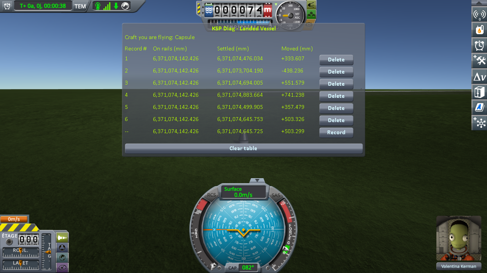
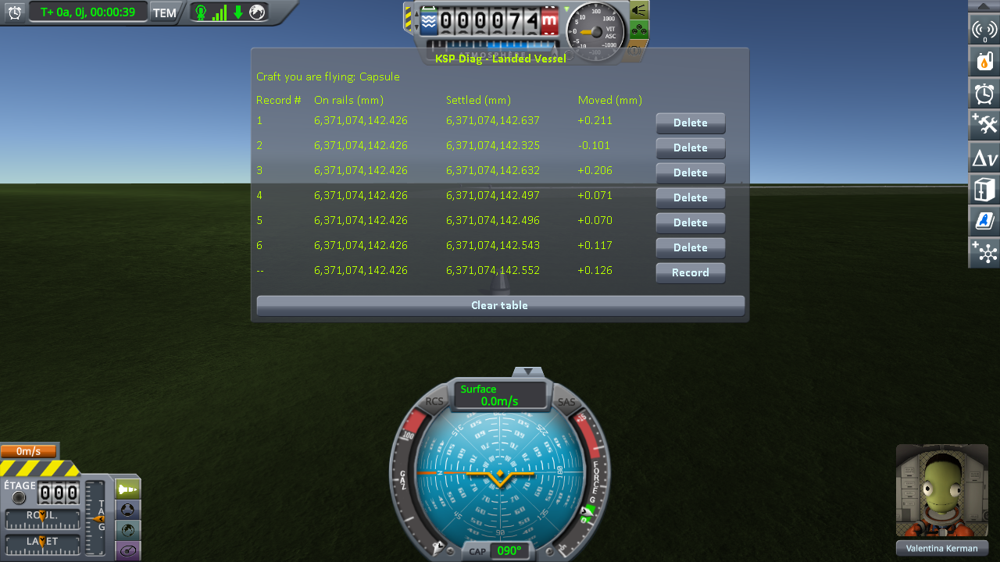

# Real Solar System: the ground workaround

Part of [Terrain Precision Fix](../../../README.md), one test of [Non-regression tests](../../non-regression.md), on [Real Solar System](../real-solar-system.md).

**Status: checked on the Moon and on Earth — with this mod, Real Solar System's ground workaround has
nothing left to correct for this defect, does not get in the way, and this mod keeps a craft in place
without it; without this mod, it does not always keep a craft from being thrown, and it never runs while
a craft is already on its wheels.**

## What it does

Real Solar System already works around the symptom. It ships a component of its own,
`VesselGroundPositionEnhancer`
([its source](https://github.com/KSP-RO/RealSolarSystem/blob/master/Source/VesselGroundPositionEnhancer.cs)),
added to *"mostly prevent vessels clipping into the ground and as a result flung into the air"*
([pull request #257](https://github.com/KSP-RO/RealSolarSystem/pull/257)). Whenever a landed craft goes
off rails, it runs the stock `Vessel.CheckGroundCollision`, which moves the craft onto the ground before
its physics starts whenever it is more than 10 cm off, inside the ground or above it, in one block, and
logs `ground contact! - error. Moving Vessel up X.XXXm` (or `down`). Under 10 cm, the stock method
leaves the craft where it is, inside the ground or not. The component only acts on a *landed* craft;
for a craft in *prelaunch*, as on Earth near the KSC, stock KSP runs that same method itself at every
load: `Vessel.GoOffRails` spares a landed craft whose saved terrain levels match the current ones, but
never a craft in *prelaunch*.

**Turning it off.** Release 20.1.3.0 has no setting for it: Real Solar System's repository has an option
to force it off, not released yet. The component turns itself off when an assembly named
`WorldStabilizer` is loaded, the mod it was written to stand in for. It was turned off in two ways
below:

- *workaround off*: an empty assembly named `WorldStabilizer` in `GameData`;
- *workaround built out*: Real Solar System built from the sources of its release 20.1.3.0 with its
  component returning at the top of its `Start`, before it subscribes to anything, as it does when
  `WorldStabilizer` is loaded; it logs `[RSS-VGPE] VesselGroundPositionEnhancer neutralized` instead. The
  version of the assembly is set to that of the release
  ([`rss-20.1.3-without-its-ground-workaround.diff`](../../../diag/non-regression/real-solar-system/the-ground-workaround/rss-20.1.3-without-its-ground-workaround.diff)).

**When it runs.** It runs whenever a landed craft goes off rails, which a craft does wherever the game
sets it down: when a save is loaded, when a craft comes back within 200 m of a craft left parked, when
the player switches to a craft far away. It never runs while a craft is already on its wheels.

**It hides the symptom, not the defect.** It moves the craft, never the ground: with it on, as in
every series of
[Checking the ground: loading the same save](../../checking-the-culprit-loading/the-ground.md), the ground is still
built somewhere else at each load, by 48.7 mm on the Moon and 292.3 mm on Earth, and the craft still
comes to rest somewhere else, by 49.2 mm and 292.4 mm. All it can do is keep the craft from being
thrown, and it does not always manage that.

**It moves the craft, not the ground under it.** The pass moves the craft straight up or down, so the
spot under it stays the same, and KSP Diag - Terrain Height reads the same ground there. On Earth,
without this mod, at the three loads where stock's pass moved the craft (`Moving Vessel down` 0.165 and
0.123 m, `Moving Vessel up` 0.128 m), the height KSP computes reads 73,707.984, 73,707.998 and
73,707.961 mm, between the 73,707.949 and 73,708.009 mm of two loads it did not touch
([Checking the ground: loading the same save](../../checking-the-culprit-loading/the-ground.md#the-ground-over-six-loads)).

## Reloading until something happens

No instrument is needed for this one: the same saves, Real Solar
System as released, reloaded from the pause menu again and again, watching whether the craft jumps or
tips over; some series are the six loads of an instrument in
[Checking the ground: loading the same save](../../checking-the-culprit-loading/the-ground.md). Real Solar System
leaves one line in `KSP.log` each time the craft goes off rails, which counts the loads:
`[RSS-VGPE] CheckGroundCollision()` for a landed craft, where its workaround runs,
`[RSS-VGPE] Vessel going off rails in PRELAUNCH` for a craft in *prelaunch*, where stock's pass runs
instead. A `Moving Vessel` line is added whenever either pass moved the craft.

The series marked *by script* follow
[the loading protocol](../../checking-the-culprit-loading/the-protocol.md) instead: six loads, each
read by KSP Diag - Landed Vessel and KSP Diag - Terrain Height, played by its script,
[`run-loading.py`](../../../diag/automation/run-loading.py), through
[KSP-MCPServer](https://github.com/lhervier/KSP-MCPServer). Nobody watches the craft there: what they
tell is what the two instruments read and the lines of `KSP.log`.

| install | save | loads | what the craft does |
|---|---|---|---|
| without this mod, workaround off | `reload-moon-rss.sfs` | 1 | **tips over** at the first load |
| without this mod, Diag LandedVessel | `reload-moon-rss.sfs` | 6 | moved up by the workaround at the third, fourth and fifth loads; nothing seen to jump; *Moved* −63.933, −5.999, +110.293, +168.523, +147.171 and −94.096 mm |
| without this mod | `reload-moon-rss.sfs` | 14 | moved up by the workaround at 6 loads, by 0.115 to 0.261 m; **tips over** at 2 and **jumps** at 1, having come back less than the 10 cm the workaround acts on; nothing visible at 5 |
| without this mod | `reload-moon-rss-resave.sfs` | 1 | **tips over** at the first load of a session, the workaround running, no `Moving Vessel` line |
| without this mod, Diag TerrainHeight | `reload-moon-rss-resave.sfs` | 6 | moved up by the workaround at 2 loads, by 0.178 and 0.216 m; **jumps** at 1; **tips over** at 1, having come back inside the ground by less than the 10 cm the workaround acts on |
| without this mod, Diag LandedVessel | `reload-earth-rss-resave.sfs` | 6 | moved by stock's pass at 5 loads, up by 0.251 to 0.456 m at 3 and down by 0.143 to 0.283 m at 2; **jumps** at 1, having come back 83 mm inside the ground |
| without this mod, Diag TerrainHeight | `reload-earth-rss-resave.sfs` | 6 | moved up by stock's pass at 4 loads, by 0.102 to 0.678 m; **jumps** at 1 |
| without this mod, by script | `reload-earth-rss-landed.sfs` | 6 | moved by the workaround at all 6 loads, up by 0.334 to 0.742 m at 5 and down by 0.437 m at 1; comes to rest across 1,179.474 mm, the ground under it read across 1,179.378 mm |
| with this mod, workaround off | `reload-moon-rss-resave.sfs` | 6 | stays put, over a spread of 0.364 mm; no `Moving Vessel` line |
| with this mod, workaround built out, by script | `reload-moon-rss-resave.sfs` | 6 | stays put, over a spread of 0.653 mm, the ground under it read across 0.243 mm; no `Moving Vessel` line |
| with this mod, workaround built out, by script | `reload-earth-rss-landed.sfs` | 6 | stays put, over a spread of 0.312 mm, the ground under it read across 0.391 mm; no `Moving Vessel` line |
| with this mod, by script | `reload-earth-rss-landed.sfs` | 6 | stays put, over a spread of 0.359 mm, the ground under it read across 0.219 mm; the workaround runs 6 times, no `Moving Vessel` line |
| with this mod | `reload-moon-rss-resave.sfs` | 24 | never moves; 24 lines of the workaround, no `Moving Vessel` line |
| with this mod | `reload-earth-rss-landed.sfs` | 27 | never moves; the craft is *landed*, the workaround runs 27 times, no `Moving Vessel` line |
| with this mod | `reload-earth-rss-resave.sfs` | 24 | never moves; the craft is in *prelaunch*, stock's pass runs 24 times, no `Moving Vessel` line |

Without this mod, read by Diag LandedVessel. With the workaround turned off, the first load of
`reload-moon-rss.sfs` was enough:

With the workaround on, the same save loaded again and again in another session, fourteen loads, all
recorded:

| load | *Moved* | what the craft did |
|---|---|---|
| 1 | +257.121 mm | moved up by the workaround (`0.257m`) |
| 2 | −45.837 mm | nothing |
| 3 | +417.383 mm | **tipped over** |
| 4 | +172.248 mm | moved up by the workaround (`0.173m`) |
| 5 | +426.948 mm | **tipped over** |
| 6 | −80.558 mm | nothing |
| 7 | +25.460 mm | **jumped** |
| 8 | −12.557 mm | nothing |
| 9 | +226.627 mm | moved up by the workaround (`0.227m`) |
| 10 | +260.629 mm | moved up by the workaround (`0.261m`) |
| 11 | −4.673 mm | nothing |
| 12 | −10.539 mm | nothing |
| 13 | +223.193 mm | moved up by the workaround (`0.223m`) |
| 14 | +114.687 mm | moved up by the workaround (`0.115m`) |

Where the craft tipped over, *Moved* reads the height of a craft lying on its side, not one that
settled: over the twelve loads where it stayed upright, the craft came to rest across 341.2 mm. Here is
the third load, after its *Record*:

On Earth, with the craft *landed*, where the workaround runs at every load, by script:

*Without this mod, Real Solar System as released, Diag LandedVessel: six loads of
`reload-earth-rss-landed.sfs`, played by `run-loading.py`. `KSP.log` holds a `Moving Vessel` line for
each of them.*

## Its limits

**Its limit: under 10 cm it does nothing, and without this mod the craft still jumps or tips over.**
A craft that comes back more than 10 cm inside the ground is moved up in one block, and one that comes
back more than 10 cm above it is moved down: nothing is launched, but a structure resting on several
points is set on its lowest one. A craft that comes back less than 10 cm inside the ground is left
there, and the physics engine pushes it out: a few centimetres are enough to throw it up, and it jumps,
or comes down on its side and tips over. On the Moon, 10 cm is less than one float step, and on Earth a fifth of one, so the draws
that fall under it are not rare: on the Moon, one jump and two tip-overs in fourteen loads, and two
more tip-overs in seven loads of the save taken again; on Earth, one jump in each of the two series of
six. The workaround ran at every one of those loads. With the workaround off, the craft tipped over at
the very first load.

**It never sees the ground move under a craft that is already rolling.** Every 500 m a craft travels,
KSP moves the floating origin back onto it, and stock places the ground under it again, somewhere else.
On Earth, across such a move, the ground under a rover driving on the grass by the KSC moved by 159 to
243 mm without this mod, and the rover was seen to jump; with this mod, a move changes nothing
([Checking the ground: driving on while the world moves](../../checking-the-culprit-driving/the-ground.md#on-earth)).
The craft does not go off rails there, so the workaround does not run.

## With this mod

**With this mod, it has nothing left to do for this defect.** The ground comes back within a
millimetre, well inside the 10 cm below which the pass leaves a craft where it is. Over 75 loads in a
row, 24 on the Moon and 51 on Earth, the craft never moved, and the pass, which still runs at every
load, found nothing to correct, without getting in the way; nor over the six loads by script on Earth,
the craft *landed*, where the craft came to rest across 0.359 mm.

**Without the workaround, this mod keeps the craft in place on its own.** On the Moon, the workaround
off, over six loads read by Diag LandedVessel:

*With this mod, Real Solar System's workaround off, Diag LandedVessel: six loads of `reload-moon-rss-resave.sfs`,
a spread of 0.364 mm, against 0.395 mm with it on.*

The workaround built out, by script, six loads on the Moon and six on Earth with the craft *landed*,
where the workaround would otherwise run at every load: the craft came to rest across 0.653 mm and
0.312 mm, and no `Moving Vessel` line was logged. On Earth:

*With this mod, Real Solar System built without its workaround, Diag LandedVessel: six loads of
`reload-earth-rss-landed.sfs`, played by `run-loading.py`.*

The workaround may well have other uses, outside the scope of this fix.

## The saves

- [`reload-moon-rss.sfs`](../../../diag/non-regression/real-solar-system/the-ground-workaround/reload-moon-rss.sfs),
  made without this mod, and
  [`reload-moon-rss-resave.sfs`](../../../diag/checking-the-culprit-loading/reload-moon-rss-resave.sfs),
  the same craft saved again at a later load — the Moon, latitude 28.61°, longitude −80.62°, on flat
  ground;
- [`reload-earth-rss-resave.sfs`](../../../diag/checking-the-culprit-loading/reload-earth-rss-resave.sfs)
  and [`reload-earth-rss-landed.sfs`](../../../diag/non-regression/real-solar-system/the-ground-workaround/reload-earth-rss-landed.sfs) —
  Earth, latitude 28.611°, longitude −80.619°, on the grass about 1.4 km west of the KSC, 74 m above
  sea level.
  `reload-earth-rss-landed.sfs` is `reload-earth-rss-resave.sfs` with one line changed in the file:
  the situation of the craft, from `PRELAUNCH` to `LANDED`, the situation in which the workaround runs.

Copy a save into the folder of a sandbox game and load it from that game. The logs of every series of
this page are listed in [`diag`](../../../diag/README.md#on-real-solar-system).
