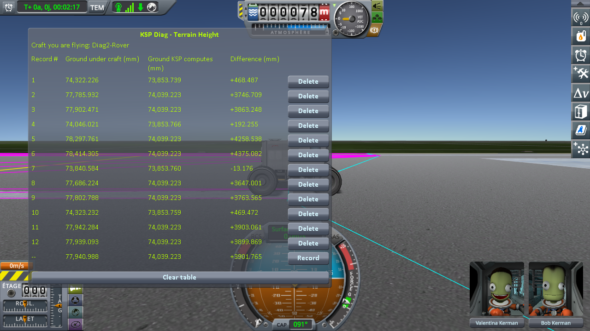
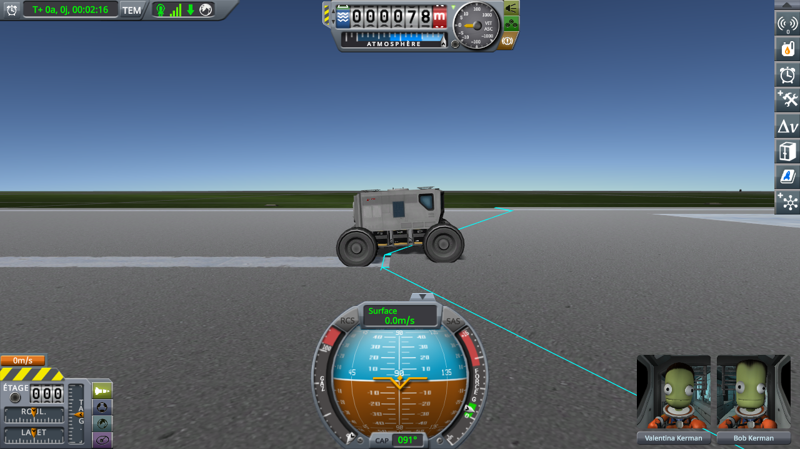
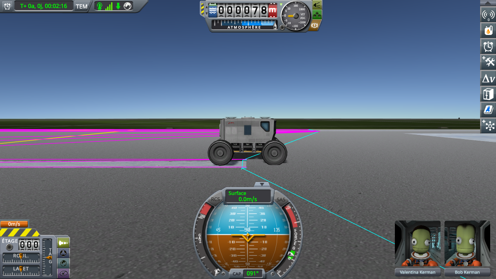
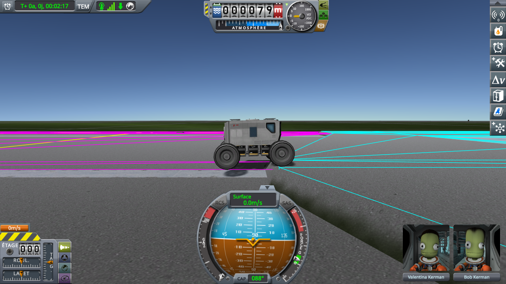
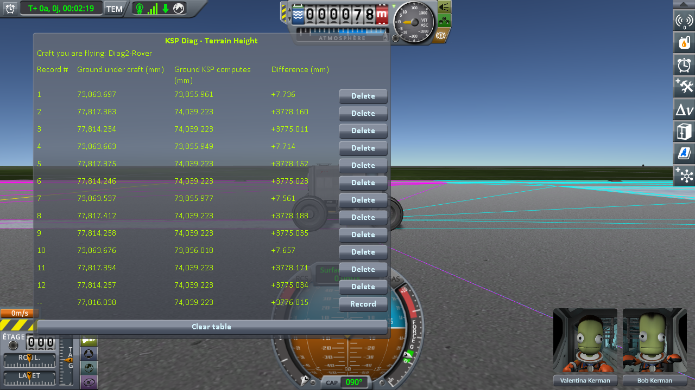
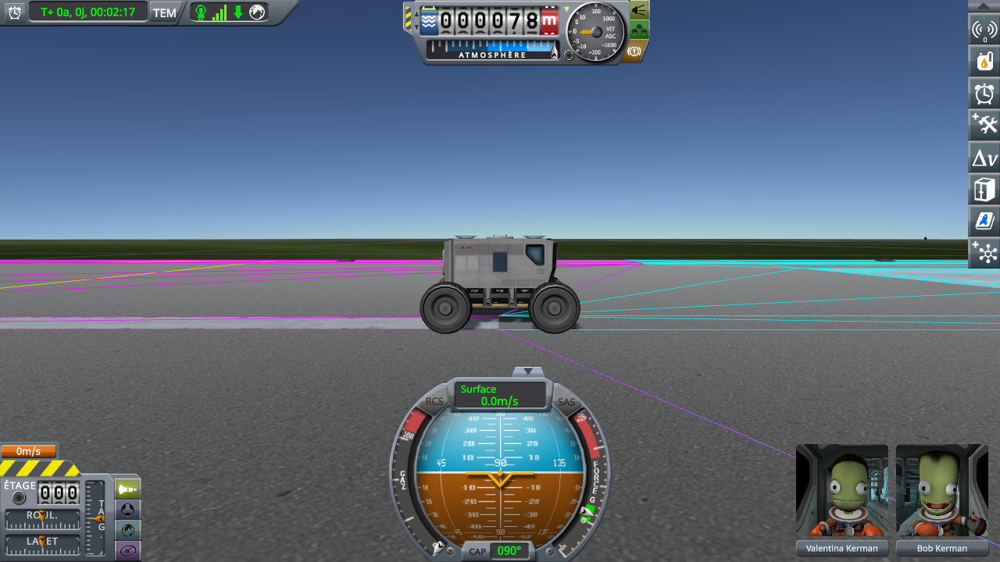
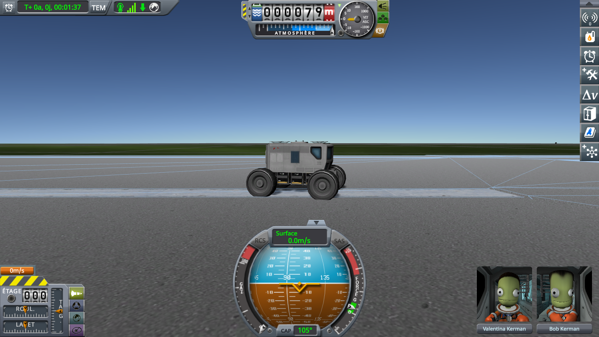
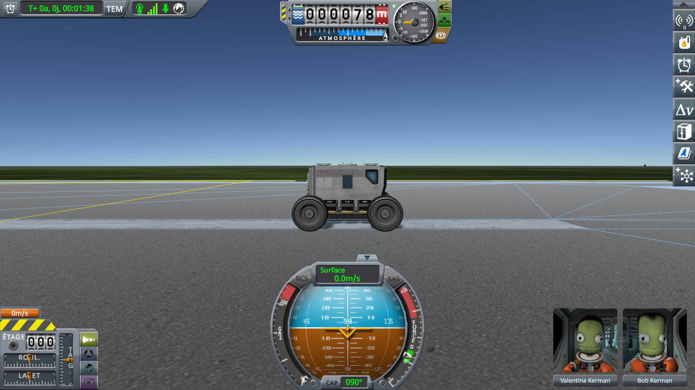

# Real Solar System: the runway fix

Part of [Terrain Precision Fix](../../../README.md), one test of [Non-regression tests](../../non-regression.md), on [Real Solar System](../real-solar-system.md).

**Status: checked on Earth — with this mod, the runway of the KSC stands at the same height at every load,
with no step on it, and the runway no longer moves when the floating origin does; so neither half of Real
Solar System's runway fix has anything left to correct for this defect.** The runway is a static, placed
like the buildings of the KSC ([The culprit: the statics](../../the-culprit-statics.md)), and this mod
places it in double while a craft is near ([The fix: the statics](../../the-fix-statics.md)).

## What Real Solar System does

Real Solar System ships a component of its own for the runway of the KSC, `RSSRunwayFix`
([its source, release 20.1.3.0](https://github.com/KSP-RO/RealSolarSystem/blob/v20.1.3.0/Source/RSSRunwayFix.cs)).
It does two things:

- **It turns off the colliders of the runway's sections.** Stock builds the runway in sections, each
  with a deck and a collider of its own, and gives the whole runway one more collider, `runway_collider`,
  in one piece (`RunwayCollisionHandler`). Once the sections are loaded, Real Solar System turns their
  colliders off, and leaves `runway_collider` alone to hold a craft.
- **It holds the floating origin while a craft rolls on the runway.** While the active craft is landed
  or in prelaunch, and a ray cast down from it hits `runway_collider`, it raises the distance at which
  KSP moves the floating origin back onto the craft to 2,700 m, and calls
  `FloatingOrigin.SetSafeToEngage(false)` every 25 physics frames: the origin does not move.

No setting turns either half off.

## What the runway does without it

The decks and colliders of the runway are separate objects hanging from the KSC, and each is placed
through a float `Transform` at planet scale, so each is rounded on its own — on Earth, by up to a float
step of 500 mm at that distance from the centre. Each is rounded twice, too: once where the game draws
it, once where the physics places it, two computations of the same position that do not round the same
way. Both change at every load. Depending on the load, a craft on the runway then finds:

- **the runway it touches above or below the runway it sees**: it rests in the air above the deck, or
  with its wheels sunk into it;
- **a step between the colliders of two sections**, which a wheel climbs.

Turning the sections' colliders off removes the step: only `runway_collider` is left, in one piece. It
cannot bring that piece back to the deck the game draws.

## The test

KSP 1.12.5 with Harmony, ModuleManager, KSP Community Fixes 1.41.1 and
[Real Solar System](https://github.com/KSP-RO/RealSolarSystem) 20.1.3.0 with what it requires (Kopernicus
248, Modular Flight Integrator, KSPTextureLoader, the RSS textures), and two instruments:

- [KSP Diag - Colliders](https://github.com/lhervier/KSP-Diag-Colliders) draws the colliders around the
  active craft where the physics places them, each in a colour of its own: here the end of the runway,
  `End09`, in magenta, and its fourth section, `Section4`, in cyan. It shows the step;
- [KSP Diag - Terrain Height](https://github.com/lhervier/KSP-Diag-TerrainHeight) reads, under a craft,
  the ground the physics touches and the ground KSP computes for the same spot. Every figure below is
  one of its lines: the first minus the second, in millimetres.

To see the runway without the runway fix, Real Solar System is built from the sources of its release
20.1.3.0 with `RSSRunwayFix` kept from doing anything: it returns at the top of its `Start`, so it
leaves the sections as stock does, never touches the floating origin, and never holds it. The version
of the assembly is set to that of the release
([`rss-20.1.3-without-its-runway-fix.diff`](../../../diag/non-regression/real-solar-system/the-runway-fix/rss-20.1.3-without-its-runway-fix.diff)).

The craft is the rover of the driving protocol,
[`Diag2-Rover.craft`](../../../diag/checking-the-culprit-driving/Diag2-Rover.craft), twice. In a new
sandbox game, at noon at Cape Canaveral:

1. a first rover, launched from the SPH onto the runway, is driven to the edge between `End09` and
   `Section4`, then 70 m north, down the bank, onto the grass: the witness of the ground, left there;
2. a second rover is launched from the SPH, driven east along the runway to 8 m before that edge, and
   saved (F5);
3. that save is loaded ten times (F9). At each load, Diag Terrain Height records three lines: under the
   witness on the grass (set as the target), under the rover 8 m before the edge, on `End09`, and under
   it 10 m past the edge, on `Section4`, where it drives at 2 m/s. Then the rover backs up until its back
   wheels stand on `End09` and its front wheels on `Section4`, and the camera looks at it from beside;
4. the rover is recovered, and 2 and 3 are played again, twice: three launches, thirty loads.

When a step stops the rover at the edge, it goes round by the grass: south down the bank of `End09`, east
on the grass past the edge, then north up the bank of `Section4`, which rises from the grass with no step,
and on to the same spot 10 m past the edge. In the sessions below, no step stopped it.

That is played without this mod, then with it at its defaults with `logLevel = Debug`, then with Real
Solar System as released, once without this mod and once with it: one launch, the rover read 8 m before
the edge.

*Played by a script.* [KSP-MCPServer](https://github.com/lhervier/KSP-MCPServer) plays the test through
[`diag/automation/run-runway-fix.py`](../../../diag/automation/run-runway-fix.py), the rover in the
`Ships/SPH` folder of the game: it starts the game itself from the main menu, and takes a screenshot of
the table of Diag Terrain Height every four loads. Every step is one a player can take: the test plays
just as well by hand.

## Seeing it

### Without the runway fix, without this mod

The runway is never at the same height twice, and the grass beside it does not follow. Over the thirty
loads, as Diag Terrain Height reads them:

| | lowest | highest |
|---|---|---|
| the grass, under the witness | −29.503 mm | +683.012 mm |
| the runway, 8 m before the edge | +3 433.022 mm | +4 674.030 mm |
| the runway, 10 m past the edge | +3 549.503 mm | +4 790.597 mm |

Past the edge, the runway stands **116.5 mm higher** than before it at 26 loads of the 30. At the four
others, it stands 0.5 to 3.2 mm lower: no step.

*Without the runway fix, without this mod: the table of Diag Terrain Height after the first four loads of
the first launch, three lines a load: the grass, before the edge, past it.*

*The same session: a load with the step, the rover backed onto the edge, its back wheels on `End09`
(magenta), its front wheels on `Section4` (cyan).*

*The same session: a load where the collider of `Section4` (cyan) lies below that of `End09` (magenta).*

*The same session, another launch: a load with the step, the runway at its highest of the thirty loads.*

### Without the runway fix, with this mod

The runway stands at the same height at every load, and so does the grass:

| | lowest | highest |
|---|---|---|
| the grass, under the witness | +7.184 mm | +7.749 mm |
| the runway, 8 m before the edge | +3 778.051 mm | +3 778.344 mm |
| the runway, 10 m past the edge | +3 774.873 mm | +3 775.180 mm |

Past the edge, the runway stands 3.1 or 3.2 mm lower than before it at every load: the slope of the deck
over 18 m, with no step.

*Without the runway fix, with this mod: the table of Diag Terrain Height after the first four loads of the
first launch.*

*The same session: the rover backed onto the edge, at the first load.*

### Real Solar System as released

The runway fix turns the sections' colliders off: `runway_collider` alone holds the rover, and no step is
left. It does not bring `runway_collider` back to the deck the game draws. One launch, the rover read 8 m
before the edge:

| | the runway, 8 m before the edge |
|---|---|
| without this mod | +4 460.347 mm |
| with this mod | +3 777.974 mm |

With this mod, the runway stands where it stood at every load without the runway fix, within 0.1 mm.

*Real Solar System as released, without this mod: the rover 8 m before the edge, the sections' colliders
off (pale blue).*

*Real Solar System as released, with this mod: the same, `runway_collider` in yellow.*

## What the results show

**Without this mod, the runway is not where it is drawn, and not in the same place twice.** Without the
runway fix, it stands more than a metre higher at one load than at another, and a step of 116.5 mm lies
between two of its sections at most loads; the grass beside it moves too, but not with it. As released,
with only `runway_collider` left, there is no step, but the runway is still where the physics rounded it:
a craft can rest with its wheels sunk into the deck. The runway fix removes the step, the only part of the
defect it can reach.

**With this mod, the runway is where it is drawn, in one piece.** The KSC and everything under it are
placed in double while a craft is near, so what the game draws and what the physics touches come from
the same position, and the sections line up. For this defect, the half of the runway fix that turns the
sections' colliders off has nothing left to correct. It may have other uses, outside the scope of this
fix.

**The hold on the floating origin: with this mod, a move of the origin moves nothing.** A rover alone by
the runway, Real Solar System built without its runway fix, reads a spot on the deck and a spot on the
grass beside it just before and just after each move of the origin, two moves a run, with the protocol
of the runway and the grass while the world moves of KSP Diag - Terrain Height. Without this mod, the
deck moves by −231.84 and +33.84 mm, together with the grass: what the runway fix holds the origin
against. With this mod, the deck moves by 0.034 mm at most, and the grass by 0.119 mm, within the spread
of the lines taken at the same spot. The readings are in
[Checking the statics: driving on while the world moves](../../checking-the-culprit-driving/the-statics.md#by-the-runway-of-the-ksc-at-cape-canaveral).
For this defect, the hold has nothing left to correct either.

The logs, what the script printed, every line of Diag Terrain Height and the screenshots of its table, for
every session, are in
[`diag/non-regression/real-solar-system/the-runway-fix/`](../../../diag/README.md#on-real-solar-system).
