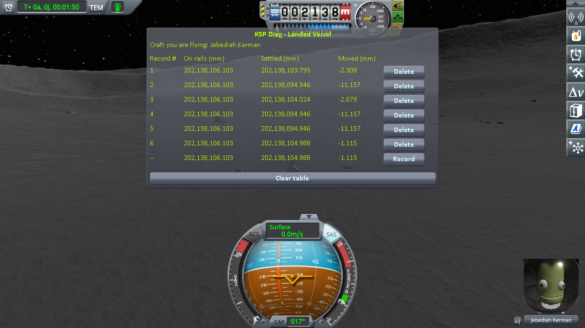

# Checking the ROCs: loading the same save

Part of [Terrain Precision Fix](../../../README.md), [the ROCs](../README.md#checked): the measurements that check [their culprit](../the-culprit.md), on a kerbal standing on a surface feature, handed back by a save, with this mod as installed and with its fix of the surface features turned off.

The features cannot be read directly by any instrument, so a kerbal is stood on one: since the feature
carries a collider, wherever it is placed at load is where the kerbal comes to rest.
[KSP Diag - Landed Vessel](https://github.com/lhervier/KSP-Diag-LandedVessel) measures the kerbal: the
distance from the kerbal to the centre of the body, as the save hands the kerbal back (*On rails*) and once it has
settled (*Settled*), and the difference (*Moved*). Its page carries its method.

This fix is built on top of [KSP Community Fixes](https://github.com/KSPModdingLibs/KSPCommunityFixes),
the base most players run, so this campaign is run in an install that has it: KSP 1.12.5 with the
Breaking Ground expansion, Harmony, ModuleManager, KSP Community Fixes 1.41.1, the instrument, and
[KSP-MCPServer](https://github.com/lhervier/KSP-MCPServer), which plays the protocol. Two configurations,
both with the terrain fix on: *ROC fix off*, with this mod and `fixRocs = false`; *with this mod*, as
installed, its fix of the surface features on ([The fix: the ROCs](../the-fix.md)). On stock the ground
itself moves at every load ([Checking the ground: loading the same save](../../ground/checking/loading.md)),
and the kerbal with it whatever the feature does: only with the ground held still does the kerbal tell
the feature's own move.

## The protocol

The protocol of the ground, with a kerbal on a surface feature instead of a capsule on bare ground: the
same save loaded six times, nothing touched in between, a *Record* once the live line stops moving,
never a save during the series. It is played by the same script,
[`run-loading.py`](../../../diag/ground/automation/run-loading.py).

**→ Full chapter: [The protocol: loading the same save](../../ground/checking/loading-protocol.md)**

The save, [`roc-mune-jeb.sfs`](../../../diag/rocs/checking/loading/roc-mune-jeb.sfs): Jebediah Kerman
standing on a small Mun stone, on the Mun (latitude −12.4400°, longitude 91.7898°), the pod Jebediah stepped
out of standing 6 m away. The stone carries one convex collider. Copy the save into the folder of a sandbox
game and load it from that game.

A kerbal is a craft of a single part, and KSP sets such a craft back onto the ground itself at load when it
finds it more than 10 cm off, with a line `ground contact! - error. Moving Vessel` in `KSP.log`. No such
line appears in either session: every load below is the stone's alone.

## The kerbal, over six loads

*Settled* and *Moved*, read off the screenshots below. *On rails* reads 202,138,106.103 mm on every line
of both.

| load | ROC fix off, *Settled* | *Moved* | with this mod, *Settled* | *Moved* |
|---|---|---|---|---|
| 1 | 202,138,103.795 mm | −2.308 mm | 202,138,096.670 mm | −9.433 mm |
| 2 | 202,138,094.946 mm | −11.157 mm | 202,138,096.671 mm | −9.432 mm |
| 3 | 202,138,104.024 mm | −2.079 mm | 202,138,096.674 mm | −9.428 mm |
| 4 | 202,138,094.946 mm | −11.157 mm | 202,138,096.678 mm | −9.425 mm |
| 5 | 202,138,094.946 mm | −11.157 mm | 202,138,096.676 mm | −9.427 mm |
| 6 | 202,138,104.988 mm | −1.115 mm | 202,138,096.673 mm | −9.430 mm |
| **range** | **10.04 mm** | | **0.008 mm** | |

The 2 screenshots

In each screenshot, the bottom line is the loading in progress, still live, and is not counted: after the
sixth *Record*, it keeps showing that same sixth loading.

## What the measurements say

**With the ground held still, the stone still moves from load to load; with this mod as installed, it no
longer does.** With the fix of the surface features off, the kerbal settles at three heights 10 mm apart
over six loads: the stone comes back where the rounding of its holder puts it, and the ground under it,
corrected, does not. With this mod as installed, the holder hangs from the quad of the ground, and the
kerbal settles within 0.008 mm, load after load.

*Moved* is the same on every load with this mod, 9.4 mm down: the save was made without the fix of the
surface features, with the stone where its holder was drawn then, and the kerbal comes to rest on the stone where it now stands.

The saves, the logs and what the script printed are in
[the runs of the ROCs](../../../diag/rocs/README.md#loading-the-same-save).
