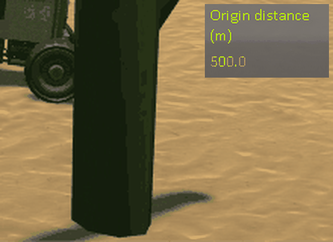

# Checking the scatter: driving on while the world moves

Part of [Terrain Precision Fix](../../../README.md), [the scatter](../README.md#checked): the measurements that check [its culprit](../the-culprit.md), around a rover that keeps driving while
the game moves its whole world, on stock, with this mod as installed, and with its scatter fix turned off.

[KSP Diag - Scatter](https://github.com/lhervier/KSP-Diag-Scatter) measures the terrain scatter against
the ground: for every quad carrying scatter around the craft, the height of its holders and of the matrices
they are drawn with, and for the objects of the quad nearest to the craft, the height of their vertices above
the ground. After a load, it is read in
[Checking the scatter: loading the same save](loading.md).

This fix is built on top of [KSP Community Fixes](https://github.com/KSPModdingLibs/KSPCommunityFixes),
the base most players run, so every campaign on this page is run in an install that has it: KSP 1.12.5
with Harmony, ModuleManager, KSP Community Fixes 1.41.1, the instrument, and
[KSP-Util-MCPServer](https://github.com/lhervier/KSP-Util-MCPServer), which drives the rover. Three configurations:
*on stock*, that install without this mod; *scatter fix off*, with this mod and `fixScatter = false`, its
terrain fix alone; *with this mod*, as installed, its scatter fix on ([The fix: the
scatter](../the-fix.md)).

Every 500 m the craft you fly travels, KSP moves the floating origin back onto it, and with it the terrain
sphere, which carries the ground and the holders of the scatter alike. A rover alone on the grass south of
the runway of the KSC records the scatter just before a move of the origin, just after it, and the same few
metres farther on with no move: [The protocol: the scatter, while the world moves](driving-protocol.md),
played by its script, [`run-scatter-driving.py`](../../../diag/scatter/automation/run-scatter-driving.py). One move per
load, six loads per configuration. Every record holds the same 8 quads and 13 holders, all of them built,
and names the same nearest quad, `Kerbin Zn3010001020`, with 50 `Grass00` and 400 measured vertices. The
records are listed in [`diag`](../../../diag/scatter/README.md#the-scatter-the-objects-across-a-move-of-the-world).

**→ Full chapter: [The protocol: the scatter, while the world moves](driving-protocol.md)**

## The objects, across a move of the world

Across each move, in millimetres: the centre of the nearest quad, the *up* of every holder's matrix, and
the height of every measured vertex above the ground under it. Between the record just after the move and
the one a few metres farther on, with no move, none of these readings changes, in any configuration: 0.000
mm everywhere.

| | load | centre of the nearest quad | *up* of the holders | each vertex above the ground |
|---|---|---|---|---|
| on stock | 1 | **−11.53** | 0.00 | −0.12 to +0.10 |
| | 2 | **−49.51** | 0.00 | −0.13 to +0.12 |
| | 3 | **−7.94** | 0.00 | −0.09 to +0.09 |
| | 4 | **+0.51** | 0.00 | −0.05 to +0.12 |
| | 5 | **+4.00** | 0.00 | −0.06 to +0.09 |
| | 6 | **−0.88** | 0.00 | −0.06 to +0.06 |
| scatter fix off | 1 | +0.02 | **+19.10 to +19.25** | **+18.28 to +19.71** |
| | 2 | −0.01 | **−7.60 to −7.54** | **−8.54 to −6.21** |
| | 3 | +0.01 | **+8.24 to +8.33** | **+8.12 to +8.39** |
| | 4 | −0.02 | **−42.63 to −42.56** | **−43.25 to −41.49** |
| | 5 | +0.01 | **−53.82 to −53.71** | **−54.27 to −52.99** |
| | 6 | +0.00 | **+4.20 to +4.24** | **+3.59 to +4.70** |
| with this mod | 1 | −0.04 | 0.00 | −0.12 to +0.10 |
| | 2 | +0.01 | 0.00 | −0.12 to +0.18 |
| | 3 | −0.04 | 0.00 | −0.12 to +0.15 |
| | 4 | +0.02 | 0.00 | −0.08 to +0.12 |
| | 5 | −0.01 | 0.00 | −0.12 to +0.12 |
| | 6 | +0.01 | 0.00 | −0.10 to +0.14 |

The rover is 500 m from the origin of the world, where a reading has a precision of a little over a
tenth of a millimetre: the spread of the last column on stock and with this mod is that, and
nothing more.

**On stock**, the ground jumps at the move, by up to 49.5 mm, and the scatter jumps with it: every holder
keeps the same offset from its quad, and every object stays where it was against the ground. The quad and
its holders hang from the same sphere, through the same frame, and round the same way when it moves.

**With the scatter fix off**, the ground holds, and the scatter jumps against it: every holder of the record
at once, by
the same amount, from 4 to 54 mm depending on the load. The terrain fix took the quad out of that frame;
the holder is still in it, and draws a new rounding at every move of the world.

**With this mod**, the holders hang from their quads, and nothing jumps: neither the ground nor
the scatter.

## Seen in the game

The same jump, filmed on a cactus in a desert of Kerbin, with this mod and its scatter fix turned off. A rover
stops a metre short of the cactus, 495.8 m from the origin, then creeps on at 0.15 m/s until the origin
moves: slowly, so that the camera, which follows the rover, keeps the scene still. Below, the frame just
before the move and the frame just after it, in turn, cropped around the foot of the cactus and enlarged
three times; inlaid in the corner, *Origin distance* from the window of
[KSP Diag - Floating Origin](https://github.com/lhervier/KSP-Diag-FloatingOrigin), which drops from 500.0 m
to 0.1 m at the move.

*Watch the foot of the cactus, where it meets the sand, and its shadow: at each switch, the cactus sinks
into the sand by almost 5 cm and shifts sideways, while the sand around it and the rover behind it do not
move. Nothing else changed between the two frames, a sixth of a second apart: the rover crept on by about
2 cm.*

[KSP Diag - Scatter](https://github.com/lhervier/KSP-Diag-Scatter) recorded the scatter right before and
right after this move: the 148 holders around the rover jumped by −47.2 to −48.1 mm, and the 50 vertices
measured on the 5 cactus of the nearest quad by −44.9 to −46.7 mm against the ground, which moved by
0.3 mm at most
([`cactus-fix-no-scatter-before.log`](../../../diag/scatter/checking/driving/cactus-fix-no-scatter-before.log),
[`cactus-fix-no-scatter-after.log`](../../../diag/scatter/checking/driving/cactus-fix-no-scatter-after.log)). Each load
draws its own jump, small or large; this take was kept for being one of the largest. How it was filmed is
in [the protocol](driving-protocol.md#filming-it).

## What the measurements say

**While you drive, the terrain fix alone makes the scatter jump against the ground; neither stock nor this
mod as installed does.** On stock, the ground jumps at every move of the world, and the scatter with it, so
the scatter
stays on its ground. With the scatter fix off, the ground no longer jumps, but the scatter still does, by up
to 54 mm in these
six moves: a limit of the terrain fix,
[The scatter](../limits/stock/the-scatter.md). With this mod as installed, neither moves.
