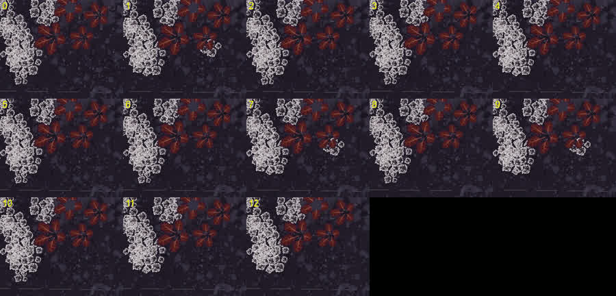
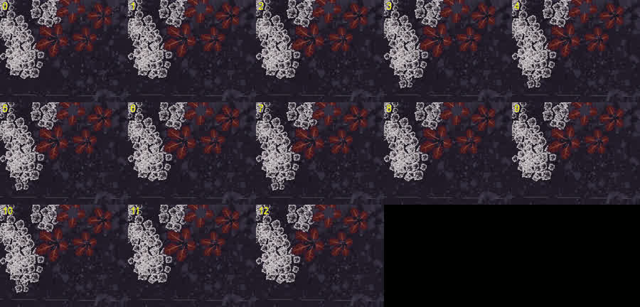

# Parallax: its scatter grows the same at every load

Part of [Terrain Precision Fix](../../../../README.md), [the scatter](../../README.md#non-regression-tests): one non-regression test, on Parallax.

**Status: checked on Eve — with the ground of stock KSP, an object of the scatter of Parallax here and
there grows at one load and not at the next; with this mod, the same objects grow at every load.**
Parallax decides where each object of its scatter grows from the mesh of the terrain quad, and stock builds
that mesh a little differently at every load
([Why it is different at every load](../../../ground/the-culprit.md#why-it-is-different-at-every-load)): an
object that sits right on one of the thresholds Parallax applies grows at one load and not at the next.
This mod builds the same mesh at every load, and the object makes the same choice every time.

## The protocol

KSP 1.12.5 with Harmony, ModuleManager, KSP Community Fixes 1.41.1,
[Parallax Continued](https://github.com/Gameslinx/Parallax-Continued) 1.0.4 rebuilt with the first commit of
our change, since released in 1.0.5
([Its rocks no longer turn at every load](../../../ground/non-regression/parallax/what-it-does-with-the-ground.md#its-rocks-no-longer-turn-at-every-load)),
so that nothing turns from one load to the next, with its stock textures and what it requires, and
[KSP Diag - Colliders](https://github.com/lhervier/KSP-Diag-Colliders); this mod, or not.

Copy [`rocks-eve-jeb.sfs`](../../../../diag/scatter/non-regression/parallax/its-scatter-grows-the-same-at-every-load/rocks-eve-jeb.sfs)
into the folder of a sandbox game and load it: a kerbal on the ground of Eve, among rocks and plants. Look
at him from straight above, from some 40 m, and take a screenshot; load the same save again at once, with
no time played, and take the same screenshot; twelve times. Then the same without this mod, and with it.
[`run-rocks-turning.py`](https://github.com/lhervier/KSP-ExtMod-ParallaxContinued/blob/claude/scatter-rotation-tests/docs/scatter-rotation/automation/run-rocks-turning.py)
of our fork of Parallax plays it through KSP-MCPServer:
`--save rocks-eve-jeb --radius 700000 --step 0`.

## Twelve loads

*The grove at the left of the view, cropped, at the first load (0) and at the twelve loads after it. Top:
without this mod. Bottom: with it. The line of KSP Diag - Floating Origin at each load and the `KSP.log`
of each session:
[`the-same-objects/`](../../../../diag/scatter/non-regression/parallax/its-scatter-grows-the-same-at-every-load/the-same-objects/).*

Without this mod, the white plant under the red ones shows at 3 loads out of 12; with it, at none. The
same series played three times more with other builds of Parallax gave 9 loads out of 36 without this
mod, and none out of 32 with it.

What still changes on Eve from one load to the next with this mod, the small pebbles drawn in the
texture of the ground, comes from Parallax itself and not from the ground
([The texture of the ground slides](../../../ground/non-regression/parallax/what-it-does-with-the-ground.md#the-texture-of-the-ground-slides)).
