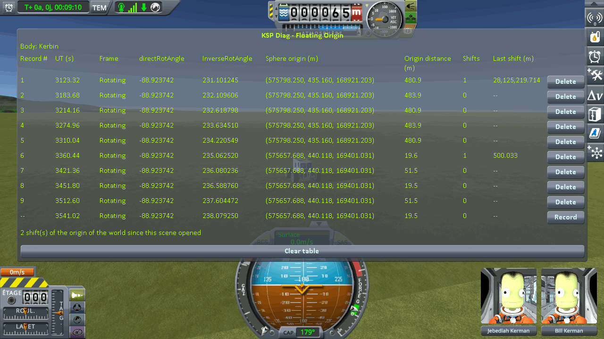
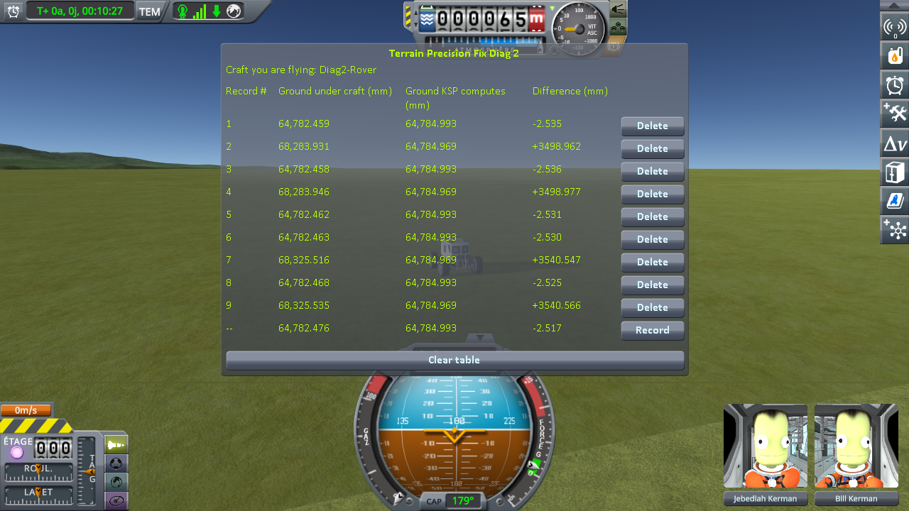
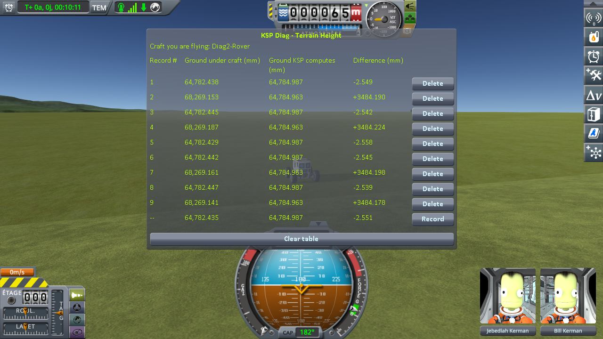
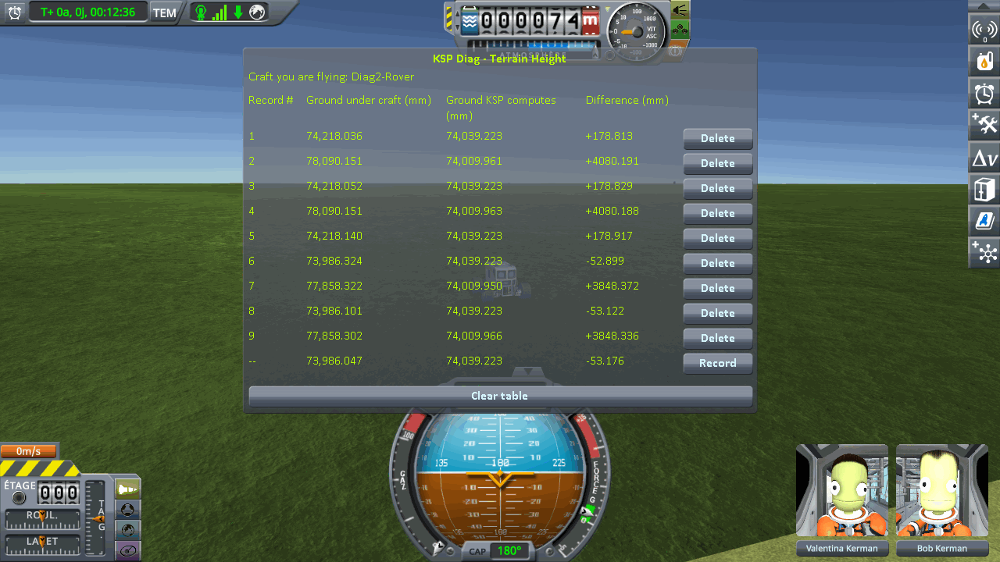
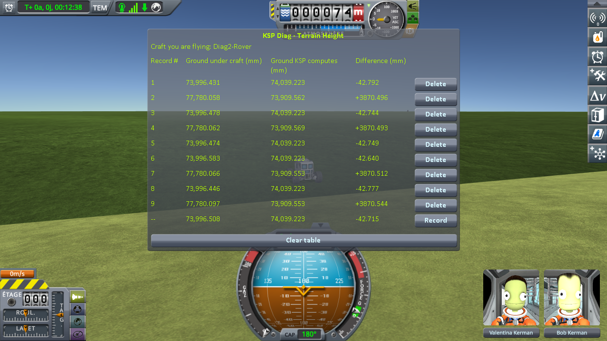

# Checking the statics: driving on while the world moves

Part of [Terrain Precision Fix](../../../README.md), [the statics](../README.md#checked): the measurements that check [its culprit](../the-culprit.md), under a rover by the runway of the
KSC while the game moves its whole world, on stock and with this mod, on Kerbin and on Earth in Real
Solar System. The install and the instruments are described in
[the checks of the statics](../README.md#checked).

Every 500 m the craft you fly travels, KSP moves the floating origin back onto it, and with it the
terrain sphere, which carries the runway of the KSC too. A rover alone by it reads a spot on the grass, G,
and a spot on the deck, P, two or three times each before a move of the origin and twice after it, nine
lines a move. A script drives the rover through
[KSP-MCPServer](https://github.com/lhervier/KSP-MCPServer) and parks it on the same spots to within a
centimetre. It is the
[protocol of the runway and the grass while the world moves](driving-protocol.md), on its saves,
in the same install, played by its script,
[`run-driving-runway.py`](../../../diag/statics/automation/run-driving-runway.py); on Earth, Real Solar System is built without its runway fix, which keeps the floating origin from
moving at 500 m once a craft has rolled onto the deck
([`rss-20.1.3-without-its-runway-fix.diff`](../../../diag/statics/non-regression/real-solar-system/the-runway-fix/rss-20.1.3-without-its-runway-fix.diff);
see [Real Solar System: the runway fix](../non-regression/real-solar-system/the-runway-fix.md)). This mod corrects
the terrain and the statics separately, each with its own setting (`fixTerrain`, `fixStatics`), so on
Kerbin the runway is read three ways: on stock, with the terrain fix alone, and with both. On Earth, on
stock and with this mod as it is installed. Across each move, the mean of the lines after minus the mean
of the lines before.

**→ Full chapter: [The protocol: the runway and the grass, while the world moves](driving-protocol.md)**

## By the runway of the KSC

Across each move, in millimetres:

| | move | the grass, G | the deck, P | the step, P − G | spread at a spot, at most |
|---|---|---|---|---|---|
| on stock | 1 | **−54.833** | **−54.847** | −0.014 | 0.073 |
| | 2 | **+53.816** | **+53.776** | −0.041 | 0.062 |
| with the terrain fix alone | 1 | +0.006 | **+41.587** | **+41.581** | 0.019 |
| | 2 | +0.004 | **−22.311** | **−22.315** | 0.017 |
| with both fixes | 1 | +0.007 | −0.019 | −0.026 | 0.034 |
| | 2 | −0.002 | −0.068 | −0.066 | 0.102 |

**On stock**, one run, logged in [`driving-runway-stock.log`](../../../diag/statics/checking/driving/driving-runway-stock.log); what
the script printed is in [`driving-runway-stock-script.txt`](../../../diag/statics/checking/driving/driving-runway-stock-script.txt),
and every line it recorded in [`driving-runway-stock-lines.json`](../../../diag/statics/checking/driving/driving-runway-stock-lines.json).
G stood 474 to 481 m from the origin of the world before each move, and the rover stopped 14 to 15 cm
from each spot. **Ground KSP computes** reads the same digits at a spot on every line of a move, to
within a thousandth of a millimetre. In *Difference*, in millimetres:

| move | G before | G after | P before | P after |
|---|---|---|---|---|
| 1 | −16.774, −16.782, −16.782 | −71.576, −71.649 | +3539.496, +3539.502 | +3484.653, +3484.651 |
| 2 | −55.219, −55.205, −55.208 | −1.364, −1.425 | +3025.245, +3025.253 | +3079.021, +3079.027 |

The first move, Diag FloatingOrigin then Diag TerrainHeight:

The second move, in [`stock-move2-diag3.png`](../../../imgs/statics/checking/driving/stock-move2-diag3.png)
and [`stock-move2-diag2.png`](../../../imgs/statics/checking/driving/stock-move2-diag2.png).
A third move, about 1.5 km east of the save, is left out: there, *Difference* reads about 0.7 m below
the computed height on the grass, the rover stopped 19 to 41 cm from the spots, and the lines taken at
a spot spread over up to 26.7 mm, as much as a move does
([`stock-move3-diag3.png`](../../../imgs/statics/checking/driving/stock-move3-diag3.png),
[`stock-move3-diag2.png`](../../../imgs/statics/checking/driving/stock-move3-diag2.png)).

**With the terrain fix alone**, an earlier run, played with an earlier version of the script, `fixStatics = false` in this mod's settings, the only line changed. The
session is logged in
[`driving-runway-diag2-fix-terrain-only.log`](../../../diag/statics/checking/driving/driving-runway-diag2-fix-terrain-only.log),
what the script printed in
[`driving-runway-diag2-fix-terrain-only-script.txt`](../../../diag/statics/checking/driving/driving-runway-diag2-fix-terrain-only-script.txt)
and every line it recorded in
[`driving-runway-diag2-fix-terrain-only-lines.json`](../../../diag/statics/checking/driving/driving-runway-diag2-fix-terrain-only-lines.json).
At the second move, the rover stalled against the lip of the deck on its way to P and stopped 0.79 m
from the spot, at the same place each time: its readings there agree to 0.017 mm. On the last visit to
P, after the move, it stopped 9.7 m away, and that line is left out: P has one line after that move.

**With both fixes**, this mod as it is installed, the same script as on stock. The session is logged in
[`driving-runway-diag2-fix.log`](../../../diag/statics/checking/driving/driving-runway-diag2-fix.log), what the script
printed in [`driving-runway-diag2-fix-script.txt`](../../../diag/statics/checking/driving/driving-runway-diag2-fix-script.txt) and
every line it recorded in
[`driving-runway-diag2-fix-lines.json`](../../../diag/statics/checking/driving/driving-runway-diag2-fix-lines.json). G stood 476 to
482 m from the origin before each move, and the rover stopped 12 to 17 cm from each spot. The third
move is left out, as on stock: the lines taken at a spot there spread over up to 26.7 mm.

## By the runway of the KSC at Cape Canaveral

Across each move, in millimetres:

| | move | the grass, G | the deck, P | the step, P − G | spread at a spot, at most |
|---|---|---|---|---|---|
| on stock | 1 | **−231.864** | **−231.835** | +0.028 | 0.223 |
| | 2 | **+34.188** | **+33.838** | −0.350 | 0.273 |
| with this mod | 1 | +0.053 | +0.034 | −0.020 | 0.137 |
| | 2 | +0.119 | −0.001 | −0.119 | 0.282 |

**On stock**, one run, two moves, logged in
[`driving-runway-earth-rss-stock.log`](../../../diag/statics/checking/driving/driving-runway-earth-rss-stock.log); what the script
printed is in [`driving-runway-earth-rss-stock-script.txt`](../../../diag/statics/checking/driving/driving-runway-earth-rss-stock-script.txt),
and every line it recorded in [`driving-runway-earth-rss-stock-lines.json`](../../../diag/statics/checking/driving/driving-runway-earth-rss-stock-lines.json).
G stood 475 to 477 m from the origin of the world before each move, and the rover stopped 13 to 16 cm
from each spot. **Ground KSP computes** reads the same digits at a spot on every line of a move, to
within two hundredths of a millimetre. In *Difference*, in millimetres:

| move | G before | G after | P before | P after |
|---|---|---|---|---|
| 1 | +178.813, +178.829, +178.917 | −52.899, −53.122 | +4080.191, +4080.188 | +3848.372, +3848.336 |
| 2 | −127.158, −127.109, −127.126 | −92.807, −93.080 | +3680.736, +3680.735 | +3714.574, +3714.573 |

The other screenshots, read by both instruments, are `earth-stock-move*.png` in
[`imgs/statics/checking/driving/`](../../../imgs/statics/checking/driving).

**With this mod**, on the same save. The session is logged in
[`driving-runway-earth-rss-diag2-fix.log`](../../../diag/statics/checking/driving/driving-runway-earth-rss-diag2-fix.log),
what the script printed in
[`driving-runway-earth-rss-diag2-fix-script.txt`](../../../diag/statics/checking/driving/driving-runway-earth-rss-diag2-fix-script.txt)
and every line it recorded in
[`driving-runway-earth-rss-diag2-fix-lines.json`](../../../diag/statics/checking/driving/driving-runway-earth-rss-diag2-fix-lines.json).
The rover stopped 13 to 16 cm from each spot, and G stood 475 to 477 m from the origin before each move;
Diag FloatingOrigin reads a move of 500.0 m, to within three centimetres, on the first line after each. The log shows
this mod taking the KSC out of its sphere once, as the save loads, and holding it there through both
moves.

The screenshots of every move by the runway, on Kerbin and on Earth, read by both instruments, are in
[`imgs/statics/checking/driving/`](../../../imgs/statics/checking/driving).

## What the measurements say

**The runway moves too, and correcting the terrain is not enough.** On stock, at every move of the
floating origin, the deck of the KSC moves — by −54.85 and +53.78 mm on Kerbin — together with the grass
beside it, to within four hundredths of a millimetre: both hang from the terrain sphere, whose position
is written in float anew at each move, and both are carried by that same new rounding. With the terrain
fix alone, the grass holds, within six thousandths of a millimetre, and the deck still moves on its own,
by +41.59 and −22.31 mm: the terrain fix does not reach a static. With both fixes, neither moves, within
seven hundredths of a millimetre on the deck over two moves: the statics fix holds the runway through a
move of the origin as it does through a loading.

**On Earth, where a float's step is eight times larger, the same.** On stock, the deck and the grass
move together, by −231.84 and +33.84 mm: a rover rolling on the runway is no better off than one on the
grass, which moves by up to 243 mm across a move. With this mod, the deck moves by 0.034 mm at most, and
the grass by 0.119 mm, within the spread of the lines taken at the same spot, 0.282 mm: the origin
moves, and nothing under the rover does.
