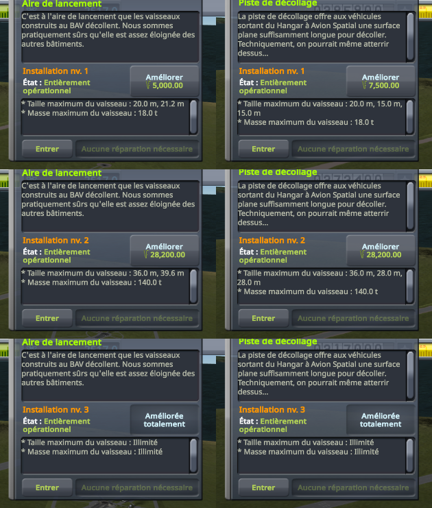

# Facility levels

Part of [Terrain Precision Fix](../../../../README.md), [the statics](../../README.md#non-regression-tests): one non-regression test, on stock.

**Status: checked on Kerbin.** At each of their three levels, a craft launched onto the launchpad stands on
the launchpad of that level, and one launched onto the runway on the runway of that level, as without this
mod. With it, each stays within 0.24 mm through its arrivals; without it, they move by up to 174 mm.

*Why.* KSP finds an upgradeable facility by its path below the KSC, as it does a destructible building, and
builds each level by replacing the model of the facility below the KSC, which this mod moves out of its
terrain sphere in flight ([The fix: the statics](../../the-fix.md)). The levels have models of their
own, colliders included, at heights of their own: the test checks that each level comes in place, and that
the craft arrives on it where it did, level by level.

## The test

A new career at the Custom difficulty: the largest starting funds and science (500 000 and 5 000), funds
penalties at 10 %, for the upgrades below, and *Bypass Entry Purchase After Research* on. The Research and
Development upgraded twice, to its last level, and the nodes the craft below need researched. That career is
[`career-with-the-parts.sfs`](../../../../diag/statics/non-regression/stock/destroyed-buildings/career-with-the-parts.sfs): copied as `persistent.sfs` into
a new folder of `saves`, it opens at the space centre. Its building impact damage multiplier is at 1, the
largest, for [Destroyed buildings](destroyed-buildings.md); it changes nothing here. Then, at each level of
the launchpad and the runway, starting from the first, the one a new career starts with:

1. the menus of the launchpad and the runway, opened for their level;
2. the Vehicle Assembly Building entered through its building, and
   [`Diag3-Rocket.craft`](https://github.com/lhervier/KSP-Diag-FloatingOrigin/blob/main/craft/Diag3-Rocket.craft)
   launched onto the launchpad; *Revert to Launch*, twice; a quicksave (F5), then a quickload of it (F9);
   *Recover*;
3. the Space Plane Hangar entered through its building, and
   [`Diag3-Rover.craft`](https://github.com/lhervier/KSP-Diag-FloatingOrigin/blob/main/craft/Diag3-Rover.craft)
   launched onto the runway, its brakes put on at once, and again after each revert; the same reverts,
   quicksave and quickload; *Recover*;
4. the launchpad and the runway upgraded from their menus (*Upgrade*), for the next level.

That makes four arrivals on each of the three launchpads and the three runways. At each one, once the
craft has settled, [KSP Diag - Terrain Height](https://github.com/lhervier/KSP-Diag-TerrainHeight)
records a line (its button *Record*): the ground under the craft, the facility, and the ground KSP computes
for the same spot.

KSP 1.12.5 with Harmony, ModuleManager, KSP Community Fixes 1.41.1, KSP Diag - Terrain Height, and this mod
with its defaults at `logLevel = Debug`. Then the same without this mod.

*Played by a script.* [KSP-Util-MCPServer](https://github.com/lhervier/KSP-Util-MCPServer) plays the test through
[`diag/statics/automation/run-facility-levels.py`](../../../../diag/statics/automation/run-facility-levels.py), the rocket in the
`Ships/VAB` folder of the game and the rover in its `Ships/SPH` folder: it starts and sets up the career
itself from the main menu, closes the guide of a new career wherever it shows, and takes a screenshot of
the table of Diag Terrain Height every twelve arrivals. Every step is one a player can take: the test plays
just as well by hand.

## The result

The menus show each facility at each level, with this mod as without it (launchpad on the left, runway on
the right):

At each level, the craft stands on the model of that level, at a height of its own: with this mod, at the
same height at every arrival, higher at each level; without it, around the same heights, within the spread
of its arrivals. The height of the facility under the craft above the ground KSP computes, lowest and
highest over its arrivals:

| | without this mod | with this mod |
|---|---|---|
| launchpad, level 1 | 2 716.217 to 2 722.470 mm (6.253 mm) | 2 747.132 to 2 747.240 mm (0.108 mm) |
| launchpad, level 2 | 4 876.859 to 4 980.296 mm (103.437 mm) | 4 954.367 to 4 954.433 mm (0.066 mm) |
| launchpad, level 3 | 7 617.780 to 7 766.939 mm (149.159 mm) | 7 628.918 to 7 628.981 mm (0.063 mm) |
| runway, level 1 | 4 044.329 to 4 195.717 mm (151.388 mm) | 4 063.833 to 4 063.972 mm (0.139 mm) |
| runway, level 2 | 4 099.778 to 4 143.807 mm (44.029 mm) | 4 116.663 to 4 116.759 mm (0.096 mm) |
| runway, level 3 | 4 218.304 to 4 392.319 mm (174.015 mm) | 4 301.077 to 4 301.316 mm (0.239 mm) |

Before every exit from the flight, the log with this mod shows the KSC put back under its sphere, and
after every arrival, taken out again: 24 times each. The logs with this mod show no error that the logs
without it do not show.

The logs, what the script printed, every line of Diag Terrain Height and the screenshots of its table, for
both sessions, are in
[`diag/statics/non-regression/stock/facility-levels/`](../../../../diag/statics/README.md#the-facility-levels-protocol).
