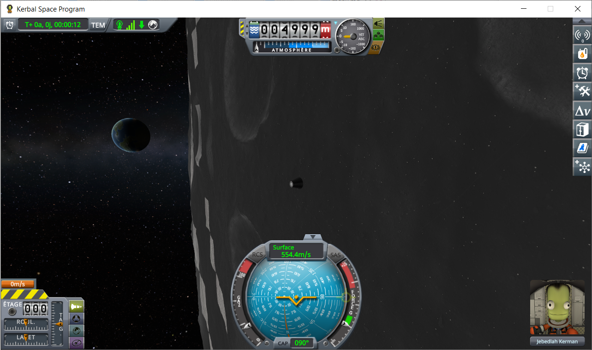
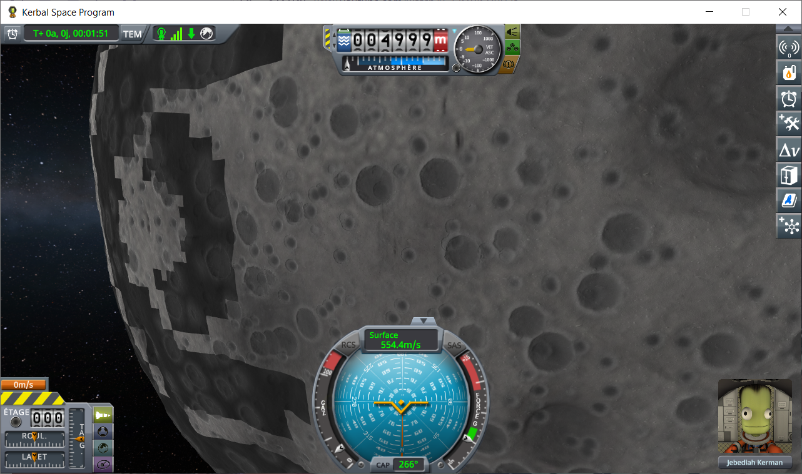
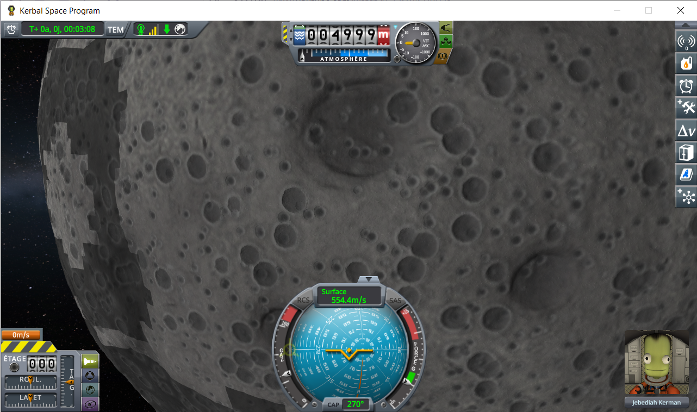
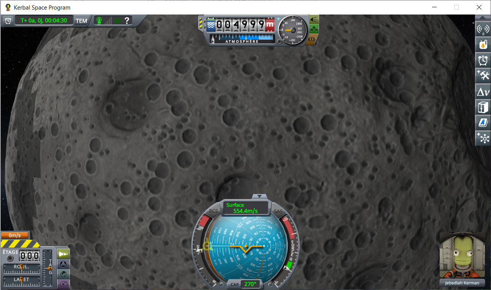

# BurstPQS: darker quads on the Mun

Part of [Terrain Precision Fix](../../../README.md), one point of [Work in progress](../../work-in-progress.md), on [BurstPQS](../../work-in-progress/burst-pqs.md).

**Status: in progress — seen, compared: BurstPQS's own.** Seen first in the flight of the scatter protocols
([in flight](../../checking-the-culprit-flight/the-scatter-protocol.md), on `ref-mune-5km`: a capsule in a
circular orbit 5 km above the Mun), with BurstPQS, with and without this mod. Whole quads of the ground are
drawn much darker than their neighbours, with stepped edges that follow the quads, while the craters run on
unbroken from one quad to the next: the relief is right, the shading of whole quads is not. Played again
without this mod, on three installs: the darker quads show with BurstPQS only, not on KSP with KSP Community
Fixes alone, nor with Kopernicus alone. They show when the flight is opened from the space centre, and fade
within the first two minutes or so; loading the same save again from that flight brings none.

## The protocol

The same flight in three installs, each from a freshly started KSP:

- KSP 1.12.5 with KSP Community Fixes;
- the same, with Kopernicus and what it requires (Modular Flight Integrator, KSPTextureLoader), without
  BurstPQS;
- the same, with BurstPQS and what it requires (Kopernicus, Modular Flight Integrator, KSPTextureLoader,
  KSPBurst).

In each: copy [`ref-mune-5km.sfs`](../../../diag/checking-the-culprit-flight/scatter/ref-mune-5km.sfs)
into a sandbox game, open that game from the main menu (the space centre shows), load the save, and at once
pull the camera back with the mouse wheel until the edge of the Mun shows, then turn it to look back along the
orbit, at the ground the capsule has just flown over. Take a screenshot every 5 seconds for 5 minutes. The
flight opens with the capsule pointing along its orbit; nothing is touched but the camera.

The same, played by script through [KSP-MCPServer](https://github.com/lhervier/KSP-MCPServer):
[run-darker-quads.py](../../../diag/automation/run-darker-quads.py) loads the save from the space centre, sets
the camera as soon as the flight shows, and takes the screenshots:

```
python run-darker-quads.py --folder <your sandbox game> --save ref-mune-5km --distance 21119 --heading 81.5 --pitch 5.5 --out out
```

The camera's heading and pitch in orbit are counted in a frame that turns with the capsule's place on its
orbit: these values give the view below at the start of the flight only, a few minutes later they put the
camera inside the Mun.

## What it shows

As the flight opens and 20 seconds later, the three installs side by side (the camera set by the script, the
same in all three):


With BurstPQS, the same flight at 60, 120 and 180 seconds (the view drifts as the capsule moves on along its
orbit):


With BurstPQS, the flight opened from the space centre, and the same save loaded again from that flight about a
minute and a half in, without leaving it, the camera set the same way, both at 35 seconds:


The first flight it was seen in, with BurstPQS and this mod: twelve seconds in, the camera as the flight
opens, most of the Mun in view is dark, with a band of light and dark blocks along its edge.



The camera pulled back to about 80 km, at 1 min 51 s, 3 min 08 s and 4 min 30 s: some quads turn normal again
while others darken, and almost all are normal at the end.







## Where it could come from

Read in BurstPQS's code, not checked in the game. The darker quads are those built as the scene opens:
loading again in flight, which keeps the Mun's terrain already built, brings none. `UVPlanetRelativePosition`
writes into the second UV channel of each vertex `1 − dot(direction of the vertex from the centre, normal)`,
the steepness the terrain shader reads to blend in the texture of steep slopes: a quad whose steepness is
wrong everywhere is drawn as a slope, darker, with its relief untouched. BurstPQS works it out again, as stock
does, whenever the normals of a quad's edges are updated (`PQSMod_UVPlanetRelativePosition.OnQuadUpdateNormals`,
patched), from `quad.verts + quad.positionPlanet`: right only if the quad's vertices are relative to
`positionPlanet`, without rotation. BurstPQS builds a quad's vertices relative to a frame chosen by
`BatchPQS.TryGetPlanetToQuad`: a translation alone for a quad in its storage of the rotating frame, otherwise
the quad's transform relative to the sphere, or through the world, rotation included. As the scene opens,
before the world turns with the body, quads are built by the last two. Which channel actually differs on a
dark quad is the first thing to read.

The other leads of the code, less likely now: the tangents BurstPQS approximates, and the renderers it
switches on and off in batches, would not depend on how the flight was opened.

## Seen at the same time: the camera held short of the north pole

In the first flight, with the camera pulled back: the camera could be turned to look at the south pole of
the Mun, but not to look at the north pole, held a few degrees short. Not compared yet without BurstPQS; it
may be the stock camera.

*To test:* in each of the three installs, the camera pulled back until the whole Mun shows, turn it towards
the north pole, then towards the south pole, and note where it stops.

## To test

- **Which quads, and what differs on them.** In the BurstPQS install, the screenshots above at 0 s, a dark
  quad and a normal one next to it: read the vertices' second UV channel and the normals of both, and their
  level of subdivision. To show to BurstPQS's author.
- **Leaving the flight and coming back.** In the BurstPQS install, after the first flight, go to the space
  centre and load the save again: if the darker quads come back, they come with the terrain being built
  again, not with the first flight of a KSP session.
