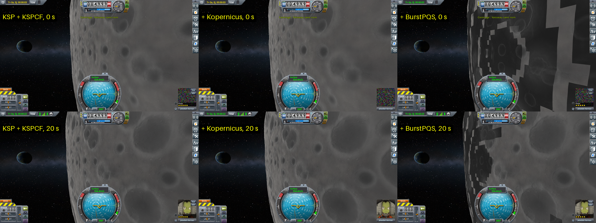
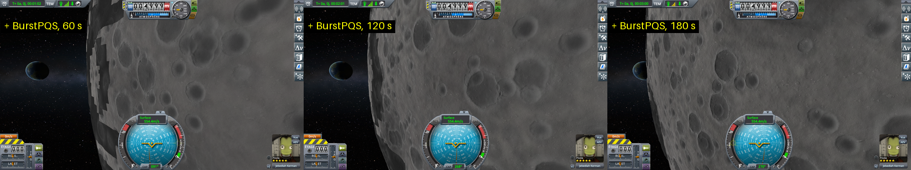
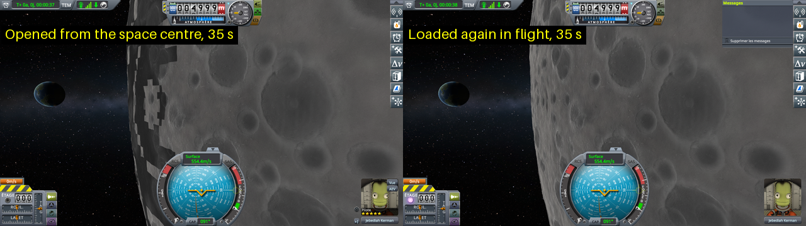
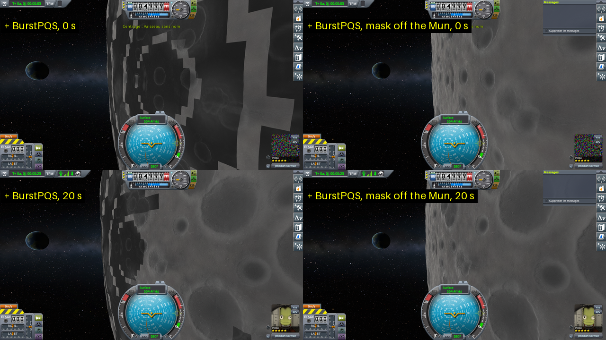
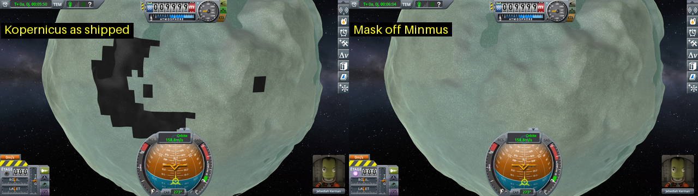
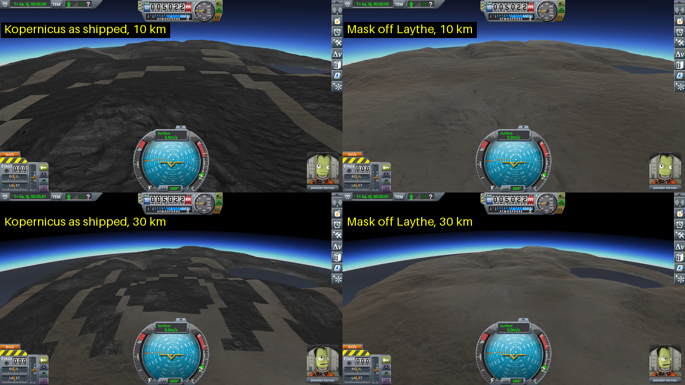
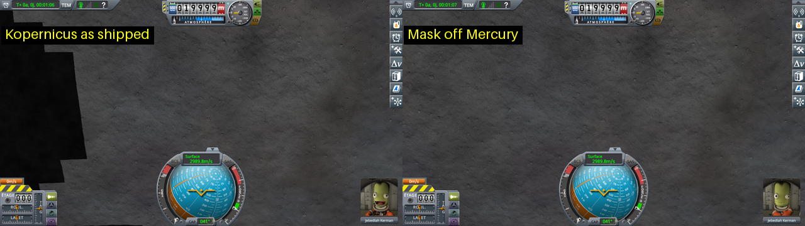

# BurstPQS: darker quads on the Mun

Part of [Terrain Precision Fix](../../../README.md), one point of [Work in progress](../../work-in-progress.md), on [BurstPQS](../../work-in-progress/burst-pqs.md).

**Status: in progress — cause found, in Kopernicus's BurstPQS plugin for its KSC scatter mask; seen on the
Mun, Minmus, Laythe and Mercury; reported to BurstPQS
([issue #15](https://github.com/Phantomical/BurstPQS/issues/15)).** Seen first in the flight of the scatter protocols
([in flight](../../checking-the-culprit-flight/the-scatter-protocol.md), on `ref-mune-5km`: a capsule in a
circular orbit 5 km above the Mun), with BurstPQS, with and without this mod. Whole quads of the ground are
drawn much darker than their neighbours, with stepped edges that follow the quads, while the craters run on
unbroken from one quad to the next: the relief is right, the colour of whole quads is not. Played again
without this mod, on three installs: the darker quads show with BurstPQS only, not on KSP with KSP Community
Fixes alone, nor with Kopernicus alone. They show in the first flight after KSP starts, and fade within the
first two minutes or so; loading the same save again from that flight, or going to the space centre and
loading it again, brings none. Taking Kopernicus's KSC scatter mask off the Mun makes them go: the plugin
Kopernicus ships for BurstPQS with that mask wipes the colour of every quad built as the Mun's terrain is
first set up.

## The protocol

The same flight in three installs, each from a freshly started KSP:

- KSP 1.12.5 with KSP Community Fixes;
- the same, with Kopernicus and what it requires (Modular Flight Integrator, KSPTextureLoader), without
  BurstPQS;
- the same, with BurstPQS and what it requires (Kopernicus, Modular Flight Integrator, KSPTextureLoader,
  KSPBurst).

In each: copy [`ref-mune-5km.sfs`](../../../diag/checking-the-culprit-flight/scatter/ref-mune-5km.sfs)
into a sandbox game, open that game from the main menu (the space centre shows), load the save, and at once
pull the camera back with the mouse wheel until the edge of the Mun shows, then turn it to look back along the
orbit, at the ground the capsule has just flown over. Take a screenshot every 5 seconds for 5 minutes. The
flight opens with the capsule pointing along its orbit; nothing is touched but the camera.

The same, played by script through [KSP-MCPServer](https://github.com/lhervier/KSP-MCPServer):
[run-darker-quads.py](../../../diag/automation/run-darker-quads.py) loads the save from the space centre, sets
the camera as soon as the flight shows, and takes the screenshots:

```
python run-darker-quads.py --folder <your sandbox game> --save ref-mune-5km --distance 21119 --heading 81.5 --pitch 5.5 --out out
```

The camera's heading and pitch in orbit are counted in a frame that turns with the capsule's place on its
orbit: these values give the view below at the start of the flight only, a few minutes later they put the
camera inside the Mun.

## What it shows

As the flight opens and 20 seconds later, the three installs side by side (the camera set by the script, the
same in all three):



With BurstPQS, the same flight at 60, 120 and 180 seconds (the view drifts as the capsule moves on along its
orbit):



With BurstPQS, the flight opened from the space centre, and the same save loaded again from that flight about a
minute and a half in, without leaving it, the camera set the same way, both at 35 seconds:



## Taking the KSC scatter mask off the Mun

Kopernicus 251 adds a `KSCScatterMask` to the terrain of every body (its `Config/KSCScatterMask.cfg`, under
`@Body,*`), to keep scatter off the space centre. The same flight, in the BurstPQS install, with one more file
in `GameData` that takes it off the Mun alone:

```
// Removes Kopernicus's KSC scatter mask from the Mun, the only change of this test.
@Kopernicus:FINAL
{
    @Body[Mun]
    {
        @PQS
        {
            @Mods
            {
                !KSCScatterMask,* {}
            }
        }
    }
}
```

`KSP.log` shows it applied: `Applying update NoKSCMaskOnMun/NoKSCMaskOnMun/@Kopernicus:FINAL to
Kopernicus/Config/System.cfg/Kopernicus[Kerbol System]`. At 0 and 20 seconds, the camera set the same way,
as Kopernicus ships it and with the mask off the Mun:



## Where it comes from

Read in the code of Kopernicus 251 and of BurstPQS 1.0.27; the test above is what was checked in the game.

- The mask is a Kopernicus terrain mod, `PQSMod_KSCScatterMask`, with a plugin for BurstPQS,
  `Kopernicus.BurstPQS.KSCScatterMask` (shipped in Kopernicus's `Plugins` folder). The mod only turns
  scatter off near the space centre; it writes a colour only in its debug mode (`debugShowColorMap`), black
  while its `quadActive` is still false. The plugin's job starts with:

  ```csharp
  if (!quadActive)
  {
      data.vertColor.Clear();
      return;
  }
  ```

  It wipes the colour of every vertex, debug mode or not.
- `quadActive` turns true in the mod's `OnQuadBuilt`, once a first quad has been built; the plugin's job takes
  its value when the job is made, before the quad is built. When BurstPQS first sets up a sphere
  (`BatchPQS.UpdateQuadsInit`), it makes the jobs of all the quads of the starting tree before it finishes the
  first one: every quad of that first build has its colour wiped. The colour mods that come after the mask in
  the Mun's list (a grey noise, the craters) are all it gets: the dark grey quads. Quads built later are right,
  and the dark ones go as they are built again.
- On the Mun, the mask should not run at all: its `OnSetup` turns it off on any body but the space centre's.
  But `PQS.SetupMods` sorts the list of mods before it calls their `OnSetup`, so the mask stays in that first
  list, and BurstPQS takes its list from there. At the next set-up of the Mun, the mask is left out: hence the
  first flight only.

On stock terrain, with Kopernicus alone, the mod itself does nothing while `quadActive` is false (outside its
debug mode), and stock builds one quad after the other: nothing to see.

## Other bodies

Whether a body shows it depends on what comes after the mask in the body's list of terrain mods. A colour
mod that writes the whole colour again hides it: a colour map, a solid colour, the land classes when they make
colours, any blend at full weight. Noise or craters blended over the wiped colour do not, and a body with no
colour mod after the mask keeps it wiped. Read from the order of each body's terrain mods, Kopernicus 251 (the
mask came with Kopernicus 249):

- **Stock system.** Exposed: the Mun, Minmus, Ike, Gilly, Pol, Bop and Laythe. Not exposed: Kerbin, Moho,
  Eve, Duna, Vall, Tylo, Dres, Eeloo.
- **Real Solar System.** Exposed: Mercury, Ganymede, Callisto, Mimas, Enceladus, Tethys, Dione, Rhea,
  Iapetus, Triton, Pluto, Charon. Not exposed: the others. The Earth, the Moon and Mars are left to stock by
  BurstPQS anyway, and stock builds one quad at a time.

Played in the game, each from a freshly started KSP, as Kopernicus ships it and then with the mask taken off
that body alone by a patch like the one above:

- **Minmus**, a capsule put on a 10 km orbit on the day side (*Set Orbit*, Alt+F12), the camera pulled back
  to see the curve of the body, about a minute after arriving:

  

- **Laythe.** From a 60 km orbit, just above its atmosphere, nothing tells the two apart. A capsule landed on
  an island near the equator, the save loaded from the space centre, the camera pulled back, a few seconds
  after the flight shows:

  

- **Mercury** (Real Solar System 20.1.3, Kopernicus 251), a 20 km orbit at local noon, about 25 s after
  arriving:

  

- **Pluto** (Real Solar System), a capsule landed near the equator: its ground is very dark already, and
  nothing tells the two apart by eye. From an orbit above its atmosphere, its terrain is not built at all.
- **Kerbin**: nothing either, as the space centre first shows, towards the mountains to the west, or around
  the launch pad.

## Seen at the same time: the camera held short of the north pole

In the first flight, with the camera pulled back: the camera could be turned to look at the south pole of
the Mun, but not to look at the north pole, held a few degrees short. Not compared yet without BurstPQS; it
may be the stock camera.

*To test:* in each of the three installs, the camera pulled back until the whole Mun shows, turn it towards
the north pole, then towards the south pole, and note where it stops.

## To do

- **Follow [BurstPQS issue #15](https://github.com/Phantomical/BurstPQS/issues/15)** until the fix reaches
  Kopernicus: in the plugin, do nothing while `quadActive` is false, or write black only in debug mode, as
  the mod itself does.
