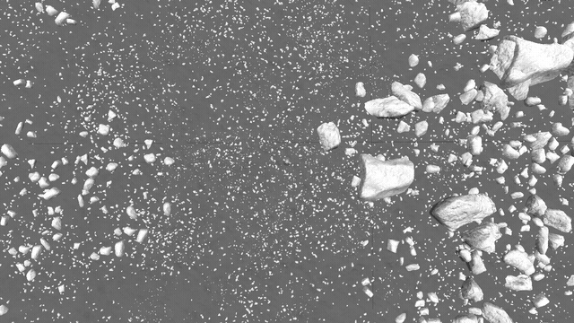
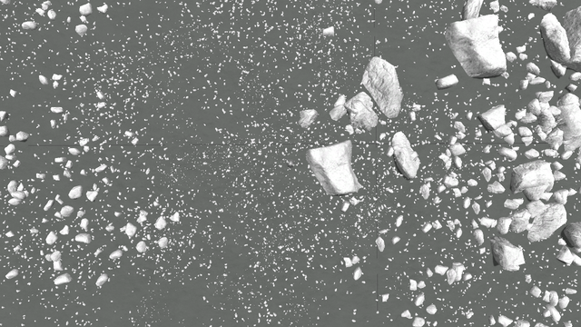

# Parallax: its terrain and its scatter

Part of [Terrain Precision Fix](../../../README.md), one point of [Work in progress](../../work-in-progress.md), on [Parallax](../../work-in-progress/parallax.md).

**Status: in progress — Parallax turns its rocks every time a save is loaded, by as much as the body has
turned since that save was made, and a craft resting on one of them, or next to one, can end up inside it
and be thrown off. Reproduced in fifteen minutes; explained in its source and in stock. Parallax rebuilt
with a change of two files keeps its rocks still, and a craft on one of them stays on it; that change is
still being checked. What this mod changes to it comes next.** [Parallax Continued](https://github.com/Gameslinx/Parallax-Continued) draws
the terrain with shaders of its own and adds a scatter of its own objects, some of which a craft can hit,
two things that sit right on the ground this fix places.

## Its rocks turn at every load



*One save, loaded thirteen times, an hour of game time more before each load: Parallax Continued 1.0.4,
the Mun, a capsule on flat ground among rocks, seen from above at 40 m, with KSP Diag - Colliders drawing
the edges of the terrain quads. The same frames as a video:
[`rocks-turning.mp4`](../../../imgs/work-in-progress/parallax/its-terrain-and-its-scatter/rocks-turning.mp4).*

**The protocol**, played by hand in about fifteen minutes. KSP 1.12.5 with Parallax Continued 1.0.4, its
three packs of stock textures and what it requires, Kopernicus among them, with its default settings
(its rocks of the Mun have colliders), and
[KSP Diag - Colliders](https://github.com/lhervier/KSP-Diag-Colliders). That one is only there to give
the screenshots a mark fixed to the ground: it outlines the collider of every terrain quad within 300 m
in grey, and so draws the edges of the quads, which meet in a cross at each vertex. It also draws, in
colour, the colliders Parallax gives the rocks near a craft. `Alt+F6` hides its window; the drawing goes
on.

1. Copy [`rocks-mun.sfs`](../../../diag/work-in-progress/parallax/its-terrain-and-its-scatter/rocks-mun.sfs)
   into the folder of a sandbox game and load it: a capsule of one part, landed on flat ground of the
   Mun, a few metres from a vertex of the terrain quads and some ten metres from the nearest rocks. Any
   craft standing still among rocks will do.
2. Look at it from straight above, from some 40 m, and take a screenshot. Near the capsule, the grey
   edges KSP Diag - Colliders draws meet in a cross: they are fixed to the ground, and tell that the view
   did not move nor turn from one screenshot to the next — the camera follows the craft, and a craft
   that moved would move the whole picture.
3. Let an hour of game time go by without loading anything: time warp ×100 on rails for about 36
   seconds. Take a screenshot again: nothing has moved.
4. Load **the same save** again, not a new one, and take the same screenshot: every cluster of rocks has
   turned on itself, around its own centre, while the ground, the quad edges and the capsule have not.
5. Repeat steps 3 and 4: at each load the rocks turn a little further.

One hour of game time turns the Mun by 9.3° on itself (it turns once in 138,984 s), and that is what each
cluster turns by, for each hour played since the save. Played in real time, ten minutes turn them by 1.6°
already. Saving and loading straight away turns nothing, and neither does time going by while nothing is
loaded: only loading an older save does, or starting KSP again, which turns them by the time played in
the whole session the save was made in.

These frames were taken with this mod installed; the cause does not involve it (below), and the same
protocol without it is the next step.

## Why they turn

Parallax orients its rocks from the vertical axis of the scene, `Vector3.up`, both the rock it draws and
the collider it gives it:

```csharp
// Parallax: CollisionManager.CreateGameObject
Quaternion rotAWorld = Quaternion.FromToRotation(Vector3.up, targetNormal);
Quaternion rotBWorld = Quaternion.AngleAxis(transform.rotation, Vector3.up);
go.transform.rotation = rotAWorld * rotBWorld;
```

```hlsl
// Parallax: GetTRSMatrix, in its scatter shaders
float3 up = float3(0, 1, 0);
float4x4 mat = TransformToPlanetNormal(up, nrm);
```

That axis is the body's axis of rotation, but it does not turn with the body: when the body is turned
another way in the scene, the ground under a rock turns and that axis does not, and the rock comes out
turned on itself. Where everything else of a rock — its place, its size — is computed in the frame of its
terrain quad, its orientation depends on how the body is turned in the scene.

And stock turns the body in the scene at every load. Below its rotating-frame altitude, KSP holds the
body still and turns the rest of the universe instead, and keeps the time played that way in
`Planetarium.InverseRotAngle`, which no save holds. When a scene is loaded, the body is turned again,
from the date of the save minus that angle (`CelestialBody.CBUpdate`):

```csharp
// KSP: CelestialBody.CBUpdate
directRotAngle = (rotationAngle - Planetarium.InverseRotAngle) % 360.0;
```

So the body comes back off by its own rotation over the time played since that save — the very thing
that makes the ground of stock come back at another place at every load
([Why it is different at every load](../../the-culprit-ground.md#why-it-is-different-at-every-load)).
Stock places everything of the ground relative to the body, and only the rounding of that frame shows;
Parallax takes the scene's axis for one of the body's, and its rocks turn by the whole angle.

## What it means for a craft, and for a base

A rock turned under or into a craft that was resting on it, or right next to it, starts the craft inside
it when the save is loaded, and the physics engine throws the craft out:

- **a craft left standing on a rock jumps when the save is loaded**, and often ends up off the rock. With
  the protocol above, a capsule saved on a rock jumped as soon as the save was loaded after ten minutes
  of play, without KSP being restarted; loaded again straight after it was saved, it stayed. This is the
  behaviour reported to Parallax in
  [issue #125](https://github.com/Gameslinx/Parallax-Continued/issues/125), *Mun Surface Scatter
  Devoured/Torn Apart Small Vessel Upon Game Relaunch*;
- **a craft next to a rock can be reached by it**: a cluster turns around its own centre, and its far
  end sweeps a circle as wide as the cluster. A capsule three or four metres from a cluster of about five
  was reached after some fifty degrees of turn, six hours of game time, and thrown off at every load from
  then on. The pebbles of the ground have colliders too, and one of them can nudge a craft.

For a base, that means choosing its place with care: on ground clear of the rocks that have colliders,
farther from the nearest cluster than that cluster is wide — and the longer the game is played between a
save and the load of it, the further every rock will have turned.

## Parallax with its rocks tied to the body

**Parallax rebuilt with one change keeps its rocks still.** The change builds the orientation of each
rock in the frame of its terrain quad, then applies the quad's rotation, rather than starting from the
axis of the scene — the same way in the shader that draws the rocks and in the code that gives them
their colliders, so that the two stay together:

```hlsl
// Parallax: GetTRSMatrix, changed
float3x3 quadToWorld = (float3x3)_ObjectToWorldMatrix;
quadToWorld /= length(quadToWorld._m00_m10_m20);    // Remove the quad's (uniform) scale
float3 localNrm = mul(transpose(quadToWorld), nrm);
float3 up = float3(0, 1, 0);
float4x4 mat = TransformToPlanetNormal(up, localNrm);
mat = mul(mat, GetRotationMatrix(rotationAngles));
mat = mul(quadRotation, mat);                       // quadToWorld, as a 4x4 matrix
```

```csharp
// Parallax: CollisionManager.CreateGameObject, changed
Vector3 localNormal = scatterSystemQuad.quad.gameObject.transform.InverseTransformDirection(targetNormal);
Quaternion rotALocal = Quaternion.FromToRotation(Vector3.up, localNormal);
Quaternion rotBLocal = Quaternion.AngleAxis(transform.rotation, Vector3.up);
go.transform.localRotation = rotALocal * rotBLocal;
```

The whole change, two files, is on the branch
[`fix/scatter-rotation`](https://github.com/lhervier/KSP-ExtMod-ParallaxContinued/compare/master...fix/scatter-rotation)
of our fork of Parallax Continued. The shader that draws the scatter is a compute shader, shipped in an
asset bundle: rebuilding it takes Unity 2019.4.18f1, the version KSP 1.12.5 runs on.



*The protocol of [Its rocks turn at every load](#its-rocks-turn-at-every-load), the same save, the same
thirteen loads and the same view, with Parallax Continued 1.0.4 rebuilt with the change. The same frames
as a video:
[`rocks-holding-still.mp4`](../../../imgs/work-in-progress/parallax/its-terrain-and-its-scatter/rocks-holding-still.mp4).*

Parallax rebuilt from the source of its 1.0.4 tag on GitHub turns its rocks the same way as the release
does, and holds them still with the change.

**A craft resting on a rock stays on it.**


*Parallax Continued 1.0.4 rebuilt with the change, the Mun,
[`capsule-on-a-rock-mun.sfs`](../../../diag/work-in-progress/parallax/its-terrain-and-its-scatter/capsule-on-a-rock-mun.sfs):
a capsule of one part landed on top of a rock. Loaded twelve times, an hour of game time of time warp
before each load, then KSP started again and the save loaded twelve times more; the view after the last
load, with [KSP Diag - Colliders](https://github.com/lhervier/KSP-Diag-Colliders) outlining the collider
Parallax gives the rock.*

At every one of those loads the capsule stayed on its rock, where Parallax as released throws it off
after ten minutes of play. That save was made with the change: Parallax as released turns the rock
under the capsule when it is loaded.

## Read in its source

- **the terrain** — Parallax draws it on the meshes stock builds. Its tessellation and its displacement
  should neither create nor hide the crack stock already has where two subdivision levels meet, and
  that this fix widens
  ([The seam between subdivision levels](../../limits-and-solutions/stock/the-seam-between-subdivision-levels.md#parallax));
- **where its scatter stands** — an object of its scatter is placed on its quad, in the quad's frame,
  and its collider is a child of the quad: it follows the ground wherever this fix places it, its
  orientation aside (above). Neither the gap of the stock scatter nor the scatter fix reaches it, and
  Parallax never names a stock holder
  ([Other mods that look for the holders](../../the-fix-scatter.md#other-mods-that-look-for-the-holders));
- **the stock scatter** — Parallax leaves the stock `LandControl` in place on every body but Eeloo, so
  on a body it does not strip, the stock scatter is still there, hanging from the same holders, with the
  gap this fix widens on Kerbin
  ([The scatter](../../limits-and-solutions/stock/the-scatter.md)), and the scatter
  fix acts on it as without Parallax;
- **its distribution noise** is sampled from directions computed in float out of planet-scale vectors,
  so an object sitting right at the cutoff can appear on one load and not on the next, and the size of
  a rock can differ very slightly, with or without this fix.

*To test:* the protocol above without this mod; the change to Parallax on the scatters that stand along
the radius of the body rather than on the slope of the ground (the trees of Kerbin), on Eve, near the
poles, under OpenGL, and with the other ways the body is turned in the scene again — a craft going above
the rotating-frame altitude and back, a change of sphere of influence, a flight opened from the space
centre; then a craft resting on a rock, loaded again and again, without this fix and with it, and the
loading and approach campaigns of KSP Diag - Landed Vessel and KSP Diag - Terrain Height on its ground.
